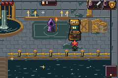
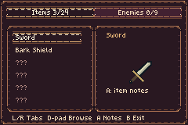
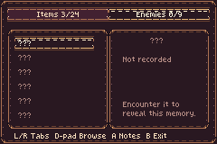
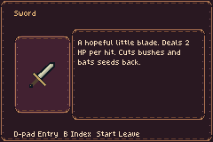
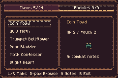
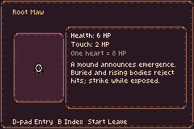

# Original music, new enemies and the memory cabinet

The **main game ROM** now includes Gilt Leech, Root Maw and Reliquary Snout in
normal encounters, the original soundtrack from `forest-art`, and a retro
memory cabinet in the Drain. The quieter glitter from the previous pass stays.

**[Download the ROM](../downloads/arcade-journal-1527dd8/bartgame-1527dd8.gba)** ·
**[Download ZIP](../downloads/arcade-journal-1527dd8/bartgame-1527dd8.zip)** ·
[Checksums](../downloads/arcade-journal-1527dd8/SHA256SUMS.txt)

## The cabinet

Find it on the **north bank near the wizard and storage**. Walk to its front,
face the cabinet and press **A**. It remembers **24 items and nine enemy
families** across runs and restarts, independently of the run save and
appearance preferences. Only encountered entries reveal their names, pictures,
notes and enemy stats; unseen records show `???`.

**L/R** changes category. **D-pad** browses, **A** opens notes, **B** returns
or leaves, and **Start** leaves from either page. Combat pauses while browsing;
the original music continues. Notes explain item uses, attack tells and
vulnerabilities. Enemy stats use HP, with eight HP per player heart.

| Cabinet in the actual Drain | Discovered starting items |
| --- | --- |
|  |  |

| Unseen enemies stay concealed | An owned item's full notes |
| --- | --- |
|  |  |

| Records from actual encounters | Catalogue fixture: Root Maw notes |
| --- | --- |
|  |  |

The starting-tool, unknown and encountered-enemy pages use the normal discovery
flow. Navigation and health fixtures are disclosed in validation. The Root Maw
note above, [all nine enemy notes](all-enemies.png), and
[all nine frame/color combinations](appearances.png) use private serialized
profiles to inspect the complete catalogue. They are **UI coverage fixtures,
not a claim of earned discoveries**. Each viewport is an untouched native
240×160 mGBA frame from the delivered ROM; contact-sheet labels occupy separate
pixels outside the viewports.

## Encounters in the main game

- **Gilt Leech** compresses before a committed straight charge. Sidestep and
  punish its recovery.
- **Root Maw** announces its emergence with a mound. Strike the exposed body;
  buried and rising phases reject hits.
- **Reliquary Snout** blocks attacks with its brass front. Evade the rush and
  strike a side or rear.

[Actual generated-forest playback](forest-new-enemies.gif) ·
[Cabinet and journal interaction](cabinet-journal.gif) ·
[Mixed-enemy playback](mixed-enemies.gif)

The forest clip retains normal generated rosters. The mixed clip uses an
explicit controlled roster to exercise combinations. The retained bestiary and
broken purple Heart remain part of normal play. The journal records visible
encounters; generating a room alone does not reveal its creatures.

## Original soundtrack

These five original `forest-art` recordings are mapped to the game's current
contexts. Listening clips are encoded from actual mGBA playback.

| Context | Original track | Listen |
| --- | --- | --- |
| Drain | 1 — Undertow Circuit | [MP3](audio/sewer.mp3) |
| Forest | 2 — Verdant Afterimage | [MP3](audio/forest.mp3) |
| Heart battle | 3 — Heart of Chrome | [MP3](audio/boss.mp3) |
| Title | 26 — Dawn Overture | [MP3](audio/title.mp3) |
| Victory | 25 — Aurora Unbound | [MP3](audio/win.mp3) |

[Music provenance and native playback](../bartgame/docs/arcade-journal/MUSIC.md)
records the exact branch revision, lossless sources and context mapping.
The [journal data](../bartgame/docs/arcade-journal/DATA.md) and
[interface notes](../bartgame/docs/arcade-journal/UI.md) explain discovery,
profile persistence and native presentation.

## Qualification

Game source:
[`1527dd84`](https://github.com/natertott/bartgame/commit/1527dd84c92f47bf5f498cbff35cdd179cad48af).
The uninstrumented ROM is **9,538,580 bytes**, SHA256
`341b7926b9a5f79ad35a789adf4b5c321fd3b5b149e94d648b50025740c6be98`.
[Build inputs](validation/build.json) and the
[complete native evidence archive](../downloads/arcade-journal-1527dd8/native-evidence.zip)
bind the ROM to captures, tools, traces and original audio observations.

| Actual qualification | Result |
| --- | --- |
| [Cabinet, discovery and run saves](validation/journal.json) | 157/157 |
| [All33 notes × nine appearances](validation/ui.json) | 662/662;297 native note views |
| [New enemy mechanics and streaming](validation/enemies.json) | 75/75 |
| [Original music and sound effects](validation/music.json) | 69/69 |
| [Native assets and palette contracts](validation/assets.json) | 296/296 |
| [HUD](validation/hud.json) / [forest progression](validation/forest.json) | 290/290 and80/80 |
| [Journal host checks](validation/host.json) | 132 production +9 isolated-lab checks |
| [Natural-room timing](validation/natural.json) | All75 forest samples:13,500/13,500 updates |
| [Sustained enemy loads](validation/stress.json) | 30 fixtures:5,400/5,400 updates |

The raw timing evidence retains **three Drain-arrival frame repeats** and one
repeat in a synthetic24-Maw emergence burst (**299/300 updates**). The tests
cover finite generated rooms and deliberately larger crowds; they do not
claim an unassisted full playthrough or certify arbitrary future enemy counts.
