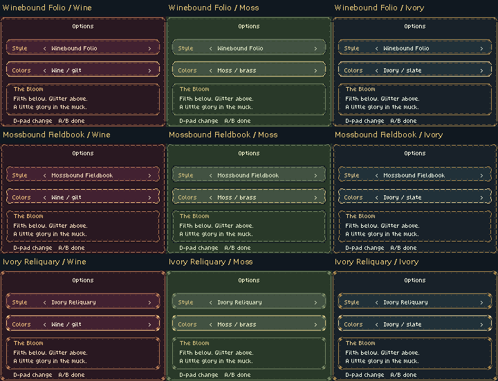
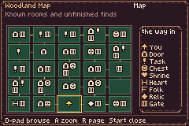
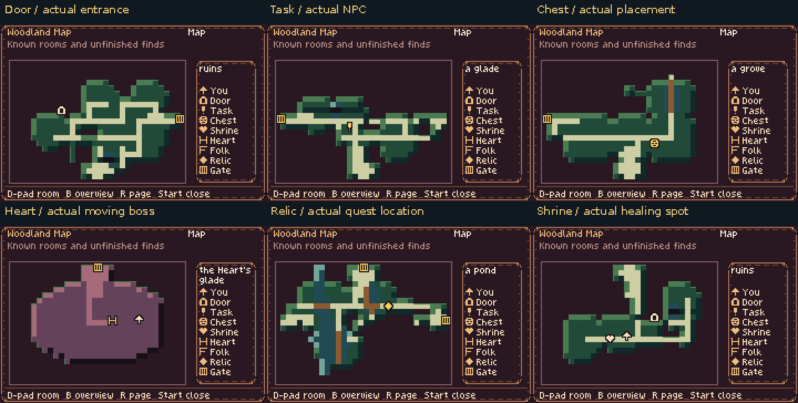
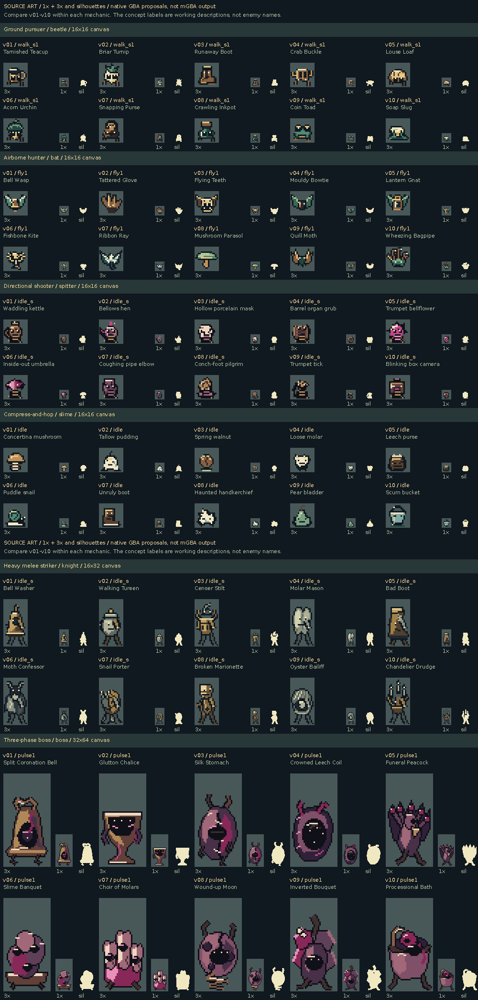
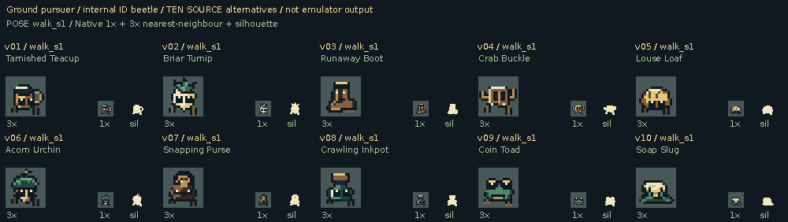
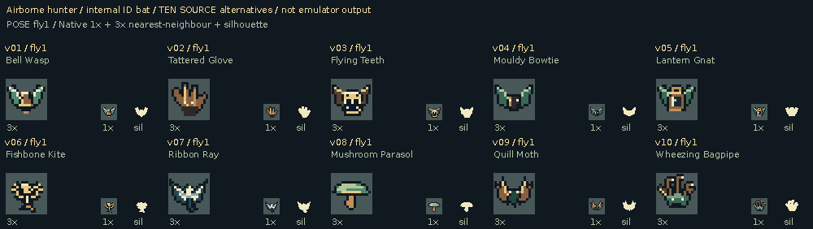
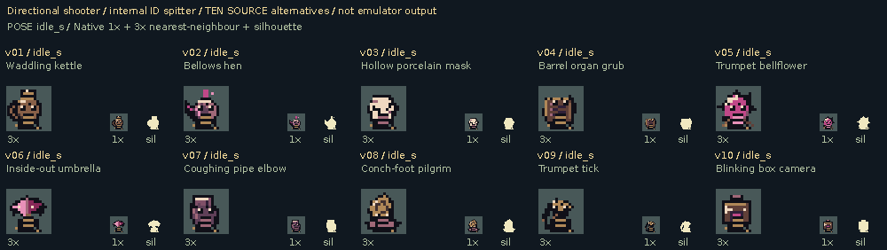
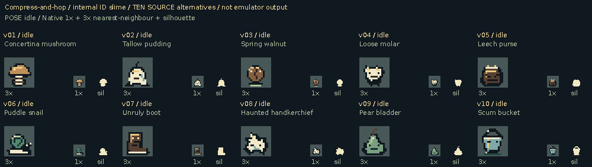
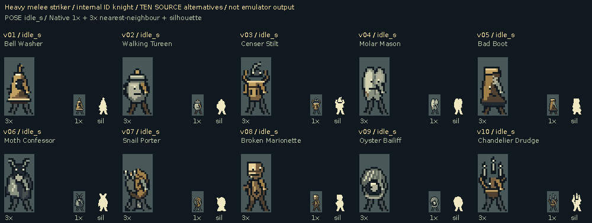
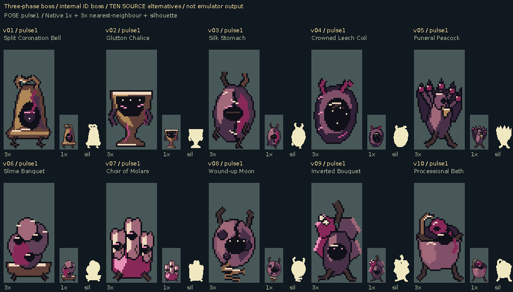

# Selected interfaces and sixty enemy alternatives

The requested interface choices are implemented in the game. The enemy pass
provides **ten original alternatives for each of the six current behavior
families**, with **640 native frame instances** and ten playable comparison
builds. Enemy choices remain proposals for feedback.

[Download the selected-interface ROM](https://raw.githubusercontent.com/natertott/bartgame/appearance-enemy-studies/downloads/appearance-enemy-5eedc6d/00-selected-ui-existing-enemies.gba)
· [Download it plus all ten enemy-study ROMs](https://raw.githubusercontent.com/natertott/bartgame/appearance-enemy-studies/downloads/appearance-enemy-5eedc6d/selected-ui-and-ten-enemy-studies.zip)
· [Individual ROMs / checksums](../../downloads/appearance-enemy-5eedc6d/README.md)

Everything starts at native GBA sizes and RGB555/4bpp limits. No HD image is
downscaled into game art. **Source pose boards** and **actual mGBA recordings**
are separated below. Integer zooms use nearest-neighbor.

## Appearance options and the selected HUD

The title screen now always includes **Options**, with or without a saved run.
Choose **Style** and **Colors** independently:

- Winebound Folio, Mossbound Fieldbook or Ivory Reliquary construction.
- Wine/gilt, Moss/brass or Ivory/slate colors, in any of the nine combinations.
- Up/Down chooses the setting; Left/Right cycles it; A/B/Start keeps it and returns.

The preview updates immediately. The preference persists through resetting,
New Game and Continue in a separate checked SRAM record; existing run saves
remain compatible. Menus, dialogue, market panels and their continuation/
selection marks use the chosen treatment.

The gameplay HUD uses your selected **#1 Winebound Folio**. It retains hearts,
gilt, equipped items, the corner minimap and ammo only for equipped seeds/bow.
Changing menu colors keeps that selected HUD identity.

[All nine actual item screens](actual/appearance/nine-items.png) ·
[Dialogue](actual/appearance/nine-dialogue.png) ·
[Market](actual/appearance/nine-shop.png) ·
[Fixed HUD comparison](actual/appearance/nine-hud.png) ·
[Title without a save](actual/appearance/title-no-save.png)

## Item layout #1, map layout #2

The item/key page uses **Loadout Workbench**: a pack of large native icons,
visible A/B/L assignments, factual resources and concise selected-tool help.
The map uses the selected **Pocket Ledger connection diagram**, independently
of that pack arrangement.

Every room rectangle contains separate badges for its known, unfinished event
types. A door, task/person, chest, shrine, relic, Heart and barrier can coexist
without overwriting one another. The player gets its own arrow; the inspected
room has a gold border. The legend repeats the same strong outlined symbols.
Shrine healing and the boss **H** have distinct icons and labels.

**A** opens the inspected room. Markers use actual generated feature positions;
the live Heart marker follows its paused physical location. Nearby features
use short tethers when their icons need separating. **B** returns to overview;
the D-pad browses rooms and **R** changes page. Item, key, inspected-room and
zoom focus persist. **Start** opens/closes; **A/B/L** assign on Items.

Map/Astrolabe/visited knowledge still determines what is revealed. Ordinary
NPCs and tasks have distinct meanings; current forest quest givers appear as
Task. Completed finds disappear. Unknown zooms say **Not charted**. Charted
unvisited features use a deterministic placement preview that restores the
live room and discovery state, rather than guessing a location at the center.

[Unvisited Astrolabe chest](actual/maps/map-charted-unvisited-chest.png) ·
[Live Heart: world](actual/maps/map-live-heart-world.png) / [map](actual/maps/map-live-heart-zoom.png) ·
[Shrine: world](actual/maps/map-shrine-world.png) / [map](actual/maps/map-shrine-zoom.png) ·
[Fog](actual/maps/map-fog-overview.png) ·
[Map without Astrolabe](actual/maps/map-charted-without-astrolabe.png)

## Enemy studies: choose by behavior

The source identifiers are retained for compatibility, but their old names did
not constrain the concepts. These are animated objects, strange animals,
organisms and corrupted ceremonial forms chosen to suit the actual mechanics.
Each family has its own choices **1–10**; you can choose different numbers for
different families. The ten study ROMs pair the same number across all six
families for convenient playtesting.

| Behavior family | Native body | Frames per alternative | What the animation communicates |
| --- | --- | ---: | --- |
| Ground pursuer | 16×16 | 6 | Planted alternating feet, separate south/east/north construction, faster chase gait; west mirrors east. |
| Airborne hunter | 16×16 | 3 | Folded rest versus open flight silhouette, continuous wings/cloth/fins and a stable collision-bearing center. |
| Directional shooter | 16×16 | 12 + seed | Cardinal facing, inhale/body expansion, open nozzle and recoil, with an attached directional projectile. |
| Compress-and-hop | 16×16 | 3 | A low preparation, extended airborne mass and compressed landing; the actual hop moves the body. |
| Heavy melee attacker | 16×32 | 24 + 2 weapon | Whole-body weight shift, distinct windup/strike/recovery and actual hurt poses in three facings. |
| Three-phase boss | 32×64 | 13 | Pulse, charge, emission, spawning, lunge, hurt and collapse, tied to existing phase timers. |

Small enemies use brighter jade/wood material planes and sparse ivory
highlights for separation from terrain. The original cloak/bush palette stays
exact. Heavy enemies retain the shared stone and blight material vocabulary.
Every form has a crisp contour, upper-left volume and attached glints; hostile
seeds use a compact body rather than masquerading as treasure glitter.

### Ground pursuers — ten choices

[**Animate every body pose for all ten**](source/beetle-all-poses-source.gif) ·
[Unobstructed actual gait comparison](comparisons/pursuer-clearing-ten-way-context-2x.gif) ·
[Actual native comparison](comparisons/pursuer-clearing-ten-way.png) ·
[Bridge/foreground encounter](comparisons/pursuer-behavior-ten-way-context-2x.gif)

The added clear-floor recording follows a natural spawn for 96 actual updates
(about 1.6 seconds); every body footprint remains unobstructed. The original
longer healthy-forest encounter includes correct bridge-rail occlusion and
is retained separately. [Individual clear-floor footage](actual/pursuer-clearing/v1/README.md).

### Airborne hunters — ten choices

[**Animate every body pose for all ten**](source/bat-all-poses-source.gif) ·
[Actual AI comparison](comparisons/flyer-behavior-ten-way-context-2x.gif) ·
[Actual native comparison](comparisons/flyer-behavior-ten-way.png)

### Directional shooters — ten choices

[**Animate every body pose for all ten**](source/spitter-all-poses-source.gif) ·
[Actual AI comparison](comparisons/shooter-behavior-ten-way-context-2x.gif) ·
[Actual native comparison](comparisons/shooter-behavior-ten-way.png)

### Compress-and-hop attackers — ten choices

[**Animate every body pose for all ten**](source/slime-all-poses-source.gif) ·
[Actual AI comparison](comparisons/hopper-behavior-ten-way-context-2x.gif) ·
[Actual native comparison](comparisons/hopper-behavior-ten-way.png)

### Heavy melee attackers — ten choices

[**Animate every body pose for all ten**](source/knight-all-poses-source.gif) ·
[Matching weapons](source/companions-source.png) ·
[Actual windup/strike/recovery](comparisons/melee-behavior-ten-way-context-2x.gif) ·
[Actual hurt/combat](comparisons/melee-real-combat-ten-way-context-2x.gif)

### Three-phase bosses — ten choices

[**Animate every body pose for all ten**](source/boss-all-poses-source.gif) ·
[Actual radial release](comparisons/boss-ring-ten-way-context-2x.gif) ·
[Actual fans/spawning](comparisons/boss-fan-and-adds-ten-way-context-2x.gif) ·
[Actual lunge](comparisons/boss-lunge-ten-way-context-2x.gif) ·
[Actual defeat chronology](comparisons/boss-real-defeat-ten-way-context-2x.png)

## Full animation coverage and honest limits

The six **source GIFs** deliberately hold each body pose for 150ms so its drawings
and directions can be examined. They are pose catalogs, not simulations of
attack timing. The [source index](source/README.md) links sixty complete atlases,
individual native indexed/RGBA PNGs, silhouettes/value checks, concept notes,
palettes and every frame hash. They cover all 610 body-frame instances; the
20 weapon and 10 seed companions complete the 640-frame native atlas set.
West-facing views use the game's horizontal
mirror. Original compatibility `atk` frames intentionally match `strike`.

The **actual AI recordings** use natural generated room spawns and ordinary
game updates, with disclosed player position, health/inventory, seed and
boss-HP fixtures. Enemy state, timer, position, animation phase and pose are
never assigned. Common encounters show healthy/intermediate/blighted terrain;
a naturally generated cave combat group provides interior contrast. The Drain
has no natural enemy encounter, so source composites on its background are
labelled as composites. An actual-frame comparison crop only changes the
viewing window; it does not paint, replace or move a sprite.

All alternatives retain the existing movement rules, damage, hitboxes,
projectiles and vulnerabilities. Windup and recovery indicate genuine timing
opportunities; decorative armor does not imply a new directional immunity.
Ordinary kills still remove the body immediately and play the existing
18-update shared puff. Boss defeat has its existing 120-update sequence,
now with separate collapse poses. Full authored-frame coverage is not a claim
that a short AI clip naturally visits every direction; each report lists the
poses observed and those covered only by source art.

Some boss concepts (3/4/8/9) share a rounded mouth-bearing center, so their
appendages, material and phase animation carry more of their identity than
the stationary silhouette alone. Judge those in motion. The pale/wood small
forms separate more clearly from terrain than the first foliage-bank proofs;
their native-size and silhouette views remain available for comparison.

The boss streams one 32-tile pose so the larger suite fits OBJ VRAM. A
conservative all-family/prop/menu union uses **816/876 available playfield
tiles**, leaving 60. The menu remains within native memory limits. Measured
selected graph draws take about 12 video frames; chamber redraws range 6–20
in the sampled cases, including exact placement preview work.

## Actual recordings and reproducibility

Source freeze:
[`5eedc6dae94d8c1ea21c55b8668435bcf0be884d`](https://github.com/natertott/bartgame/commit/5eedc6dae94d8c1ea21c55b8668435bcf0be884d).
The selected-interface ROM is the normal build. Enemy profiles are optional
until designs are chosen. Existing Drain/world/Bloom/Step-and-cut/items/font/
glitter artwork is preserved by the independent ROM audit.

Each of the eleven actual-run reports links native PNGs, sixteen-step
chronologies, selected native frames, exact-only GIFs and full-rate MP4:

[Current enemies](actual/enemies/v0/README.md) ·
[1](actual/enemies/v1/README.md) · [2](actual/enemies/v2/README.md) ·
[3](actual/enemies/v3/README.md) · [4](actual/enemies/v4/README.md) ·
[5](actual/enemies/v5/README.md) · [6](actual/enemies/v6/README.md) ·
[7](actual/enemies/v7/README.md) · [8](actual/enemies/v8/README.md) ·
[9](actual/enemies/v9/README.md) · [10](actual/enemies/v10/README.md).

PNG framebuffers are exact. MP4s are full-rate lossy viewing copies. GIFs
sample every second video frame with preserved cadence and are published
only when the complete animation has an exact palette. Defeat/fade GIFs that
exceed 256 colors are omitted; their native PNGs and MP4 remain.

The core final suite covers **224 actual presentations and 1,409 runtime/save
checks**: 132 enemy encounters, 56 appearance views and 36 map/control cases,
plus the separate legacy-save checks. The independent audit passes
**11,632/11,632**, including **108/108** exact gameplay-trajectory matches
between the ten positive enemy profiles. All thirteen new boss poses were
observed in each positive profile. These checks establish encoding and
behavior, not a preference ranking or a human playtest score.

Ten additional clear-floor pursuer recordings pass **60/60** checks, with
**960/960** unobstructed body footprints and **9/9** matching positive-profile
timelines. Overall publication: **234 actual cases and 1,469 runtime/save
checks**. [Clear-floor proof](validation/pursuer-clearing-summary.json).

The existing-art baseline's four boss recordings start one update apart from
the expanded streamed-art recordings because their loading/global-frame phase
differs. Their AI rules/timers are unchanged; no claim of exact baseline
boss-clip identity is made. The ten same-sized positive study builds do match
one another exactly. [Detailed runtime scope](validation/enemy-runtime-review.md)
and [baseline comparison](validation/baseline-vs-positive-mechanics.json).

[Appearance checks](actual/appearance/appearance-review.json) ·
[Map/input checks](actual/maps/capture.json) ·
[Independent ROM audit](validation/audit-summary.json) ·
[Memory/build restoration](validation/final-runtime-verification.json) ·
[Exact build/source hashes](validation/builds.json) ·
[Publication provenance](validation/publication-manifest.json).

The [living art bible](../../bartgame/docs/art-reboot/ART_BIBLE.md),
[direction log](../../bartgame/docs/art-reboot/ART_DIRECTION_LOG.md),
[appearance implementation](../../bartgame/docs/art-reboot/references/APPEARANCE_OPTIONS.md),
[map design](../../bartgame/docs/art-reboot/references/ADOPTED_MENU_MAP.md) and
[reference register](../../bartgame/docs/art-reboot/REFERENCE_REGISTER.md)
record the adopted rules and unselected enemy concepts for future areas.
