# Enemy alternatives 01

[Main gallery](../../../README.md) · [Full capture report](capture.json)

These are actual mGBA recordings from the frozen ROM, not source pose animations. Safe player position, inventory, health and boss-phase HP fixtures are disclosed in the report. Enemy AI state, timer, height and pose are never assigned to fabricate an action.

Native PNGs and chronology frames retain exact game pixels. MP4 is the full-rate, lossy viewing copy. GIF links are included only when the complete sequence has an exact palette.

| Actual action | Preview | Watch / inspect |
| --- | --- | --- |
| Ground pursuit with bridge depth | [Native PNG](pursuer-behavior.png) | [Exact GIF](pursuer-behavior.gif) · [Full-rate MP4](pursuer-behavior.mp4) · [Chronology](pursuer-behavior-filmstrip.png) |
| Airborne hunt | [Native PNG](flyer-behavior.png) | [Exact GIF](flyer-behavior.gif) · [Full-rate MP4](flyer-behavior.mp4) · [Chronology](flyer-behavior-filmstrip.png) |
| Directional seed shot | [Native PNG](shooter-behavior.png) | [Exact GIF](shooter-behavior.gif) · [Full-rate MP4](shooter-behavior.mp4) · [Chronology](shooter-behavior-filmstrip.png) |
| Squash and hop | [Native PNG](hopper-behavior.png) | [Exact GIF](hopper-behavior.gif) · [Full-rate MP4](hopper-behavior.mp4) · [Chronology](hopper-behavior-filmstrip.png) |
| Heavy wind-up and strike | [Native PNG](melee-behavior.png) | [Exact GIF](melee-behavior.gif) · [Full-rate MP4](melee-behavior.mp4) · [Chronology](melee-behavior-filmstrip.png) |
| Heavy after menu restoration | [Native PNG](melee-after-menu.png) | [Exact GIF](melee-after-menu.gif) · [Full-rate MP4](melee-after-menu.mp4) · [Chronology](melee-after-menu-filmstrip.png) |
| Real heavy combat, hurt and defeat | [Native PNG](melee-real-combat.png) | [Exact GIF](melee-real-combat.gif) · [Full-rate MP4](melee-real-combat.mp4) · [Chronology](melee-real-combat-filmstrip.png) |
| Boss radial burst | [Native PNG](boss-ring.png) | [Exact GIF](boss-ring.gif) · [Full-rate MP4](boss-ring.mp4) · [Chronology](boss-ring-filmstrip.png) |
| Boss aimed fan and summons | [Native PNG](boss-fan-and-adds.png) | [Exact GIF](boss-fan-and-adds.gif) · [Full-rate MP4](boss-fan-and-adds.mp4) · [Chronology](boss-fan-and-adds-filmstrip.png) |
| Boss lunge | [Native PNG](boss-lunge.png) | [Exact GIF](boss-lunge.gif) · [Full-rate MP4](boss-lunge.mp4) · [Chronology](boss-lunge-filmstrip.png) |
| Real boss combat and defeat | [Native PNG](boss-real-defeat.png) | [Full-rate MP4](boss-real-defeat.mp4) · [Chronology](boss-real-defeat-filmstrip.png) |
| Natural cave encounter | [Native PNG](cave-natural-group.png) | [Exact GIF](cave-natural-group.gif) · [Full-rate MP4](cave-natural-group.mp4) · [Chronology](cave-natural-group-filmstrip.png) |

## Ground pursuit with bridge depth

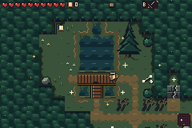

[Exact-palette animation](pursuer-behavior.gif) · [Full-rate MP4](pursuer-behavior.mp4) · [Chronology filmstrip](pursuer-behavior-filmstrip.png)

Natural generated enemy; safe player position, inventory, healing and unrelated-actor clearing fixtures. AI state/timer/pose/height never assigned.

## Airborne hunt

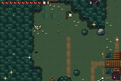

[Exact-palette animation](flyer-behavior.gif) · [Full-rate MP4](flyer-behavior.mp4) · [Chronology filmstrip](flyer-behavior-filmstrip.png)

Natural generated enemy; safe player position, inventory, healing and unrelated-actor clearing fixtures. AI state/timer/pose/height never assigned.

## Directional seed shot

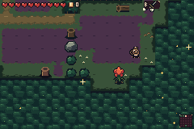

[Exact-palette animation](shooter-behavior.gif) · [Full-rate MP4](shooter-behavior.mp4) · [Chronology filmstrip](shooter-behavior-filmstrip.png)

Natural generated enemy; safe player position, inventory, healing and unrelated-actor clearing fixtures. AI state/timer/pose/height never assigned.

## Squash and hop

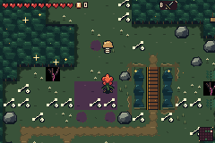

[Exact-palette animation](hopper-behavior.gif) · [Full-rate MP4](hopper-behavior.mp4) · [Chronology filmstrip](hopper-behavior-filmstrip.png)

Natural generated enemy; safe player position, inventory, healing and unrelated-actor clearing fixtures. AI state/timer/pose/height never assigned.

## Heavy wind-up and strike

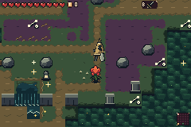

[Exact-palette animation](melee-behavior.gif) · [Full-rate MP4](melee-behavior.mp4) · [Chronology filmstrip](melee-behavior-filmstrip.png)

Natural generated enemy; safe player position, inventory, healing and unrelated-actor clearing fixtures. AI state/timer/pose/height never assigned.

## Heavy after menu restoration

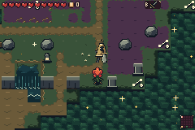

[Exact-palette animation](melee-after-menu.gif) · [Full-rate MP4](melee-after-menu.mp4) · [Chronology filmstrip](melee-after-menu-filmstrip.png)

Ordinary Start opened and closed the live item menu. Native enemy weapon VRAM and small-enemy/foliage OBJ palette banks are independently verified unchanged; real AI resumes.

## Real heavy combat, hurt and defeat

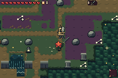

[Exact-palette animation](melee-real-combat.gif) · [Full-rate MP4](melee-real-combat.mp4) · [Chronology filmstrip](melee-real-combat-filmstrip.png)

Natural 10HP heavy enemy, actual D-pad/B sword inputs. Player health/position/equipment and unrelated-actor clearing are fixtures; enemy HP/state/timer/pose are never assigned.

## Boss radial burst

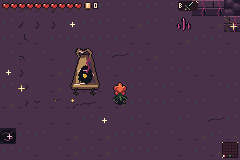

[Exact-palette animation](boss-ring.gif) · [Full-rate MP4](boss-ring.mp4) · [Chronology filmstrip](boss-ring-filmstrip.png)

Natural 40HP generated boss: ordinary pulse, drift and eight-spore burst. Player healing/position fixtures only.

## Boss aimed fan and summons

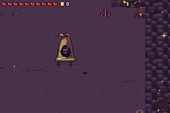

[Exact-palette animation](boss-fan-and-adds.gif) · [Full-rate MP4](boss-fan-and-adds.mp4) · [Chronology filmstrip](boss-fan-and-adds-filmstrip.png)

Disclosed boss HP26 fixture selects its existing middle phase; no AI state/timer/pose injected. Actual fans and add spawns follow.

## Boss lunge

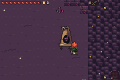

[Exact-palette animation](boss-lunge.gif) · [Full-rate MP4](boss-lunge.mp4) · [Chronology filmstrip](boss-lunge-filmstrip.png)

Disclosed boss HP12 fixture selects existing low-health lunge phase; all motion and state transitions are real AI.

## Real boss combat and defeat

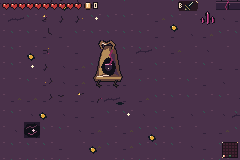

[Full-rate MP4](boss-real-defeat.mp4) · [Chronology filmstrip](boss-real-defeat-filmstrip.png)

Natural boss with disclosed HP4 fixture; real D-pad/B sword inputs cause a nonlethal hit, then existing 120-update death, blasts and Grail drop. No enemy animation/state assignments.

An exact GIF is unavailable because the complete sequence exceeds 256 colors; PNG and MP4 retain the evidence.

## Natural cave encounter

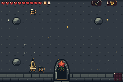

[Exact-palette animation](cave-natural-group.gif) · [Full-rate MP4](cave-natural-group.mp4) · [Chronology filmstrip](cave-natural-group-filmstrip.png)

Actual generated cave combat trial entered through its real mouth. All naturally spawned enemies are retained; only player healing is a fixture. No Drain enemy spawns or invented enemy room are claimed.
