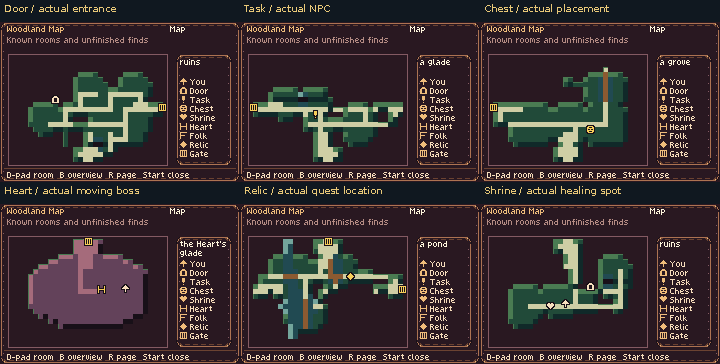

# Actual map and location-marker review

[Main gallery](../../README.md) · [Full capture report](capture.json)

Native frames show the adopted graph overview and chamber zoom, with real generated event positions. Map ownership, completion and safe-player fixtures are stated in each case. No unknown event position is invented.

[Integer 2× comparison](map-feature-comparison-2x.png)

| Case | Actual pixels |
| --- | --- |
| map-overview-all-known | [Native PNG](map-overview-all-known.png) · [Chronology](map-overview-all-known-filmstrip.png) |
| map-room-00 | [Native PNG](map-room-00.png) · [Chronology](map-room-00-filmstrip.png) |
| map-room-01 | [Native PNG](map-room-01.png) · [Chronology](map-room-01-filmstrip.png) |
| map-room-02 | [Native PNG](map-room-02.png) · [Chronology](map-room-02-filmstrip.png) |
| map-room-03 | [Native PNG](map-room-03.png) · [Chronology](map-room-03-filmstrip.png) |
| map-room-04 | [Native PNG](map-room-04.png) · [Chronology](map-room-04-filmstrip.png) |
| map-room-05 | [Native PNG](map-room-05.png) · [Chronology](map-room-05-filmstrip.png) |
| map-room-06 | [Native PNG](map-room-06.png) · [Chronology](map-room-06-filmstrip.png) |
| map-room-07 | [Native PNG](map-room-07.png) · [Chronology](map-room-07-filmstrip.png) |
| map-room-08 | [Native PNG](map-room-08.png) · [Chronology](map-room-08-filmstrip.png) |
| map-room-09 | [Native PNG](map-room-09.png) · [Chronology](map-room-09-filmstrip.png) |
| map-room-10 | [Native PNG](map-room-10.png) · [Chronology](map-room-10-filmstrip.png) |
| map-room-11 | [Native PNG](map-room-11.png) · [Chronology](map-room-11-filmstrip.png) |
| map-room-12 | [Native PNG](map-room-12.png) · [Chronology](map-room-12-filmstrip.png) |
| map-room-13 | [Native PNG](map-room-13.png) · [Chronology](map-room-13-filmstrip.png) |
| map-room-14 | [Native PNG](map-room-14.png) · [Chronology](map-room-14-filmstrip.png) |
| map-room-15 | [Native PNG](map-room-15.png) · [Chronology](map-room-15-filmstrip.png) |
| map-room-16 | [Native PNG](map-room-16.png) · [Chronology](map-room-16-filmstrip.png) |
| map-room-17 | [Native PNG](map-room-17.png) · [Chronology](map-room-17-filmstrip.png) |
| map-room-18 | [Native PNG](map-room-18.png) · [Chronology](map-room-18-filmstrip.png) |
| map-room-19 | [Native PNG](map-room-19.png) · [Chronology](map-room-19-filmstrip.png) |
| map-room-20 | [Native PNG](map-room-20.png) · [Chronology](map-room-20-filmstrip.png) |
| map-room-21 | [Native PNG](map-room-21.png) · [Chronology](map-room-21-filmstrip.png) |
| map-room-22 | [Native PNG](map-room-22.png) · [Chronology](map-room-22-filmstrip.png) |
| map-room-23 | [Native PNG](map-room-23.png) · [Chronology](map-room-23-filmstrip.png) |
| map-room-24 | [Native PNG](map-room-24.png) · [Chronology](map-room-24-filmstrip.png) |
| map-charted-unvisited-chest | [Native PNG](map-charted-unvisited-chest.png) · [Chronology](map-charted-unvisited-chest-filmstrip.png) |
| map-live-heart-world | [Native PNG](map-live-heart-world.png) · [Chronology](map-live-heart-world-filmstrip.png) |
| map-live-heart-zoom | [Native PNG](map-live-heart-zoom.png) · [Chronology](map-live-heart-zoom-filmstrip.png) |
| map-completed | [Native PNG](map-completed.png) · [Chronology](map-completed-filmstrip.png) |
| map-shrine-world | [Native PNG](map-shrine-world.png) · [Chronology](map-shrine-world-filmstrip.png) |
| map-shrine-zoom | [Native PNG](map-shrine-zoom.png) · [Chronology](map-shrine-zoom-filmstrip.png) |
| map-fog-overview | [Native PNG](map-fog-overview.png) · [Chronology](map-fog-overview-filmstrip.png) |
| map-fog-zoom | [Native PNG](map-fog-zoom.png) · [Chronology](map-fog-zoom-filmstrip.png) |
| map-charted-without-astrolabe | [Native PNG](map-charted-without-astrolabe.png) · [Chronology](map-charted-without-astrolabe-filmstrip.png) |
| map-charted-without-astrolabe-zoom | [Native PNG](map-charted-without-astrolabe-zoom.png) · [Chronology](map-charted-without-astrolabe-zoom-filmstrip.png) |
