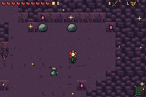

# Unobstructed ground pursuit / alternative 08

[Main gallery](../../../README.md) · [Full capture report](capture.json)

These are actual mGBA recordings from the frozen ROM, not source pose animations. Safe player position, inventory, health and boss-phase HP fixtures are disclosed in the report. Enemy AI state, timer, height and pose are never assigned to fabricate an action.

Native PNGs and chronology frames retain exact game pixels. MP4 is the full-rate, lossy viewing copy. GIF links are included only when the complete sequence has an exact palette.

| Actual action | Preview | Watch / inspect |
| --- | --- | --- |
| Unobstructed ground pursuit | [Native PNG](pursuer-clearing.png) | [Exact GIF](pursuer-clearing.gif) · [Full-rate MP4](pursuer-clearing.mp4) · [Chronology](pursuer-clearing-filmstrip.png) |

## Unobstructed ground pursuit

[Exact-palette animation](pursuer-clearing.gif) · [Full-rate MP4](pursuer-clearing.mp4) · [Chronology filmstrip](pursuer-clearing-filmstrip.png)

Supplementary natural pursuer on an independently selected unobstructed natural floor lane. No enemy position/state/timer/frame or terrain writes. Main bridge-depth recordings remain untouched.
