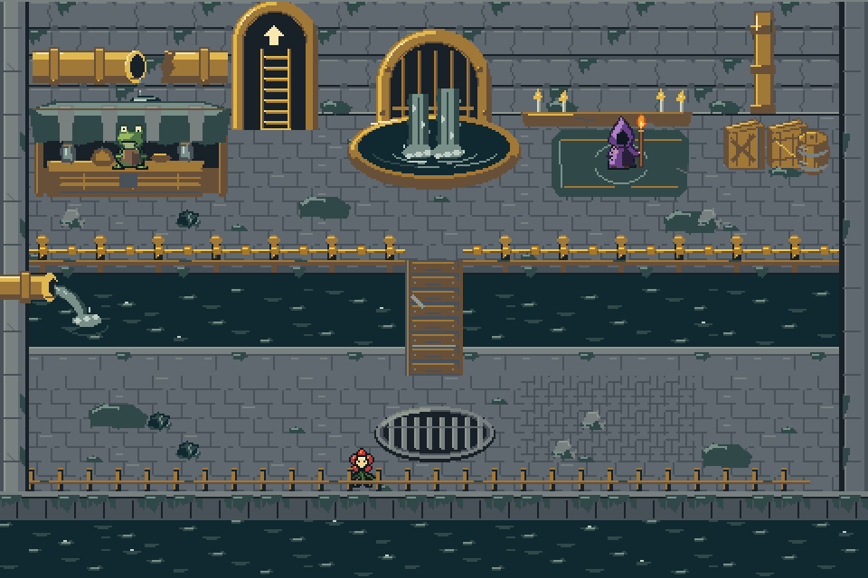
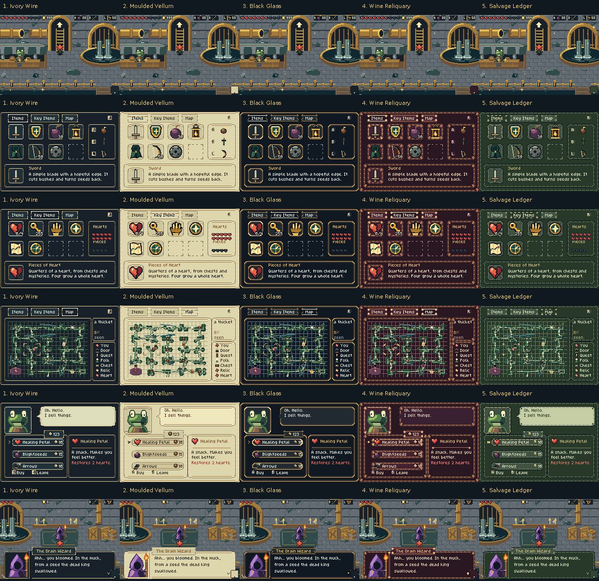
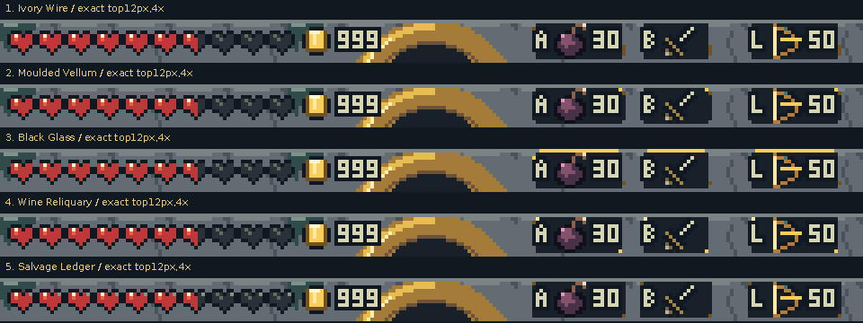

# Final Drain and five interface studies

The Drain now has one final art set synthesized from your preferred pieces.
The five interface skins are separate choices over that same room and game.
**The minimap remains in the HUD. Equipped blightseeds and bow show their
current ammunition; other equipment has no ammo label.**

[Download the final ROM](../../downloads/drain-final-ui-87abc1b/00-final-drain-quiet-brass.gba) ·
[All six ROMs in one ZIP](../../downloads/drain-final-ui-87abc1b/final-drain-and-five-ui-studies.zip) ·
[Watch the five UI styles in real mGBA](five-ui-studies-mgba.mp4)

## Final room

This whole-room image assembles the actual native assets at 480×320 world
pixels. **It is a source assembly, not an emulator screenshot.** It omits the
runtime ambient glitter emitter and uses an unchanged Bloom pose for scale.
The actual recordings below are unchanged 240×160 mGBA framebuffers.

The synthesis follows the selected cues:

| Family | Final treatment |
| --- | --- |
| Floor/debris | Broad #1 brick and a coherent #5 inset repair/debris language. |
| Walls | #1/#3 rear masonry; independently drawn capped side returns. |
| Broken pipe | A larger cylindrical pipe with a dark severed mouth, collars, falling drips and a catch stain. |
| Ladder | A larger, taller arch and longer ladder; solid up-arrow above the rungs. |
| Arches | One consistent front material, connected upper-left highlight and narrow depth return. |
| Cistern | Preferred #2 split flow, foam and impact ripples. |
| Market | #1/#3 stall construction, broad-eyed frog and legible wares. |
| Wizard corner | Preferred worn #2 corner with the pointed purple wizard. |
| Crossing/upper rail | #2/#5 timber and brass construction. |
| Side outlet | Profile view from the LEFT edge, dumping rightward into the river. The old right-front ring is gone. |
| Storage | #2/#3 closed wooden lids, braces, barrel staves and hoops. |
| Drain/lower rail | Clear barred floor drain and worn #4 lower railing. |

The physical room layout, collision, anchors and gameplay stay intact.
Different picture IDs let side walls and fixtures stop borrowing unrelated
north-wall or floor images. All 657 occupied placements keep their resolved
collision, type, prop and glitter flags. Original picture IDs remain stable.
No high-resolution picture was reduced into these game assets.

[Native room](source/final-room-native.png) · [Grayscale check](source/final-room-values.png) ·
[Source water/leak animation](source/source-water-motion.gif) ·
[Every placement and animation frame](source/catalogue.json)

## Final fixtures

These are source crops at integer nearest-neighbour zoom, not screenshots.

- [Brick and debris](source/fixtures/floor.png)
- [North wall and leaking broken pipe](source/fixtures/north-wall.png)
- [Taller ladder and arrow](source/fixtures/ladder.png)
- [Cistern and arch lighting](source/fixtures/cistern.png)
- [Market](source/fixtures/market.png)
- [Wizard corner](source/fixtures/wizard.png)
- [Crossing](source/fixtures/bridge.png)
- [Upper rail](source/fixtures/rail.png)
- [Left profile outlet](source/fixtures/left-outlet.png)
- [Crates and barrel](source/fixtures/storage.png)
- [Floor drain](source/fixtures/grate.png)
- [Lower bank and rail](source/fixtures/lower-bank.png)
- [Left wall](source/fixtures/left-wall.png)
- [Right wall](source/fixtures/right-wall.png)

## Five interface directions

The following board is **actual mGBA output**. Each column keeps its original
240×160 pixels; captions sit outside gameplay. Rows show gameplay HUD,
inventory, key items, map, shop and dialogue. Individual native images and
other screens are linked below.

| UI | Style | Art direction |
| --- | --- | --- |
| 0 | Quiet Brass | Neutral established theme with the new compact HUD; production baseline. |
| 1 | Ivory Wire | Thin ivory relic lines and sparse worn gilt. |
| 2 | Moulded Vellum | Stained light paper, torn/rounded corners and clear dark body type. |
| 3 | Black Glass | Stepped clipped corners, dark fields and controlled metallic edges. |
| 4 | Wine Reliquary | Deep wine material and ornate worn embroidery; the most decorative extreme. |
| 5 | Salvage Ledger | Repaired green ledger panels, seams, rivets and scuffs. |

The styles change frame, tab, selection, marker and cursor geometry as well as
palette. The native font and familiar controls stay stable. The five are
options for feedback; no new style has been selected over the neutral baseline.

## Compact HUD, minimap and ammunition

- The top HUD paints at most 12 rows, with no full-width opaque bar.
- Hearts and gilt occupy the left; equipped A/B/L items occupy fixed right-side
  anchors. Empty slots are transparent and normal items use smaller backplates.
- Only equipped blightseeds or bow show their current amount, including zero.
  Native 3×5 figures can display the full 0–255 value without truncation.
- The native 16×16 current/explored/fog/goal minimap is at (222,142), in the lower
  right. It follows actual generated rooms and navigation.
- The top-center gap at x116–147 remains transparent. The ladder arrow is above
  its rungs and visible below the compact top paint.
- Keys, unrelated ammunition and the R-action prompt remain off the HUD.

[Actual minimaps, enlarged 4×](minimap-4x.png) ·
[Ammo 0](comparisons/hud-ammo-0.png) · [Ammo 9](comparisons/hud-ammo-9.png) ·
[Ammo 99](comparisons/hud-ammo-99.png) · [Ammo 255](comparisons/hud-ammo-255.png) ·
[Non-ammo equipment](comparisons/hud-non-ammo-equipment.png) ·
[Forest HUD](comparisons/hud-healthy.png) · [Blighted HUD](comparisons/hud-blighted.png) ·
[Cave HUD](comparisons/hud-cave.png)

## Menus, dialogue and interaction screens

Five-way actual comparisons:

- [Inventory and item information](comparisons/menu-items.png)
- [Equipped-item selection](comparisons/menu-equipped.png)
- [Key items](comparisons/menu-key-items.png)
- [Map](comparisons/menu-map.png)
- [Map zoom](comparisons/menu-map-zoom.png)
- [Peddler shop](comparisons/shop.png)
- [Shop selection](comparisons/shop-selected.png)
- [Purchase response](comparisons/shop-purchase-response.png)
- [Unaffordable purchase](comparisons/shop-unaffordable.png)
- [Wizard dialogue](comparisons/dialogue-wizard.png)
- [Later dialogue page](comparisons/dialogue-wizard-page2.png)
- [Natural chest reward/item-get](comparisons/reward-chest.png)
- [Death and return](comparisons/death-return.png)
- [Press Start](comparisons/title-start.png)
- [Continue/New Game choices](comparisons/title-continue.png)
- [New Game selected](comparisons/title-new-game-selected.png)
- [Heart victory screen](comparisons/victory.png)

Actual native review corrected three inherited contrast assumptions: new dark
selected tabs now use semantic high-contrast type; floating icon counts use
pale type with a dark contour; backed vellum victory prose uses plain body
text instead of a dark floating-title outline. Floating title prompts remain
pale. The old 443e pilot is archived separately and is not final evidence.

The game has no generic yes/no dialogue primitive. The gallery shows its real
shop, title, equipment, dialogue and reward interactions rather than inventing
an interface that is not implemented.

## Actual final-room runs

All world views below use the final neutral UI0. Other skins keep the same
Drain art. Native frames, GIFs and full-rate MP4s are actual mGBA output.

| View | Native PNG | Motion |
| --- | --- | --- |
| Market/broken pipe | [Native](actual/v0/drain-market.png) | [GIF](actual/v0/drain-market.gif) · [MP4](actual/v0/drain-market.mp4) |
| Ladder and above-arrow | [Native](actual/v0/drain-ladder.png) | [GIF](actual/v0/drain-ladder.gif) · [MP4](actual/v0/drain-ladder.mp4) |
| Cistern | [Native](actual/v0/drain-cistern.png) | [GIF](actual/v0/drain-cistern.gif) · [MP4](actual/v0/drain-cistern.mp4) |
| Wizard | [Native](actual/v0/drain-wizard.png) | [GIF](actual/v0/drain-wizard.gif) · [MP4](actual/v0/drain-wizard.mp4) |
| Left profile outlet | [Native](actual/v0/drain-left-outlet.png) | [GIF](actual/v0/drain-left-outlet.gif) · [MP4](actual/v0/drain-left-outlet.mp4) |
| Bridge | [Native](actual/v0/drain-bridge.png) | [GIF](actual/v0/drain-bridge.gif) · [MP4](actual/v0/drain-bridge.mp4) |
| Storage | [Native](actual/v0/drain-storage.png) | [GIF](actual/v0/drain-storage.gif) · [MP4](actual/v0/drain-storage.mp4) |
| Left wall | [Native](actual/v0/drain-left-wall.png) | [GIF](actual/v0/drain-left-wall.gif) · [MP4](actual/v0/drain-left-wall.mp4) |
| Right wall | [Native](actual/v0/drain-right-wall.png) | [GIF](actual/v0/drain-right-wall.gif) · [MP4](actual/v0/drain-right-wall.mp4) |
| Lower rail/bank | [Native](actual/v0/drain-lower-bank.png) | [GIF](actual/v0/drain-lower-bank.gif) · [MP4](actual/v0/drain-lower-bank.mp4) |

[Walking through the actual room](actual/v0/drain-walk.mp4) ·
[Five-way dialogue animation](dialogue-wizard-five.gif) ·
[Five-way shop animation](shop-five.gif)

Seed, inventory/resources, safe position and navigation transitions are
explicit capture fixtures. Shop choices, menus, type-on dialogue, chests,
enemy contact/death, Continue/New Game and the actual Heart fight/Grail victory
use the game's own events and controls. No UI canvas, screenshot, animation
phase or sprite pose is assigned to fabricate an image.

The final suite contains **234 fresh captures**: 39 per UI profile.

| Profile | Complete actual report |
| --- | --- |
| 0. Quiet Brass | [Every capture, fixture, native-frame path and trace](actual/v0/capture.json) |
| 1. Ivory Wire | [Every capture, fixture, native-frame path and trace](actual/v1/capture.json) |
| 2. Moulded Vellum | [Every capture, fixture, native-frame path and trace](actual/v2/capture.json) |
| 3. Black Glass | [Every capture, fixture, native-frame path and trace](actual/v3/capture.json) |
| 4. Wine Reliquary | [Every capture, fixture, native-frame path and trace](actual/v4/capture.json) |
| 5. Salvage Ledger | [Every capture, fixture, native-frame path and trace](actual/v5/capture.json) |

MP4s preserve all 59.7275 fps frames as lossy viewing copies. Published GIFs keep
exact source colors; any GIF exceeding 256 colors is retained only as a labelled
local archive. Death/return crosses changing palettes, so use its exact native
PNGs and full-rate MP4. Comparison PNGs preserve the unmodified original game
frames. Raw all-frame sequences and duplicate world GIFs remain local; portable
reports label those paths as archival rather than broken published links.

## Playable ROMs and source

- [0. Quiet Brass](../../downloads/drain-final-ui-87abc1b/00-final-drain-quiet-brass.gba)
- [1. Ivory Wire](../../downloads/drain-final-ui-87abc1b/01-ui-1-ivory-wire.gba)
- [2. Moulded Vellum](../../downloads/drain-final-ui-87abc1b/02-ui-2-moulded-vellum.gba)
- [3. Black Glass](../../downloads/drain-final-ui-87abc1b/03-ui-3-black-glass.gba)
- [4. Wine Reliquary](../../downloads/drain-final-ui-87abc1b/04-ui-4-wine-reliquary.gba)
- [5. Salvage Ledger](../../downloads/drain-final-ui-87abc1b/05-ui-5-salvage-ledger.gba)

[All six as one ZIP](../../downloads/drain-final-ui-87abc1b/final-drain-and-five-ui-studies.zip) ·
[SHA256 checksums](../../downloads/drain-final-ui-87abc1b/SHA256SUMS.txt)

Source: [`87abc1b`](https://github.com/natertott/bartgame/commit/87abc1b4aa90d8f993896669a4bbebec8dd2112e),
with final room profile 9 and UI0–5. Normal `make -j4` produces the final room
and neutral compact UI0; `make -j4 BART_UI=N` selects a proposed skin.
Step-and-cut stays the default sword. No commercial base ROM is needed.

D-pad moves; A/B/L use their assigned items; A talks; R rolls/lifts/throws;
Start opens inventory; R/L change tabs. Existing saves remain compatible.

## Verification and living art direction

The independent source/4bpp-ROM audit and runtime regressions pass
**59,509/59,509 checks**. The separate visual-capture suite
passes **894/894 checks**. These counts establish
encoding, physical preservation, state updates and sampled runtime behavior;
they do not score artistic taste or guarantee every possible scene's performance.

The audit decodes all 1,554 frame drawings for 657 final room placements,
exact native UI/HUD/cursor art and palettes, and preserves unrelated sprites,
Bloom/Step-and-cut, item/enemy artwork, forest/interior art, the title bitmap,
physical metadata and timing tables. All 52 code inputs match the frozen commit.
Thirty-six ordinary-enemy contact samples remove sword art one video frame
after hurt. Minimap cells are checked against actual current/explored/goal state;
ammo counters respond only to their corresponding equipped item. Pause closes
restore the current HUD.

Drain resident use is 822/1024 BG subtiles in one palette, with 69 identical-sequence
animation allocations serving 130 declared placement clones. This is native
sharing, not loss of frame detail. Forest 693 and interior 114 remain unchanged.
The compact HUD reduces occlusion; the same glitter emitter can now appear in
the newly exposed top band while keeping its artwork, source budget and surfaces.

[Independent audit](validation/audit-summary.json) · [Full named checks](validation/audit.json) ·
[Capture summary](validation/review-summary.json) · [Builds and hashes](validation/builds.json) ·
[Source atlas/catalogue](source/catalogue.json) · [Five complete UI kits](source/ui-kit-five-styles.png)

[Shared art bible](../../bartgame/docs/art-reboot/ART_BIBLE.md) ·
[Continuous direction log](../../bartgame/docs/art-reboot/ART_DIRECTION_LOG.md) ·
[Reference register](../../bartgame/docs/art-reboot/REFERENCE_REGISTER.md) ·
[Final room notes](../../bartgame/docs/art-reboot/references/DRAIN_FINAL.md) ·
[UI study notes](../../bartgame/docs/art-reboot/references/UI_STUDIES.md) ·
[HUD runtime notes](../../bartgame/docs/art-reboot/references/UI_RUNTIME.md)

Remaining choices: Wire is the quietest, Vellum deliberately bright, Glass
more geometric, Wine the busiest ornamental extreme, and Ledger the most
repaired/utilitarian. The inset paving is intentionally denser than the broad
main floor. Tiny HUD glyphs carry less detail than inventory illustrations.
All screenshots are available at native size for judging those tradeoffs.
