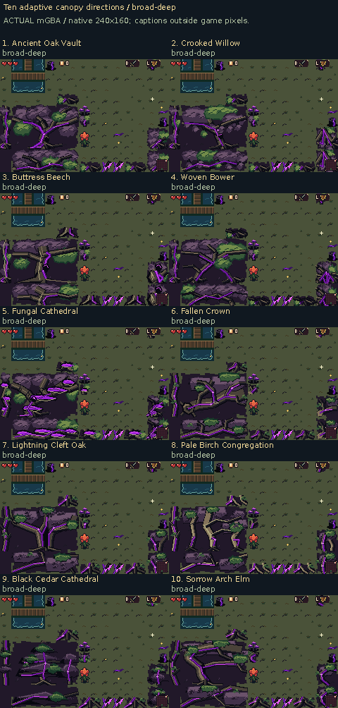

# Ten room-fitted forest canopy designs

The previous fixed-block canopy artwork is retired from these new studies. Each direction has new tree anatomy, with compact growth for isolated remnants, long limbs for narrow strips, and larger branching compositions for broad forest borders. All artwork starts at native GBA dimensions and RGB555 colors.

[Download all ten playable ROMs](https://raw.githubusercontent.com/natertott/bartgame/forest-canopy-adaptive/downloads/forest-canopy-adaptive-c6dc060/forest-canopy-adaptive-c6dc060.zip) · [Individual builds and checksums](../../downloads/forest-canopy-adaptive-c6dc060/README.md) · [Actual mGBA recordings](actual/README.md) · [Native artwork catalog](source/README.md)

[Compare all ten healthy forests](ten-healthy-canopies-actual.png) · [Small isolated pieces](isolated-small-ten-directions-actual.png) · [Narrow forest strips](narrow-arm-ten-directions-actual.png) · [Separated patches and corners](separated-corner-ten-directions-actual.png)

Each gameplay panel is an untouched **240×160 mGBA framebuffer**. Captions sit outside the game pixels. The same disclosed generated rooms, positions and ordinary inputs allow comparison across all ten options.

| # | Direction | Tree structure | Review |
| --- | --- | --- | --- |
| 1 | **Ancient Oak Vault** | Stout oak with unequal, spreading forks. | [mGBA](actual/variant-01/README.md) · [Native art](source/variant-01/README.md) |
| 2 | **Crooked Willow** | Leaning trunk beneath a broad swept crown. | [mGBA](actual/variant-02/README.md) · [Native art](source/variant-02/README.md) |
| 3 | **Buttress Beech** | Heavy root flare and a broad, scarred bole. | [mGBA](actual/variant-03/README.md) · [Native art](source/variant-03/README.md) |
| 4 | **Woven Bower** | Two interlocking trees and crossed lateral limbs. | [mGBA](actual/variant-04/README.md) · [Native art](source/variant-04/README.md) |
| 5 | **Fungal Cathedral** | Stepped dying wood with luminous shelf fungi. | [mGBA](actual/variant-05/README.md) · [Native art](source/variant-05/README.md) |
| 6 | **Fallen Crown** | A heavy fallen trunk with attached root and fork growth. | [mGBA](actual/variant-06/README.md) · [Native art](source/variant-06/README.md) |
| 7 | **Lightning Cleft Oak** | A divided trunk with a glowing central wound. | [mGBA](actual/variant-07/README.md) · [Native art](source/variant-07/README.md) |
| 8 | **Pale Birch Congregation** | Three unequal pale trees in one stand. | [mGBA](actual/variant-08/README.md) · [Native art](source/variant-08/README.md) |
| 9 | **Black Cedar Cathedral** | Dark conifers with layered horizontal branches. | [mGBA](actual/variant-09/README.md) · [Native art](source/variant-09/README.md) |
| 10 | **Sorrow Arch Elm** | A bowed trunk carrying a long arching crown. | [mGBA](actual/variant-10/README.md) · [Native art](source/variant-10/README.md) |

The room is generated first. A visual planner measures connected forest space and fits purpose-drawn 16×16, 32×32, 48×48, 64×64 and 96×64 compositions, plus narrow branches, roots and border pieces. The different sizes have their own drawings. Logical collision, events and progression retain their existing locations; protected approaches remain clear. A resident GBA tile atlas stores the resulting art.

The ten anatomies share a coherent bark/leaf vocabulary. Healthy material progresses to dead plum foliage, blackened wood and luminous violet wounds, while living green remains. Accepted grey sick grass and the rest of forest profile 6 remain unchanged. Broad foreground boughs extend over walkable floor; Bloom retains his native artwork and the existing partial-visibility safeguard.

**Visual review:** oak and buttress forms give the clearest ordinary-tree read; fungi create the brightest, busiest supernatural treatment. Fallen Crown is a more open fallen-wood grove, and Cedar uses sparse layered branches. Some long edges and small remnants still reveal the rectangular room footprint. The resident kit can recur across rooms. These are ten review alternatives, with no candidate selected as the production default.

**Evidence and limits:** frozen game/art source [`c6dc060`](https://github.com/natertott/bartgame/commit/c6dc060043aa6d0d5e2eb43d4d09e97ddf77450a). The final recordings pass 1,961/1,961 runtime checks across 79 contexts: 71 new-style contexts and eight previous-profile 6 controls. There are 22 full-rate clips, including 20 new-style clips. The published six comparison boards contain 80 byte-verified native panels. Source art, recorded-plan diagrams and resident-layer reconstructions have separate labels.

Independent verification records **12,823/12,824** passing assertions. Its one retained failure measures menu-return timing: profile 19 resumes three video frames (about 50ms) later than profile 6 in the focused fixture. Per-playing-interval cadence, native art/palettes, fit, protected content, visibility and strict gameplay/RNG comparisons pass. The failed absolute-timing comparison remains visible in the report.

Room entry also costs more: one measured transition takes 47 video frames (about 0.79s), compared with 28 (about 0.47s) in profile 6. This improves the first adaptive version’s 108 frames while preserving its exact maps. Recorded ordinary movement has no missed gameplay-update intervals. These finite-case measurements are not worst-case guarantees.

Forest residency is 867–942/1,024 background subtiles and 11/12 world banks. All nineteen historical profiles 0–18 rebuild byte-identically; default 0 is preserved. The generator’s lantern-placement redesign remains a separate pending task.

[Detailed validation, fixtures and remaining timing differences](validation/README.md) · [Shared art direction](../../bartgame/docs/art-reboot/ART_BIBLE.md) · [Decision log](../../bartgame/docs/art-reboot/ART_DIRECTION_LOG.md) · [Room-first engine notes](../../bartgame/docs/art-reboot/references/FOREST_ADAPTIVE_ENGINE.md)
