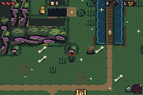
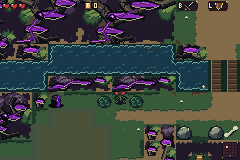
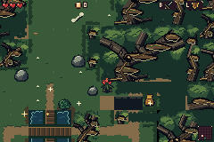
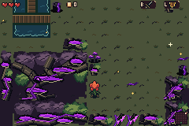
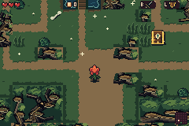
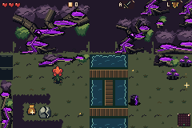
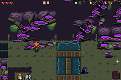

# 5. Fungal Cathedral: actual mGBA

Generated-room views and ordinary-input motion from the frozen ROM. Player, camera, inventory and controlled action-RNG fixtures are disclosed in the report. Source drawings and room-layer reconstructions are separate.

[Complete report](capture.json)

## isolated-small

Seed 0xb4a7 · room 4 · Actual room footprint and adaptive native composition. No terrain or video injection.

[After](isolated-small-after.png) · [Native filmstrip](isolated-small-filmstrip.png) · [Least visible displayed character](isolated-small/frame-000.png) · [Least visible body](isolated-small/frame-000.png)

## narrow-arm

Seed 0xb4a7 · room 6 · Actual room footprint and adaptive native composition. No terrain or video injection.

[After](narrow-arm-after.png) · [Native filmstrip](narrow-arm-filmstrip.png) · [Least visible displayed character](narrow-arm/frame-000.png) · [Least visible body](narrow-arm/frame-000.png)

## broad-healthy

Seed 0xb4a7 · room 16 · Actual room footprint and adaptive native composition. No terrain or video injection.

[After](broad-healthy-after.png) · [Native filmstrip](broad-healthy-filmstrip.png) · [Least visible displayed character](broad-healthy/frame-000.png) · [Least visible body](broad-healthy/frame-000.png) · [Ground-layer reconstruction, not a framebuffer](broad-healthy/bg2-resident-layer.png)

## broad-deep

Seed 0x6 · room 4 · Actual room footprint and adaptive native composition. No terrain or video injection.

[After](broad-deep-after.png) · [Native filmstrip](broad-deep-filmstrip.png) · [Least visible displayed character](broad-deep/frame-000.png) · [Least visible body](broad-deep/frame-000.png) · [Ground-layer reconstruction, not a framebuffer](broad-deep/bg2-resident-layer.png)

## separated-corner

Seed 0xb4a7 · room 16 · Actual room footprint and adaptive native composition. No terrain or video injection.

[After](separated-corner-after.png) · [Native filmstrip](separated-corner-filmstrip.png) · [Least visible displayed character](separated-corner/frame-000.png) · [Least visible body](separated-corner/frame-000.png)

## deep-branch-walk-roll

Seed 0x6 · room 4 · Ordinary input beneath a naturally generated adaptive tree boundary; no pose, z or timer assignment.

[After](deep-branch-walk-roll-after.png) · [Native filmstrip](deep-branch-walk-roll-filmstrip.png) · [Full-rate MP4](deep-branch-walk-roll.mp4) · [Exact-palette GIF](deep-branch-walk-roll.gif) · [Before](deep-branch-walk-roll/frame-000.png) · [Under](deep-branch-walk-roll/frame-045.png) · [Emerged](deep-branch-walk-roll/frame-127.png) · [Least visible displayed character](deep-branch-walk-roll/frame-065.png) · [Least visible body](deep-branch-walk-roll/frame-065.png)

## deep-branch-cape

Seed 0x6 · room 4 · Ordinary input beneath a naturally generated adaptive tree boundary; no pose, z or timer assignment.

[After](deep-branch-cape-after.png) · [Native filmstrip](deep-branch-cape-filmstrip.png) · [Full-rate MP4](deep-branch-cape.mp4) · [Exact-palette GIF](deep-branch-cape.gif) · [Cape flight](deep-branch-cape/frame-018.png) · [Least visible displayed character](deep-branch-cape/frame-043.png) · [Cape overlaps body](deep-branch-cape/frame-013.png) · [Least visible body](deep-branch-cape/frame-040.png)

Body-only and complete displayed-character minima are different measurements; a native attached cape can legitimately cover body pixels. MP4s are lossy viewing copies; exact-color GIFs and native PNGs retain their stated fidelity. Raw all-frame archives remain local.
