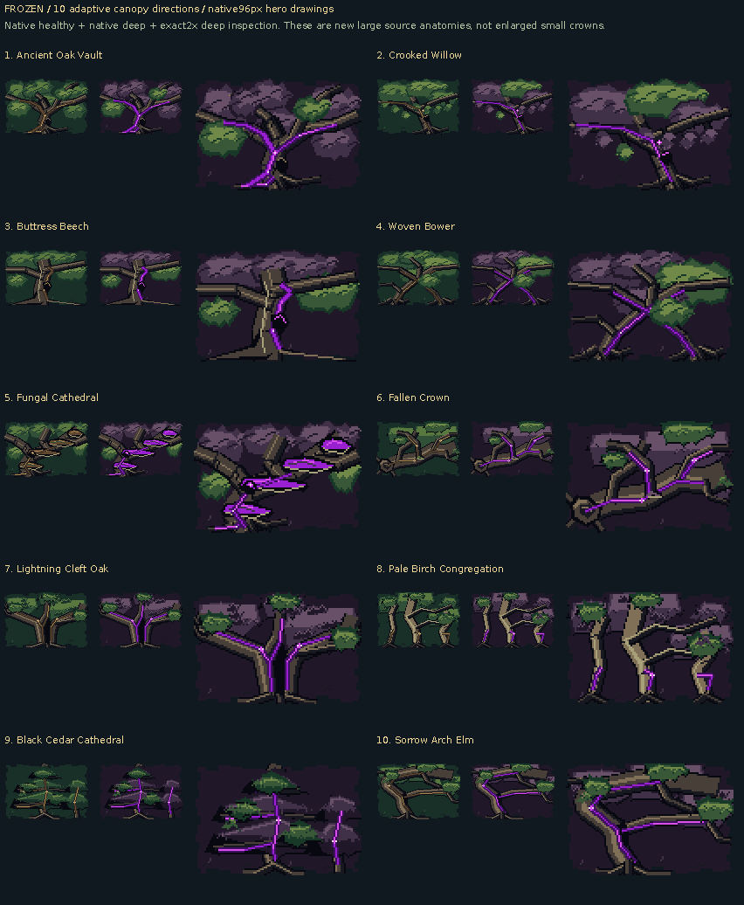

# 10 native adaptive canopy directions

**SOURCE assets and original native sizes. Real mGBA evidence is separate.**

- [1. Ancient Oak Vault](variant-01/README.md)
- [2. Crooked Willow](variant-02/README.md)
- [3. Buttress Beech](variant-03/README.md)
- [4. Woven Bower](variant-04/README.md)
- [5. Fungal Cathedral](variant-05/README.md)
- [6. Fallen Crown](variant-06/README.md)
- [7. Lightning Cleft Oak](variant-07/README.md)
- [8. Pale Birch Congregation](variant-08/README.md)
- [9. Black Cedar Cathedral](variant-09/README.md)
- [10. Sorrow Arch Elm](variant-10/README.md)

Every role has its own native anatomy and dimensions. The room mask/placement plan chooses a fitting drawing; the gallery does not generate a field of repeated small caps. Separate plan diagnostics show actual drawing bounds, placement extents and the room’s physical mask. Source figures alone do not establish in-game composition or visibility.

[Recorded room-plan source figures](recorded-plan-source-manifest.json)

[Source inputs, native inventory and file hashes](source-manifest.json)
