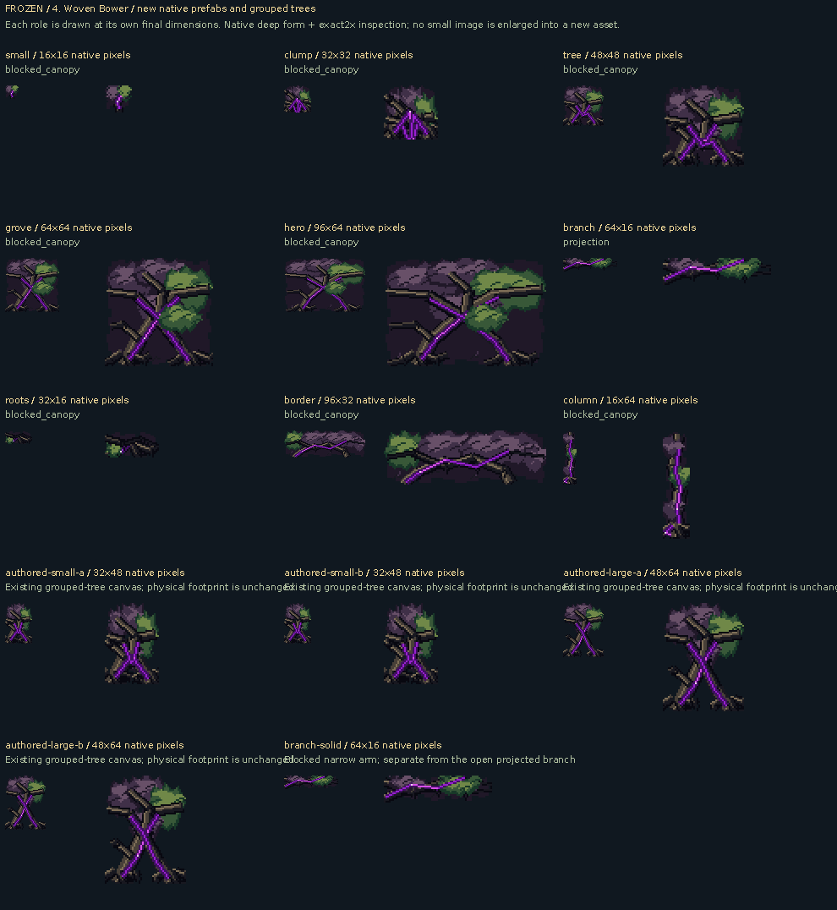

# 4. Woven Bower: native adaptive source

**SOURCE drawings and palette inspection, not mGBA screenshots.**

[Native files and physical-role metadata](native-manifest.json) · [Four depth/pulse palette states](hero-palette-pulse-source.gif) · [Different-size drawing check](native-size-distinctions.json)

Small remnants, standalone trees, groves, long branches and large hero compositions are distinct native drawings. The resident atlas and real room plan decide which fits. A source canvas/alpha bound is not a claim of walkable space or collision.

The phase GIF uses fixed inspection holds. Healthy/deep changes use the engine-declared RGB555 palette tables over the new native geometry; no screenshot is graded. Retained-green ink roles stay distinct from other leaves that become discolored with depth.
