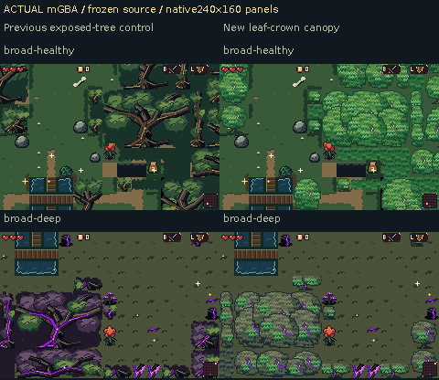

# Leaf crowns inspired by the Emerald reference

This focused revision replaces the rejected exposed-branch trees with dense rounded foliage: overlapping leaf clusters, a lit crown, a darker hanging skirt and short supporting trunks. It uses the user's Emerald crop as a design reference, with original artwork drawn at native GBA sizes.

[Download the playable review ROM](https://raw.githubusercontent.com/natertott/bartgame/forest-canopy-emerald/downloads/forest-canopy-emerald-ead9bb6/forest-canopy-emerald-ead9bb6.zip) · [Individual ROM/checksums](../../downloads/forest-canopy-emerald-ead9bb6/README.md) · [Native source catalog](source/README.md) · [Actual mGBA recordings](actual/README.md)

Every gameplay panel is an untouched **240×160 mGBA framebuffer**, with captions outside the game pixels. Left is the prior profile 19 control; right is the new profile 29 canopy. Generated rooms, standing positions, inventory and ordinary inputs use the disclosed comparison fixtures.

[Isolated growth, narrow banks and corner comparisons](canopy-boundaries-before-after-actual.png) · [Walking and rolling](actual/profile-29/deep-branch-walk-roll.gif) · [Cape movement](actual/profile-29/deep-branch-cape.gif)

The empty purple-black field came from both sparse artwork and a forced renderer backing. The new leaf volume supplies its own detail and depth. Transparent crown edges now clear BG1 and reveal actual local grass or sick ground on BG2. Existing stored and adjacent floors are retained; an interior without either uses appropriate grass rather than inventing a brown path underneath the forest.

Whole crown skirts end inside their native canvases, so the largest pieces have unequal lobes and grass glimpses instead of a cropped rectangular carpet. Small isolated growth, narrow leafy thickets and broad stands use their own drawings. Room-first placement still chooses native footprints from generated space; the maze, collision, event locations and progression are unchanged.

Healthy crowns and deep infection share recognizable leaf volume. Diseased foliage uses gray-green/olive planes, surviving green sprays and attached violet wounds/sparkles. Accepted grey ground and all non-canopy art, Bloom/Step-and-cut, selected enemies, UI and existing glitter remain.

**Remaining visual tradeoffs:** the bright healthy leaf texture is busy; some short repeated bands and tile-aligned joins remain. Deep gray/olive crowns can resemble mossy stones at a glance. This is one coherent review option, not a final production selection.

Frozen game/art source: [`ead9bb6`](https://github.com/natertott/bartgame/commit/ead9bb68ca1cec93c8969dd813deda94c919af07). Final recordings pass **420/420** checks across 16 contexts (eight new, eight control), 800 frame observations, four videos and four exact-color GIFs. Independent verification passes **2,090/2,090**, including packed/source art, actual blank-BG1/native-floor proof, protected content, physics/RNG and recorded character visibility/cadence. Technical counts support fidelity; the images are the art review.

The forest uses 986/1,024 BG subtiles and 11/12 world banks. All 29 historical profiles 0–28 rebuild byte-identically; default 0 stays unchanged. One measured room entry takes 45 video/VBlank frames versus 47 in the prior adaptive control (~0.75s vs~0.79s); menu handoff returns one frame earlier. These are finite observations, not worst-case performance claims. Source drawings and BG1/BG2 layer reconstructions are separately labelled and are not screenshots.

[Validation and exact reports](validation/README.md) · [Emerald reference analysis](../../bartgame/docs/art-reboot/references/EMERALD_CANOPY_REFERENCE.md) · [Shared art rules](../../bartgame/docs/art-reboot/ART_BIBLE.md) · [Decision log](../../bartgame/docs/art-reboot/ART_DIRECTION_LOG.md)
