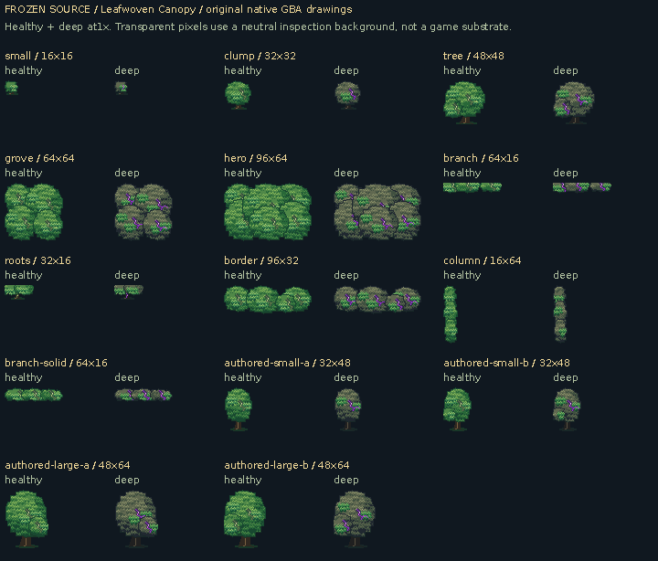

# Leafwoven Canopy: native source

**SOURCE drawings and palette inspection. Actual mGBA frames are separate.**

[Native files and physical-role metadata](native-manifest.json) · [Four-stage palette inspection](palette-inspection-source.gif) · [Source/index/palette data](source-art.json)

The fourteen pieces are nine resident roles, one solid branch map and four authored-tree groups. Healthy/deep images share original native geometry with dedicated RGB555 material tables. Transparent pixels in this source sheet use a neutral inspection background; the actual renderer reveals local grass/soil.

The reference-informed leaf crowns are drawn at their final native sizes. The source GIF uses fixed inspection holds and makes no engine-timing claim. The source catalog does not simulate a room or establish in-game contact/visibility by itself.
