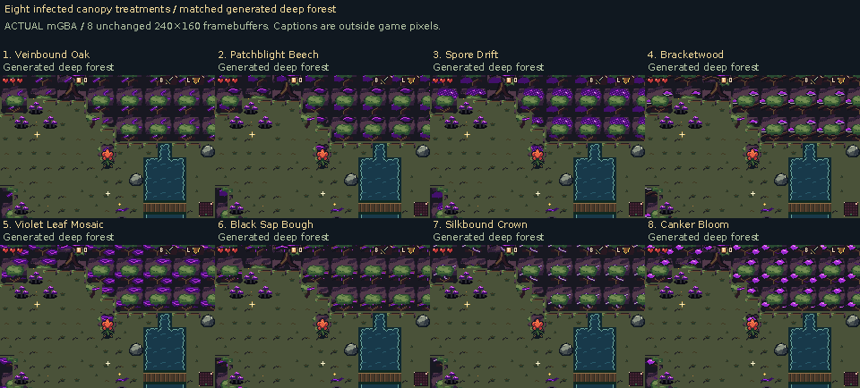

# Eight leafy forest canopy directions

The grey dead grass is retained. These studies rebuild healthy and infected
canopies around leafy crowns, visible bark forks and broad lateral branches.
Infection sits on that tree structure; living green leaves remain visible in
all deep canopy configurations. The eight methods explore a wide range of
sickness rather than replacing the forest with a purple field.

[Download all eight ROMs](https://raw.githubusercontent.com/natertott/bartgame/forest-canopy-v3/downloads/forest-canopy-v3-e923557/forest-canopy-v3-e923557.zip) ·
[Individual ROMs and checksums](../../downloads/forest-canopy-v3-e923557/README.md) ·
[Actual mGBA gallery](actual/README.md) · [Complete native canopy catalog](source/README.md)

These are **unselected alternatives**, numbered 1–8 and built with
`BART_FOREST=11..18`. Other environment art stays at previous forest profile 6.
Production default 0 and all earlier profiles 0–10 remain byte-identical.

[Compare all eight healthy canopies](eight-healthy-canopies-actual.png).
Every gameplay panel is an unchanged native **240×160 mGBA framebuffer**;
captions sit outside the captured pixels. All new styles and the previous
profile 6 control use matched generated geometry and disclosed fixtures.

| Option | Infection treatment | Actual movement and views | Native source |
| --- | --- | --- | --- |
| **1. Veinbound Oak** | Branching purple veins follow the leaf/branch structure. | [mGBA](actual/variant-01/README.md) | [Catalog](source/variant-01/README.md) |
| **2. Patchblight Beech** | Ragged necrotic patches interrupt the leaf planes. | [mGBA](actual/variant-02/README.md) | [Catalog](source/variant-02/README.md) |
| **3. Spore Drift** | Local dithered spore clusters and attached purple light. | [mGBA](actual/variant-03/README.md) | [Catalog](source/variant-03/README.md) |
| **4. Bracketwood** | Shelf fungi grow from lateral boughs. | [mGBA](actual/variant-04/README.md) | [Catalog](source/variant-04/README.md) |
| **5. Violet Leaf Mosaic** | Diseased violet leaves sit among living green. | [mGBA](actual/variant-05/README.md) | [Catalog](source/variant-05/README.md) |
| **6. Black Sap Bough** | Wet dark sap follows forks and short drips. | [mGBA](actual/variant-06/README.md) | [Catalog](source/variant-06/README.md) |
| **7. Silkbound Crown** | Parasitic silk spans parts of the leafy crown. | [mGBA](actual/variant-07/README.md) | [Catalog](source/variant-07/README.md) |
| **8. Canker Bloom** | Luminous cankers flower on intact tree forms. | [mGBA](actual/variant-08/README.md) | [Catalog](source/variant-08/README.md) |

## Recognition, surviving green and depth

The first source drafts were too flat, and their first actual connected walls
still looked like rounded masonry. The final construction uses one larger
crown per 32px span and short bark forks on exposed lower faces. Healthy and
diseased versions share that leaf anatomy. Approximately 20% living green is
measured across the complete infected source crown; every isolated parity and
all 47 infected adjacency cases retain actual green leaves. It is a composition
guide, not a 20% quota in every 16px tile.

[Previous/new healthy canopy](prior-and-new-healthy-actual.png) ·
[Previous/new deep canopy](prior-and-new-deep-actual.png) ·
[Living canopy passage](living-canopy-walkunder-actual.png) ·
[Sick canopy passage](sick-canopy-walkunder-actual.png) ·
[Cape flight and visibility](prior-and-new-living-cape-visibility-actual.png)

Horizontal boughs and fringes project over walkable floor. Bloom keeps his
current native artwork; a small foreground fragment protects a recognizable
lower portion while branches retain real upper-body overlap. It copies only
his existing pixels where vegetation would cover them, without cutting a
rectangular opening in the scenery. Directional held-part order is preserved;
front parts can be more visible during protection, while far-side parts stay
behind. This is an explicit readability choice, not arbitrary whole-body
foreground switching.

The full cape is part of the visible character during flight. A back-worn cape
can naturally cover Bloom's body pixels; actual proof distinguishes that
wardrobe overlap from canopy hiding him. Only the exact attached native cape
phase, palette, anchor and OAM order count toward the displayed-character
composite. Source-body visibility against canopy is checked separately.
Intentional hurt blinking, tiny shrinking poses and existing menu redraw
boundaries are explicitly disclosed rather than counted as foliage failures.

## Evidence and scope

Game/art source: [`e923557`](https://github.com/natertott/bartgame/commit/e923557aa74b01626f3e599f7c4b50366e096507).
Final runtime results: **3,477/3,477**, across
**198 actual contexts** (176 new-style contexts plus
22 previous-profile 6 contexts), with 63 full-rate clips.
Each new style has 16 generated contexts and 6 explicit diagnostic rooms.
Source drawings, actual generated terrain and deliberately inserted diagnostic
shapes have separate labels and counts.

The focused source catalog contains **3,952 native frame instances**: 704
canonical phases and 3,248 canopy/fringe aliases. It has all 47 adjacency cases,
four world parities, tree assemblies, isolated/concave configurations, native
palette swatches and eight exact source palette-inspection GIFs. Their fixed
inspection clock does not claim engine timing. Native PNGs/filmstrips are exact;
MP4s are lossy full-rate viewing copies; published GIFs preserve exact sampled
colors. Raw all-frame recordings and superseded pilots remain local.

The independent native/runtime audit passes **186,010/186,010**.
It verifies all non-canopy pixels and palette roles against profile 6, including
accepted grey ground, other environment objects/portraits, Bloom, selected
bestiary/Heart, items, UI/title/fonts, Drain and existing glitter. Semantic
collision and maze/lantern generation are unchanged. All 11 historical forest
profiles 0–10 are rebuilt and byte-compared to their prior ROMs. Normal0 remains
SHA256 `9330a44a4e27d99606a757134aa41a62adb122a74315c400e1ad3427048c8661`.

An early guard prototype caused dropped gameplay updates. Its runtime pose
analysis was replaced by immutable metadata for the 133 native body frames.
Final same-input movement, action states, RNG, positions and recorded game/IRQ
cadence match the previous-profile 6 control. This is evidence for the recorded
contexts, not a universal CPU/frame-time guarantee or a new full maze audit.
The original tiny falling pose has only two small colored components; it is
protected in full without inventing extra Bloom pixels.

Dense interior crowns still show a regular 32px rhythm, with the strongest tree
cues on exposed edges and standalone trees. The healthy construction uses two
related anchors, so the eight directions differ more in infection anatomy
than healthy silhouette. Wide infection patches can hide some leaf detail;
bright fungi or blooms draw more attention than the restrained treatments.
These remain visible selection tradeoffs, rather than a claim of finished
natural forest composition. Existing open-field composition stays unchanged.

[Native/source and runtime validation](validation/README.md) ·
[Exact comparison panels](actual-panel-manifest.json) ·
[Publication file hashes](validation/publication-manifest.json) ·
[Canopy implementation notes](../../bartgame/docs/FOREST_CANOPY_V3.md) ·
[Living art direction](../../bartgame/docs/art-reboot/ART_BIBLE.md) ·
[Decision log](../../bartgame/docs/art-reboot/ART_DIRECTION_LOG.md)
