# 3. Spore Drift: actual generated mGBA contexts

Generated terrain with disclosed player/navigation/inventory fixtures. Source art is reviewed separately.

[Complete capture report](capture.json)

16 contexts in this index; 399/399 total capture checks.

## healthy-canopy

Seed 0xb4a7 · room 16 · Matched naturally generated healthy/mixed/deep canopy context. No terrain injection.

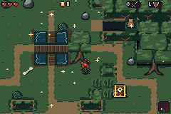

[After](healthy-canopy-after.png) · [Native filmstrip](healthy-canopy-filmstrip.png) · [Full-rate MP4](healthy-canopy.mp4) · [Exact-palette GIF](healthy-canopy.gif) · [Least visible displayed character](healthy-canopy/frame-000.png) · [Least visible body](healthy-canopy/frame-000.png)

## mixed-forest

Seed 0xb4a7 · room 0 · Matched naturally generated healthy/mixed/deep canopy context. No terrain injection.

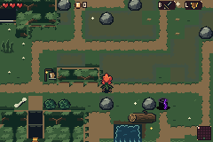

[After](mixed-forest-after.png) · [Native filmstrip](mixed-forest-filmstrip.png) · [Full-rate MP4](mixed-forest.mp4) · [Exact-palette GIF](mixed-forest.gif) · [Least visible displayed character](mixed-forest/frame-000.png) · [Least visible body](mixed-forest/frame-000.png)

## deep-blight

Seed 0x6 · room 4 · Matched naturally generated healthy/mixed/deep canopy context. No terrain injection.

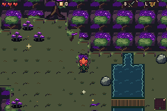

[After](deep-blight-after.png) · [Native filmstrip](deep-blight-filmstrip.png) · [Full-rate MP4](deep-blight.mp4) · [Exact-palette GIF](deep-blight.gif) · [Least visible displayed character](deep-blight/frame-000.png) · [Glow phase 0](deep-blight/frame-000.png) · [Glow phase 1](deep-blight/frame-008.png) · [Glow phase 2](deep-blight/frame-016.png) · [Glow phase 3](deep-blight/frame-024.png) · [Least visible body](deep-blight/frame-000.png)

## living-canopy-walkunder

Seed 0xb4a7 · room 4 · Ordinary walk, roll, real wall impact/recoil and retreat at generated canopy edge.

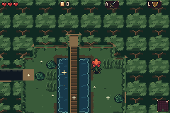

[After](living-canopy-walkunder-after.png) · [Native filmstrip](living-canopy-walkunder-filmstrip.png) · [Full-rate MP4](living-canopy-walkunder.mp4) · [Exact-palette GIF](living-canopy-walkunder.gif) · [Before](living-canopy-walkunder/frame-000.png) · [Under](living-canopy-walkunder/frame-046.png) · [Emerged](living-canopy-walkunder/frame-127.png) · [Least visible displayed character](living-canopy-walkunder/frame-065.png) · [Least visible body](living-canopy-walkunder/frame-065.png)

## sick-canopy-walkunder

Seed 0xb4a7 · room 20 · Ordinary walk, roll, real wall impact/recoil and retreat at generated canopy edge.

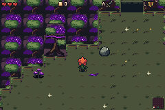

[After](sick-canopy-walkunder-after.png) · [Native filmstrip](sick-canopy-walkunder-filmstrip.png) · [Full-rate MP4](sick-canopy-walkunder.mp4) · [Exact-palette GIF](sick-canopy-walkunder.gif) · [Before](sick-canopy-walkunder/frame-000.png) · [Under](sick-canopy-walkunder/frame-046.png) · [Emerged](sick-canopy-walkunder/frame-127.png) · [Least visible displayed character](sick-canopy-walkunder/frame-065.png) · [Least visible body](sick-canopy-walkunder/frame-065.png)

## living-actions-n

Seed 0xb4a7 · room 4 · Initial facing/inventory fixture; real sword input followed by disclosed A-slot shield assignment and ordinary held input. No pose/timer assignment.

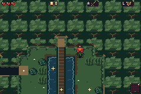

[After](living-actions-n-after.png) · [Native filmstrip](living-actions-n-filmstrip.png) · [Sword action](living-actions-n/frame-012.png) · [Shield held](living-actions-n/frame-064.png) · [Least visible displayed character](living-actions-n/frame-057.png) · [Least visible body](living-actions-n/frame-057.png)

## living-actions-e

Seed 0xb4a7 · room 4 · Initial facing/inventory fixture; real sword input followed by disclosed A-slot shield assignment and ordinary held input. No pose/timer assignment.

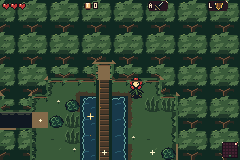

[After](living-actions-e-after.png) · [Native filmstrip](living-actions-e-filmstrip.png) · [Sword action](living-actions-e/frame-012.png) · [Shield held](living-actions-e/frame-064.png) · [Least visible displayed character](living-actions-e/frame-057.png) · [Least visible body](living-actions-e/frame-057.png)

## living-actions-s

Seed 0xb4a7 · room 4 · Initial facing/inventory fixture; real sword input followed by disclosed A-slot shield assignment and ordinary held input. No pose/timer assignment.

[After](living-actions-s-after.png) · [Native filmstrip](living-actions-s-filmstrip.png) · [Sword action](living-actions-s/frame-012.png) · [Shield held](living-actions-s/frame-064.png) · [Least visible displayed character](living-actions-s/frame-057.png) · [Least visible body](living-actions-s/frame-057.png)

## living-actions-w

Seed 0xb4a7 · room 4 · Initial facing/inventory fixture; real sword input followed by disclosed A-slot shield assignment and ordinary held input. No pose/timer assignment.

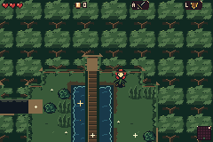

[After](living-actions-w-after.png) · [Native filmstrip](living-actions-w-filmstrip.png) · [Sword action](living-actions-w/frame-012.png) · [Shield held](living-actions-w/frame-064.png) · [Least visible displayed character](living-actions-w/frame-057.png) · [Least visible body](living-actions-w/frame-057.png)

## living-cape-under-canopy

Seed 0xb4a7 · room 4 · Actual cape jump facing the generated canopy collision limit; real z and timers.

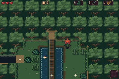

[After](living-cape-under-canopy-after.png) · [Native filmstrip](living-cape-under-canopy-filmstrip.png) · [Cape flight](living-cape-under-canopy/frame-018.png) · [Least visible displayed character](living-cape-under-canopy/frame-043.png) · [Cape overlaps body](living-cape-under-canopy/frame-013.png) · [Least visible body](living-cape-under-canopy/frame-012.png)

## sick-actions-n

Seed 0xb4a7 · room 20 · Initial facing/inventory fixture; real sword input followed by disclosed A-slot shield assignment and ordinary held input. No pose/timer assignment.

[After](sick-actions-n-after.png) · [Native filmstrip](sick-actions-n-filmstrip.png) · [Full-rate MP4](sick-actions-n.mp4) · [Exact-palette GIF](sick-actions-n.gif) · [Sword action](sick-actions-n/frame-012.png) · [Shield held](sick-actions-n/frame-064.png) · [Least visible displayed character](sick-actions-n/frame-057.png) · [Least visible body](sick-actions-n/frame-057.png)

## sick-actions-e

Seed 0xb4a7 · room 20 · Initial facing/inventory fixture; real sword input followed by disclosed A-slot shield assignment and ordinary held input. No pose/timer assignment.

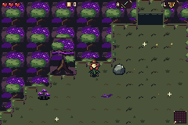

[After](sick-actions-e-after.png) · [Native filmstrip](sick-actions-e-filmstrip.png) · [Sword action](sick-actions-e/frame-012.png) · [Shield held](sick-actions-e/frame-064.png) · [Least visible displayed character](sick-actions-e/frame-057.png) · [Least visible body](sick-actions-e/frame-057.png)

## sick-actions-s

Seed 0xb4a7 · room 20 · Initial facing/inventory fixture; real sword input followed by disclosed A-slot shield assignment and ordinary held input. No pose/timer assignment.

[After](sick-actions-s-after.png) · [Native filmstrip](sick-actions-s-filmstrip.png) · [Sword action](sick-actions-s/frame-012.png) · [Shield held](sick-actions-s/frame-064.png) · [Least visible displayed character](sick-actions-s/frame-057.png) · [Least visible body](sick-actions-s/frame-057.png)

## sick-actions-w

Seed 0xb4a7 · room 20 · Initial facing/inventory fixture; real sword input followed by disclosed A-slot shield assignment and ordinary held input. No pose/timer assignment.

[After](sick-actions-w-after.png) · [Native filmstrip](sick-actions-w-filmstrip.png) · [Sword action](sick-actions-w/frame-012.png) · [Shield held](sick-actions-w/frame-064.png) · [Least visible displayed character](sick-actions-w/frame-057.png) · [Least visible body](sick-actions-w/frame-057.png)

## sick-cape-under-canopy

Seed 0xb4a7 · room 20 · Actual cape jump facing the generated canopy collision limit; real z and timers.

[After](sick-cape-under-canopy-after.png) · [Native filmstrip](sick-cape-under-canopy-filmstrip.png) · [Cape flight](sick-cape-under-canopy/frame-018.png) · [Least visible displayed character](sick-cape-under-canopy/frame-043.png) · [Cape overlaps body](sick-cape-under-canopy/frame-013.png) · [Least visible body](sick-cape-under-canopy/frame-012.png)

## sick-canopy-menu-resume

Seed 0xb4a7 · room 20 · One focused ordinary menu open/close under generated foliage. Interface frames are explicitly outside the player-visibility scope; every displayed world frame before and after is checked.

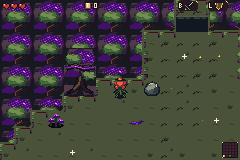

[After](sick-canopy-menu-resume-after.png) · [Native filmstrip](sick-canopy-menu-resume-filmstrip.png) · [Before menu](sick-canopy-menu-resume/frame-000.png) · [Menu open](sick-canopy-menu-resume/frame-018.png) · [After resume](sick-canopy-menu-resume/frame-064.png) · [Least visible displayed character](sick-canopy-menu-resume/frame-000.png) · [Least visible body](sick-canopy-menu-resume/frame-000.png)

Native PNGs retain actual 240×160 pixels. MP4s are lossy viewing copies. Only exact-color GIFs are included. Raw all-frame recording archives remain local.

“Least visible body” measures the body bitmap alone. The native cape may legitimately cover it. “Least visible displayed character” instead measures the exact native Bloom/cape composite; these are different frame selections and must not be confused with complete canopy occlusion. The capture report records both measurements and the cape’s source/palette/anchor proof.
