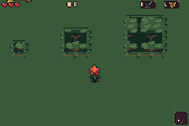
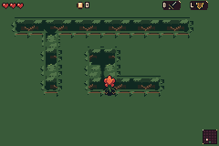
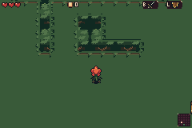
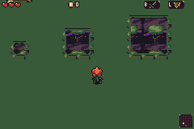
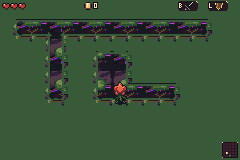
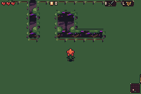

# 6. Black Sap Bough: diagnostic mGBA fixtures

**Explicit diagnostic rooms, not natural generation.**

[Complete capture report](../capture.json)

6 contexts in this index; 399/399 total capture checks.

## diagnostic-living-canopy-isolated-sizes

Seed 0xb4a7 · room 16 · Explicit semantic adjacency fixture, not a naturally generated room.

[After](../diagnostic-living-canopy-isolated-sizes-after.png) · [Native filmstrip](../diagnostic-living-canopy-isolated-sizes-filmstrip.png) · [Least visible displayed character](../diagnostic-living-canopy-isolated-sizes/frame-000.png) · [Least visible body](../diagnostic-living-canopy-isolated-sizes/frame-000.png)

## diagnostic-living-canopy-narrow-inner-corners

Seed 0xb4a7 · room 16 · Explicit semantic adjacency fixture, not a naturally generated room.

[After](../diagnostic-living-canopy-narrow-inner-corners-after.png) · [Native filmstrip](../diagnostic-living-canopy-narrow-inner-corners-filmstrip.png) · [Least visible displayed character](../diagnostic-living-canopy-narrow-inner-corners/frame-000.png) · [Least visible body](../diagnostic-living-canopy-narrow-inner-corners/frame-000.png)

## diagnostic-living-canopy-corner-motion

Seed 0xb4a7 · room 16 · Explicit semantic narrow/concave canopy fixture with ordinary walk/roll/recoil inputs.

[After](../diagnostic-living-canopy-corner-motion-after.png) · [Native filmstrip](../diagnostic-living-canopy-corner-motion-filmstrip.png) · [Least visible displayed character](../diagnostic-living-canopy-corner-motion/frame-065.png) · [Least visible body](../diagnostic-living-canopy-corner-motion/frame-065.png)

## diagnostic-sick-canopy-isolated-sizes

Seed 0xb4a7 · room 16 · Explicit semantic adjacency fixture, not a naturally generated room.

[After](../diagnostic-sick-canopy-isolated-sizes-after.png) · [Native filmstrip](../diagnostic-sick-canopy-isolated-sizes-filmstrip.png) · [Least visible displayed character](../diagnostic-sick-canopy-isolated-sizes/frame-000.png) · [Least visible body](../diagnostic-sick-canopy-isolated-sizes/frame-000.png)

## diagnostic-sick-canopy-narrow-inner-corners

Seed 0xb4a7 · room 16 · Explicit semantic adjacency fixture, not a naturally generated room.

[After](../diagnostic-sick-canopy-narrow-inner-corners-after.png) · [Native filmstrip](../diagnostic-sick-canopy-narrow-inner-corners-filmstrip.png) · [Least visible displayed character](../diagnostic-sick-canopy-narrow-inner-corners/frame-000.png) · [Least visible body](../diagnostic-sick-canopy-narrow-inner-corners/frame-000.png)

## diagnostic-sick-canopy-corner-motion

Seed 0xb4a7 · room 16 · Explicit semantic narrow/concave canopy fixture with ordinary walk/roll/recoil inputs.

[After](../diagnostic-sick-canopy-corner-motion-after.png) · [Native filmstrip](../diagnostic-sick-canopy-corner-motion-filmstrip.png) · [Full-rate MP4](../diagnostic-sick-canopy-corner-motion.mp4) · [Exact-palette GIF](../diagnostic-sick-canopy-corner-motion.gif) · [Before](../diagnostic-sick-canopy-corner-motion/frame-000.png) · [Under](../diagnostic-sick-canopy-corner-motion/frame-046.png) · [Emerged](../diagnostic-sick-canopy-corner-motion/frame-127.png) · [Least visible displayed character](../diagnostic-sick-canopy-corner-motion/frame-065.png) · [Least visible body](../diagnostic-sick-canopy-corner-motion/frame-065.png)

Native PNGs retain actual 240×160 pixels. MP4s are lossy viewing copies. Only exact-color GIFs are included. Raw all-frame recording archives remain local.
