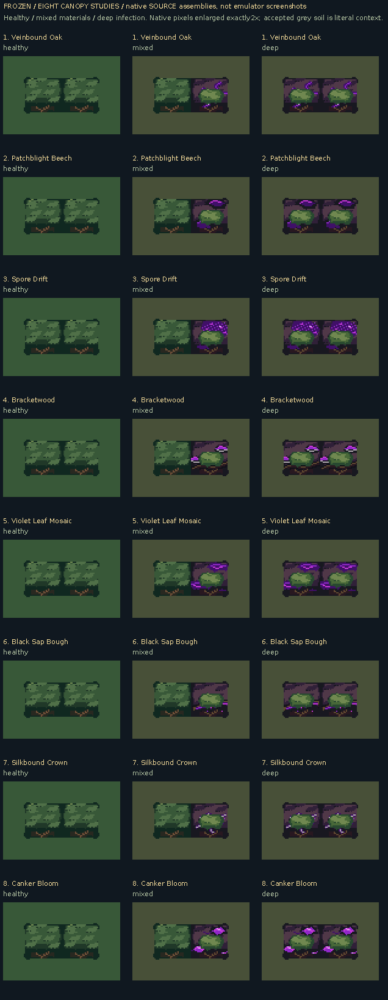

# Eight native canopy directions

**SOURCE review: native drawings, literal assemblies and fixed-clock palette inspection. Not mGBA screenshots.**

[Healthy/infected/dead tree anatomy](horizontal-tree-forms-source.png)

- [1. Veinbound Oak](variant-01/README.md)
- [2. Patchblight Beech](variant-02/README.md)
- [3. Spore Drift](variant-03/README.md)
- [4. Bracketwood](variant-04/README.md)
- [5. Violet Leaf Mosaic](variant-05/README.md)
- [6. Black Sap Bough](variant-06/README.md)
- [7. Silkbound Crown](variant-07/README.md)
- [8. Canker Bloom](variant-08/README.md)

The accepted grey diseased ground is retained as context. Every direction begins with recognizable tree/crown anatomy; the infection is attached to that structure. Green percentages use declared live-green ink roles among painted source pixels, not a biological claim or a quota for every small tile.

Only the canopy/tree/fringe families are catalogued. The many adjacency aliases share indexed native sheets and exact crop/hash metadata instead of thousands of duplicate individual files. Existing prop, portrait, equipment and unrelated terrain catalogs are intentionally outside this focused pass.

[Source inputs, outputs and summary](source-manifest.json) · [Comparison panel definitions](source-comparison-manifest.json)
