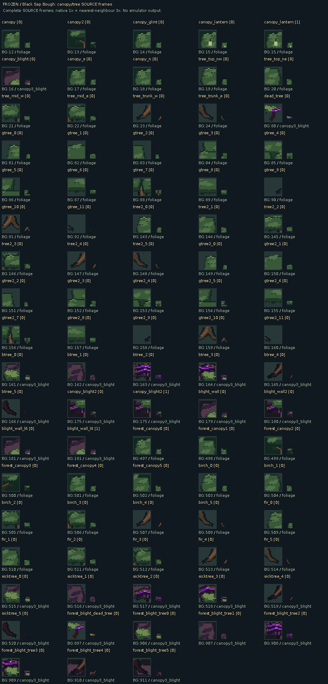

# 6. Black Sap Bough: native source

**SOURCE artwork and assemblies; these are not emulator captures.**

[Back to all eight](../README.md)

[47 healthy cases](all47-healthy-source.png) · [47 infected cases](all47-infected-source.png) · [Islands, strips and concave joins](adjacency-islands-source.png) · [Floor/branch foreground planes](foreground-branch-layers-source.png)

[Exact fixed-clock palette inspection](palette-pulse-source.gif) · [Four PNG phases](palette-phase-0-source.png) · [Native ink swatches](palette-inks-source.png)

[Canonical native frames and alias-sheet rectangles](native-manifest.json) · [Assembly definitions](assembly-manifest.json) · [Green-retention measurement](green-retention.json)

Canonical frames have individual indexed/RGBA PNGs. Appended canopy/fringe aliases share literal native indexed sheets; every 16×16 rectangle and its nibble/RGBA hash is recorded. Logical collision is reported separately from image transparency. Source silhouettes cannot prove in-game visibility, cutout behavior or motion. The separately labelled actual recordings do.

In forest play, semantic canopy cells select adjacency/parity aliases. The canonical pictures remain catalogued for full source review alongside the actual render-alias sheets.

The approximate 80/20 retained-green target is measured over complete source crowns using declared live-green ink roles; it is not imposed on every quarter or counted by screenshot hue. Fixed inspection holds do not establish gameplay cadence.
