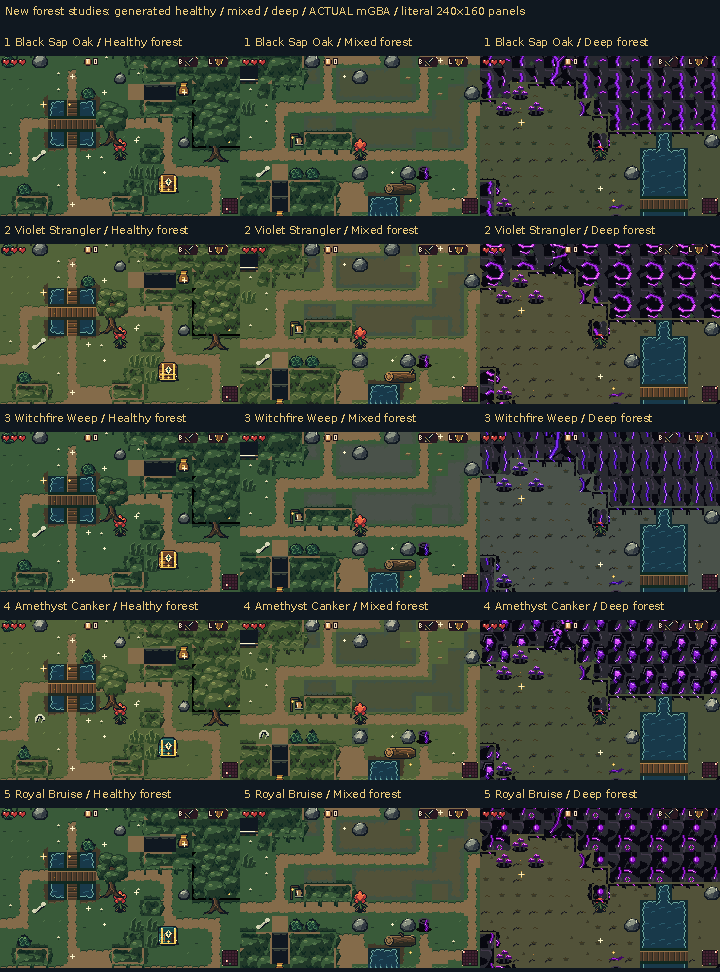

# Five infected forest directions, with real layered depth

Five playable alternatives push the deep forest toward blackened wood, sick
ground and brilliant purple infection. Healthy grass stays green; the deep
floor becomes sparse and pallid. The strongest light belongs to wounds,
growths and branches, alongside the existing glitter.

[Download all five ROMs](https://raw.githubusercontent.com/natertott/bartgame/forest-concepts-v2/downloads/forest-concepts-v2-e5e3fcb/forest-concepts-v2-e5e3fcb.zip) ·
[Individual ROMs and checksums](../../downloads/forest-concepts-v2-e5e3fcb/README.md) ·
[Actual mGBA gallery](actual/README.md) · [Every native asset](source/README.md)

These are **unselected studies**, numbered 1–5 below and built with
`BART_FOREST=6..10`. The ordinary build remains forest0. Earlier studies 1–5
remain available separately.

| Option | Infection and character direction | Actual footage | Complete source |
| --- | --- | --- | --- |
| **1. Black Sap Oak** | Split black bark, luminous sap; Snail Sage, Moth Sister and Compost Beetle. | [mGBA](actual/variant-01/README.md) | [Catalog](source/variant-01/README.md) |
| **2. Violet Strangler** | Purple constrictors around dead wood; Morel Abbot, Bellflower Veil and Frog Botanist. | [mGBA](actual/variant-02/README.md) | [Catalog](source/variant-02/README.md) |
| **3. Witchfire Weep** | Hanging infected wounds; Stump Librarian, Mourning Bell and Carrot Sexton. | [mGBA](actual/variant-03/README.md) | [Catalog](source/variant-03/README.md) |
| **4. Amethyst Canker** | Wet luminous cankers; Owl Reader, Willow Dryad and Compost Salamander. | [mGBA](actual/variant-04/README.md) | [Catalog](source/variant-04/README.md) |
| **5. Royal Bruise** | Forked dead branches and glowing buds; Teapot Hermit, Rag Doll and Mole Planter. | [mGBA](actual/variant-05/README.md) | [Catalog](source/variant-05/README.md) |

All gameplay panels are unchanged **240×160 mGBA framebuffers**. Captions sit
outside the game pixels. The five new ROMs use matched generated geometry and
recorded fixtures. Source sheets below are labelled separately.

## Depth that works while moving

Canopy silhouettes and leaf fringes now sit on foreground **BG1**, over the
actual floor on **BG2**. Bloom, his held parts and their shadows use compatible
sorting. He can walk beneath neighboring leaves with partial upper-body
occlusion and visible grounded feet. The HUD remains on **BG0**.

- [Living canopy: before, under and emerged](living-canopy-walkunder-actual.png).
- [Sick canopy: before, under and emerged](sick-canopy-walkunder-actual.png).
- [Raised root arch: before, under and emerged](root-arch-underpass-actual.png).
- [Water, bridge, pits and raised ledge faces](water-and-ledges-actual.png).
- [Larger logs and tall shrine/relic markers](landmarks-and-logs-actual.png).

[Watch the actual canopy passage](actual/variant-01/living-canopy-walkunder.mp4) ·
[Watch the actual root underpass](actual/variant-01/root-arch-underpass.mp4)

The root arch has a real lower passage with at least one complete 16px lane.
Its upper span is scenery. A bridge usable both above and below still needs
explicit elevation, route entry/exit rules and separate collision. This pass
does not implement that full system. A brief airborne wall-recoil sorting
exception keeps Bloom readable beneath low fringes; ordinary walking, rolls,
full crowns and root roofs retain their foreground overlap.

## Props, characters and terrain joins

- **Ten wooden chest forms**, two per option, with connected open
  states: [closed](wooden-chests-before-actual.png) · [opened in game](wooden-chests-open-actual.png) · [all source states](source/ten-wooden-chests-source.png).
- **Fifteen new forest folk** and matching native portraits:
  [world sprites](forest-folk-before-actual.png) · [dialogue](forest-folk-dialogue-actual.png) · [named source comparison](source/fifteen-forest-folk-source.png).
- Five visibly different webs, simple full-tile buttons, purple thorns,
  fractured bomb stone and **one large keyhole**:
  [gates before use](gates-before-actual.png) · [same-room cleared floor](gates-cleared-actual.png) · [source interactions and height](source/five-way-interactions-height-source.png).
- New sick grass, tall grass, dead trees and ledge faces; preferred healthy
  constructions remain anchors. [Cave, hollow and thicket rooms](mystery-interiors-actual.png).
- **47 adjacency cases** handle rounded islands, ends, connected edges and
  concave joins. Isolated water corners are transparent over the correct local
  floor. [Explicit water fixtures](diagnostic-water-actual.png) ·
  [living canopy fixtures](diagnostic-living-canopy-actual.png) ·
  [sick canopy fixtures](diagnostic-sick-canopy-actual.png).
- [Four actual purple-glow phases](four-glow-phases-actual.png), authored in
  native RGB555 BG palette inks. The BG pulse leaves shared OBJ, UI and
  existing glitter colors unchanged.

[All source families and adjacency/layer diagrams](source/README.md) ·
[All 25 room viewports per option](actual/README.md) ·
[Historical first-pass comparison](v1-v2-deep-historical-actual.png)

The historical comparison uses different seeds, positions and cameras. It is
illustrative context, not an aligned pixel comparison or a claim that each
old/new option number represents the same family.

## Verification and remaining work

Final game/art source: [`e5e3fcb`](https://github.com/natertott/bartgame/commit/e5e3fcb21fe1bcc50c965943164146a2dc1e3c46).
The new styles have **485 recorded art contexts**:
455 generated contexts and 30
deliberately constructed diagnostic rooms. Control 0 adds 83
separate contexts. All **7,733 runtime checks pass**. Additional
earned-progression runs exercise the three required tasks, real item gates
and Heart entry; their snapshots/logs are separate from the art-context count.

The source catalog contains **5,320 native frame instances**, with twenty
albums per option and fifteen exact source GIFs; independent export
verification passes **47,515/47,515**. The final native/runtime audit passes
**139,478/139,478**. A frozen real-C host corpus checks
**20,000 seeds, 500,000 rooms and 60,000 tuned world graphs**. It also exposed
inherited rare blocked approaches; the new studies reserve fronts, connect
small fallback clearings to an actual entry, and fit all required censers.
Final log cleanup preserves complete two-cell logs without rebuilding an
obstacle across a repaired route. Item-gated side pockets retain their gates.

Bloom/Step-and-cut, selected enemies/Heart, equipment/pickups, selected
interfaces, Drain architecture/keepers and established glitter keep their
art. Shared environment chests, entrances and portable objects use the new
study drawings wherever they appear. Renderer/generator changes are confined
to the new forest profiles. Control 0 and historical 1/5 are byte-identical to
their previous ROMs; ordinary 0 remains SHA256
`9330a44a4e27d99606a757134aa41a62adb122a74315c400e1ad3427048c8661`.

Long canopy bands still expose repetition; repeated purple strokes/loops can
read as a glowing fence more than branching wood. Rounded joins solve hard
corners, but broader forest-mass placement remains an important next step.
Quiet deep ground can look spare. Some unusual chests rely on their latch to
read as treasure, and the friendly Moth Sister shares a wing family with the
enemy Confessor. These are visible tradeoffs for selection, not a claim that
the art or procedural composition is finished.

Natural captures disclose seed, navigation/player positioning, inventory,
health and unrelated-enemy clearing. Diagnostic rooms deliberately replace
logical terrain and call the real frozen renderer/collision builder; their
counts and labels are separate. Native PNGs and filmstrips preserve captured
pixels. MP4s are lossy full-rate viewing copies; GIFs are included only when
their sampled sequence retains exact colors. Source GIF inspection holds do
not establish gameplay timing. Raw recordings and superseded runs stay local.

[Native resource budgets](validation/native-budgets.json) ·
[Runtime methodology](validation/runtime/runtime-review.md) ·
[Publication summary](validation/publication-summary.json) ·
[Panel provenance](actual-panel-manifest.json) ·
[File hashes](validation/publication-manifest.json) ·
[Independent audit](validation/audit/finalaudit-summary.json) ·
[Source critique](validation/source-gallery-review.md) ·
[Actual visual critique](validation/audit/visual-review-actual.md) ·
[Topology and future elevation notes](../../bartgame/docs/FOREST_TOPOLOGY.md) ·
[Living art direction](../../bartgame/docs/art-reboot/ART_BIBLE.md) ·
[Decision log](../../bartgame/docs/art-reboot/ART_DIRECTION_LOG.md)
