# Unchanged production control: actual mGBA

[Back to the complete review](../../README.md)

83 non-diagnostic recorded contexts; 0 explicit diagnostic-room contexts. 482/482 capture checks. [Complete report and fixtures](capture.json).

Natural cases use generated terrain with disclosed navigation, player, health/inventory and unrelated-enemy-clearing fixtures. New profiles share their own generated geometry; production control0 is separate. Diagnostic cases deliberately replace logical terrain and call the real ROM renderer/collision builder. They are actual mGBA output, and are not naturally generated rooms.

Native PNGs and filmstrips are exact. MP4s are full-rate lossy 2× viewing copies. Only exact-palette GIFs are linked; raw all-frame archives remain local.

## Terrain and forest depth

### Healthy forest

Seed 0xb4a7 · room 16 · stage 0

Generated landscape and live ambient glitter. Heart context retains the real boss; other enemies are cleared.

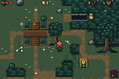

[After action](healthy-canopy-after.png) · [Native chronological filmstrip](healthy-canopy-filmstrip.png) · [Full-rate MP4](healthy-canopy.mp4) · [Exact-palette GIF](healthy-canopy.gif)

### Mixed forest

Seed 0xb4a7 · room 2 · stage 2

Generated landscape and live ambient glitter. Heart context retains the real boss; other enemies are cleared.

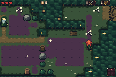

[After action](mixed-forest-after.png) · [Native chronological filmstrip](mixed-forest-filmstrip.png) · [Full-rate MP4](mixed-forest.mp4) · [Exact-palette GIF](mixed-forest.gif)

### Deep forest

Seed 0xb4a7 · room 20 · stage 3

Generated landscape and live ambient glitter. Heart context retains the real boss; other enemies are cleared.

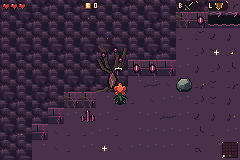

[After action](deep-blight-after.png) · [Native chronological filmstrip](deep-blight-filmstrip.png) · [Full-rate MP4](deep-blight.mp4) · [Exact-palette GIF](deep-blight.gif)

### Water and bridge

Seed 0xb4a7 · room 7 · stage 1

Generated landscape and live ambient glitter. Heart context retains the real boss; other enemies are cleared.

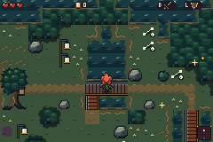

[After action](water-bridge-after.png) · [Native chronological filmstrip](water-bridge-filmstrip.png) · [Full-rate MP4](water-bridge.mp4) · [Exact-palette GIF](water-bridge.gif)

### Recessed pit and bank

Seed 0xb4a7 · room 17 · stage 1

Generated landscape and live ambient glitter. Heart context retains the real boss; other enemies are cleared.

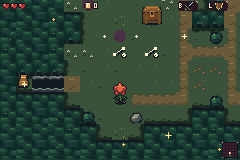

[After action](pit-bank-after.png) · [Native chronological filmstrip](pit-bank-filmstrip.png)

### Ledge and path

Seed 0xb4a7 · room 24 · stage 0

Generated landscape and live ambient glitter. Heart context retains the real boss; other enemies are cleared.

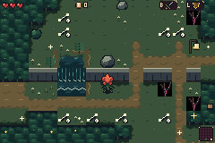

[After action](ledge-path-after.png) · [Native chronological filmstrip](ledge-path-filmstrip.png)

### Ground growths

Seed 0xb4a7 · room 19 · stage 1

Generated landscape and live ambient glitter. Heart context retains the real boss; other enemies are cleared.

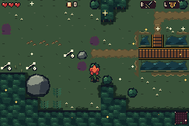

[After action](ground-growths-after.png) · [Native chronological filmstrip](ground-growths-filmstrip.png)

### Heart glade

Seed 0xb4a7 · room 20 · stage 3

Generated landscape and live ambient glitter. Heart context retains the real boss; other enemies are cleared.

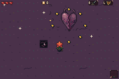

[After action](heart-glade-after.png) · [Native chronological filmstrip](heart-glade-filmstrip.png) · [Full-rate MP4](heart-glade.mp4) · [Exact-palette GIF](heart-glade.gif)

## All 25 generated room views

### Room 00 stage2

Seed 0xb4a7 · room 0 · stage 2

Actual generated room; same fixed standing point in all five alternatives.

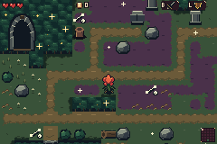

### Room 01 stage2

Seed 0xb4a7 · room 1 · stage 2

Actual generated room; same fixed standing point in all five alternatives.

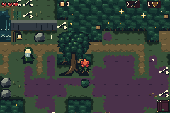

### Room 02 stage2

Seed 0xb4a7 · room 2 · stage 2

Actual generated room; same fixed standing point in all five alternatives.

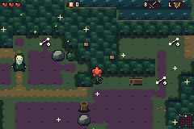

### Room 03 stage2

Seed 0xb4a7 · room 3 · stage 2

Actual generated room; same fixed standing point in all five alternatives.

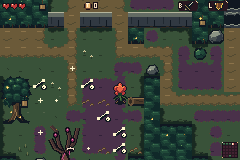

### Room 04 stage1

Seed 0xb4a7 · room 4 · stage 1

Actual generated room; same fixed standing point in all five alternatives.

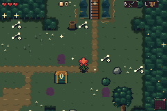

### Room 05 stage2

Seed 0xb4a7 · room 5 · stage 2

Actual generated room; same fixed standing point in all five alternatives.

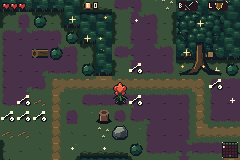

### Room 06 stage2

Seed 0xb4a7 · room 6 · stage 2

Actual generated room; same fixed standing point in all five alternatives.

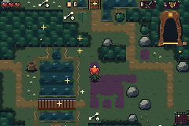

### Room 07 stage1

Seed 0xb4a7 · room 7 · stage 1

Actual generated room; same fixed standing point in all five alternatives.

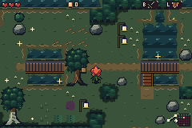

### Room 08 stage1

Seed 0xb4a7 · room 8 · stage 1

Actual generated room; same fixed standing point in all five alternatives.

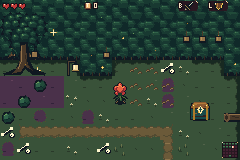

### Room 09 stage1

Seed 0xb4a7 · room 9 · stage 1

Actual generated room; same fixed standing point in all five alternatives.

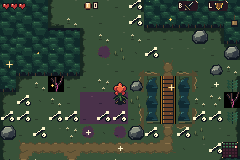

### Room 10 stage2

Seed 0xb4a7 · room 10 · stage 2

Actual generated room; same fixed standing point in all five alternatives.

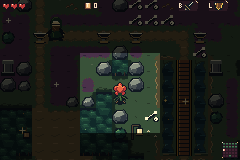

### Room 11 stage0

Seed 0xb4a7 · room 11 · stage 0

Actual generated room; same fixed standing point in all five alternatives.

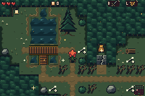

### Room 12 stage1

Seed 0xb4a7 · room 12 · stage 1

Actual generated room; same fixed standing point in all five alternatives.

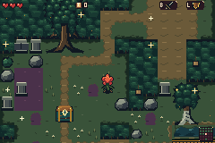

### Room 13 stage1

Seed 0xb4a7 · room 13 · stage 1

Actual generated room; same fixed standing point in all five alternatives.

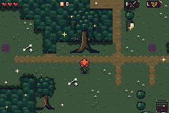

### Room 14 stage1

Seed 0xb4a7 · room 14 · stage 1

Actual generated room; same fixed standing point in all five alternatives.

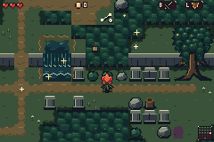

### Room 15 stage2

Seed 0xb4a7 · room 15 · stage 2

Actual generated room; same fixed standing point in all five alternatives.

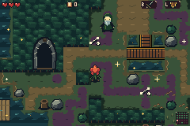

### Room 16 stage0

Seed 0xb4a7 · room 16 · stage 0

Actual generated room; same fixed standing point in all five alternatives.

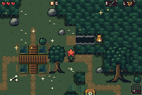

### Room 17 stage1

Seed 0xb4a7 · room 17 · stage 1

Actual generated room; same fixed standing point in all five alternatives.

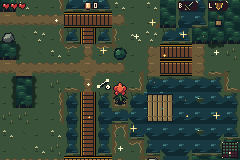

### Room 18 stage1

Seed 0xb4a7 · room 18 · stage 1

Actual generated room; same fixed standing point in all five alternatives.

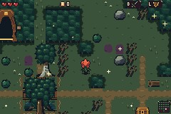

### Room 19 stage1

Seed 0xb4a7 · room 19 · stage 1

Actual generated room; same fixed standing point in all five alternatives.

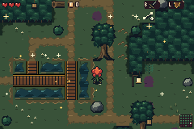

### Room 20 stage3

Seed 0xb4a7 · room 20 · stage 3

Actual generated room; same fixed standing point in all five alternatives.

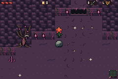

### Room 21 stage0

Seed 0xb4a7 · room 21 · stage 0

Actual generated room; same fixed standing point in all five alternatives.

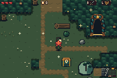

### Room 22 stage0

Seed 0xb4a7 · room 22 · stage 0

Actual generated room; same fixed standing point in all five alternatives.

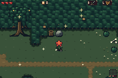

### Room 23 stage0

Seed 0xb4a7 · room 23 · stage 0

Actual generated room; same fixed standing point in all five alternatives.

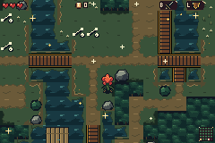

### Room 24 stage0

Seed 0xb4a7 · room 24 · stage 0

Actual generated room; same fixed standing point in all five alternatives.

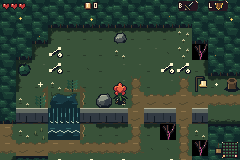

## Forest folk and dialogue

### Npc hermit

Seed 0xb4a7 · room 1 · stage 2

Actual generated NPC placement and ordinary talk input; sprite and portrait share the real room.

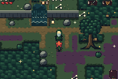

[After action](forest-npc-hermit-after.png) · [Native chronological filmstrip](forest-npc-hermit-filmstrip.png)

### Npc nun

Seed 0xb4a7 · room 5 · stage 2

Actual generated NPC placement and ordinary talk input; sprite and portrait share the real room.

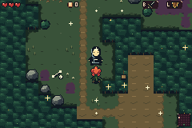

[After action](forest-npc-nun-after.png) · [Native chronological filmstrip](forest-npc-nun-filmstrip.png)

### Npc gardener

Seed 0xb4a7 · room 10 · stage 2

Actual generated NPC placement and ordinary talk input; sprite and portrait share the real room.

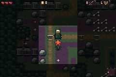

[After action](forest-npc-gardener-after.png) · [Native chronological filmstrip](forest-npc-gardener-filmstrip.png)

## Cave, hollow and thicket interiors

### Interior cave

Seed 0xb · room 17 · stage 0

Entered through the natural generated mouth. No mystery descriptor or terrain fixture.

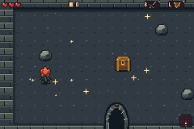

### Interior hollow

Seed 0x6 · room 3 · stage 2

Entered through the natural generated mouth. No mystery descriptor or terrain fixture.

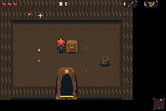

### Interior thicket

Seed 0x6 · room 17 · stage 0

Entered through the natural generated mouth. No mystery descriptor or terrain fixture.

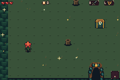

## Objects, entrances and item interactions

### Wood chest

Seed 0x6 · room 16 · stage 0

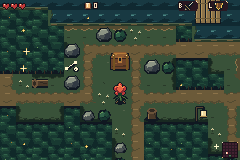

[After action](forest-wood-chest-after.png) · [Native chronological filmstrip](forest-wood-chest-filmstrip.png) · [Full-rate MP4](forest-wood-chest.mp4) · [Exact-palette GIF](forest-wood-chest.gif)

### Blight wood chest

Seed 0x9 · room 15 · stage 3

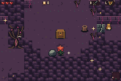

[After action](blight-wood-chest-after.png) · [Native chronological filmstrip](blight-wood-chest-filmstrip.png)

### Brass chest

Seed 0x7 · room 10 · stage 1

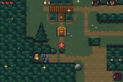

[After action](forest-brass-chest-after.png) · [Native chronological filmstrip](forest-brass-chest-filmstrip.png)

### Blight brass chest

Seed 0x7 · room 18 · stage 3

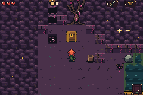

[After action](blight-brass-chest-after.png) · [Native chronological filmstrip](blight-brass-chest-filmstrip.png)

### Relic chest

Seed 0xb4a7 · room 21 · stage 0

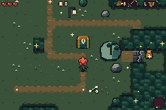

[After action](forest-relic-chest-after.png) · [Native chronological filmstrip](forest-relic-chest-filmstrip.png)

### Blight relic chest

Seed 0x6 · room 19 · stage 3

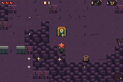

[After action](blight-relic-chest-after.png) · [Native chronological filmstrip](blight-relic-chest-filmstrip.png)

### Cave door

Seed 0xb4a7 · room 11 · stage 0

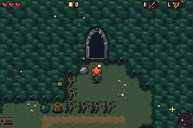

[After action](forest-cave-door-after.png) · [Native chronological filmstrip](forest-cave-door-filmstrip.png)

### Mixed cave door

Seed 0xb4a7 · room 0 · stage 2

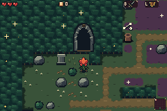

[After action](mixed-cave-door-after.png) · [Native chronological filmstrip](mixed-cave-door-filmstrip.png)

### Hollow door

Seed 0x6 · room 0 · stage 0

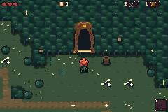

[After action](forest-hollow-door-after.png) · [Native chronological filmstrip](forest-hollow-door-filmstrip.png)

### Blight hollow door

Seed 0x6 · room 24 · stage 3

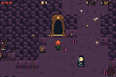

[After action](blight-hollow-door-after.png) · [Native chronological filmstrip](blight-hollow-door-filmstrip.png)

### Thicket door

Seed 0xb4a7 · room 7 · stage 1

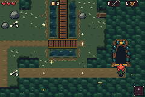

[After action](forest-thicket-door-after.png) · [Native chronological filmstrip](forest-thicket-door-filmstrip.png)

### Blight thicket door

Seed 0x7 · room 14 · stage 3

[After action](blight-thicket-door-after.png) · [Native chronological filmstrip](blight-thicket-door-filmstrip.png)

### Small hollow chest

Seed 0x6 · room 3 · stage 2

[After action](small-hollow-chest-after.png) · [Native chronological filmstrip](small-hollow-chest-filmstrip.png)

### Medium cave chest

Seed 0xb · room 17 · stage 0

[After action](medium-cave-chest-after.png) · [Native chronological filmstrip](medium-cave-chest-filmstrip.png)

### Large thicket chest

Seed 0x6 · room 17 · stage 0

[After action](large-thicket-chest-after.png) · [Native chronological filmstrip](large-thicket-chest-filmstrip.png)

### Cave floor switch

Seed 0xb4a7 · room 11 · stage 0

[After action](cave-floor-switch-after.png) · [Native chronological filmstrip](cave-floor-switch-filmstrip.png) · [Full-rate MP4](cave-floor-switch.mp4) · [Exact-palette GIF](cave-floor-switch.gif)

### Hollow floor switch

Seed 0x6 · room 0 · stage 0

[After action](hollow-floor-switch-after.png) · [Native chronological filmstrip](hollow-floor-switch-filmstrip.png)

### Thicket floor switch

Seed 0x6 · room 12 · stage 0

[After action](thicket-floor-switch-after.png) · [Native chronological filmstrip](thicket-floor-switch-filmstrip.png)

### Thicket censer

Seed 0xb4a7 · room 13 · stage 1

[After action](thicket-censer-after.png) · [Native chronological filmstrip](thicket-censer-filmstrip.png)

### Cave pot

Seed 0xb4a7 · room 12 · stage 1

[After action](cave-pot-after.png) · [Native chronological filmstrip](cave-pot-filmstrip.png)

### Cave spring

Seed 0xb4a7 · room 3 · stage 2

[After action](cave-spring-after.png) · [Native chronological filmstrip](cave-spring-filmstrip.png)

### Cave exit

Seed 0xb · room 17 · stage 0

[After action](cave-exit-after.png) · [Native chronological filmstrip](cave-exit-filmstrip.png)

### Hollow exit

Seed 0x6 · room 3 · stage 2

[After action](hollow-exit-after.png) · [Native chronological filmstrip](hollow-exit-filmstrip.png)

### Thicket exit

Seed 0x6 · room 17 · stage 0

[After action](thicket-exit-after.png) · [Native chronological filmstrip](thicket-exit-filmstrip.png)

### Bomb wall

Seed 0xdeadbeef · room 15 · stage 0

[After action](forest-bomb-wall-after.png) · [Native chronological filmstrip](forest-bomb-wall-filmstrip.png) · [Full-rate MP4](forest-bomb-wall.mp4) · [Exact-palette GIF](forest-bomb-wall.gif)

### Blight bomb wall

Seed 0x6 · room 4 · stage 3

[After action](blight-bomb-wall-after.png) · [Native chronological filmstrip](blight-bomb-wall-filmstrip.png)

### Cobweb

Seed 0x6 · room 0 · stage 0

[After action](forest-cobweb-after.png) · [Native chronological filmstrip](forest-cobweb-filmstrip.png) · [Full-rate MP4](forest-cobweb.mp4) · [Exact-palette GIF](forest-cobweb.gif)

### Blight cobweb

Seed 0x6 · room 24 · stage 3

[After action](blight-cobweb-after.png) · [Native chronological filmstrip](blight-cobweb-filmstrip.png)

### Cape hole

Seed 0xb4a7 · room 16 · stage 0

[After action](forest-cape-hole-after.png) · [Native chronological filmstrip](forest-cape-hole-filmstrip.png) · [Full-rate MP4](forest-cape-hole.mp4) · [Exact-palette GIF](forest-cape-hole.gif)

### Blight cape hole

Seed 0x6 · room 9 · stage 3

[After action](blight-cape-hole-after.png) · [Native chronological filmstrip](blight-cape-hole-filmstrip.png)

### Locked door

Seed 0xb4a7 · room 24 · stage 0

[After action](forest-locked-door-after.png) · [Native chronological filmstrip](forest-locked-door-filmstrip.png)

### Blight locked door

Seed 0x7 · room 14 · stage 3

[After action](blight-locked-door-after.png) · [Native chronological filmstrip](blight-locked-door-filmstrip.png)

### Shrine

Seed 0xdeadbeef · room 5 · stage 0

[After action](forest-shrine-after.png) · [Native chronological filmstrip](forest-shrine-filmstrip.png)

### Relic pedestal

Seed 0xb4a7 · room 23 · stage 0

[After action](forest-relic-pedestal-after.png) · [Native chronological filmstrip](forest-relic-pedestal-filmstrip.png)

### Bush

Seed 0xb4a7 · room 16 · stage 0

[After action](forest-bush-after.png) · [Native chronological filmstrip](forest-bush-filmstrip.png)

### Rock small

Seed 0xb4a7 · room 16 · stage 0

[After action](forest-rock_small-after.png) · [Native chronological filmstrip](forest-rock_small-filmstrip.png)

### Thorn

Seed 0xb4a7 · room 11 · stage 0

[After action](forest-thorn-after.png) · [Native chronological filmstrip](forest-thorn-filmstrip.png)

### Thicket boulder

Seed 0x7 · room 17 · stage 0

[After action](thicket-boulder-after.png) · [Native chronological filmstrip](thicket-boulder-filmstrip.png)

## Inter-room barriers: actual actions

### Thorns

Seed 0xb4a7 · room 0 · stage 2

Actual generated inter-room gate; inventory/key fixtures permit the real sword/item/unlock action.

[After action](outer-gate-thorns-after.png) · [Native chronological filmstrip](outer-gate-thorns-filmstrip.png)

### Cracked wall

Seed 0xb4a7 · room 18 · stage 1

Actual generated inter-room gate; inventory/key fixtures permit the real sword/item/unlock action.

[After action](outer-gate-cracked-wall-after.png) · [Native chronological filmstrip](outer-gate-cracked-wall-filmstrip.png)

### Cobweb

Seed 0xb4a7 · room 3 · stage 2

Actual generated inter-room gate; inventory/key fixtures permit the real sword/item/unlock action.

[After action](outer-gate-cobweb-after.png) · [Native chronological filmstrip](outer-gate-cobweb-filmstrip.png)

### Locked door

Seed 0xb4a7 · room 8 · stage 1

Actual generated inter-room gate; inventory/key fixtures permit the real sword/item/unlock action.

[After action](outer-gate-locked-door-after.png) · [Native chronological filmstrip](outer-gate-locked-door-filmstrip.png)

### Chasm

Seed 0xb4a7 · room 15 · stage 2

Actual generated inter-room gate; inventory/key fixtures permit the real sword/item/unlock action.

[After action](outer-gate-chasm-after.png) · [Native chronological filmstrip](outer-gate-chasm-filmstrip.png)

## Unchanged Drain control

### Drain control

Seed 0xb4a7 · room None

