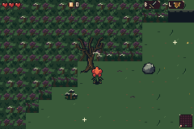
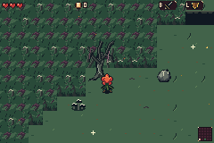
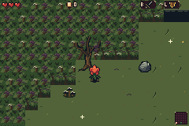
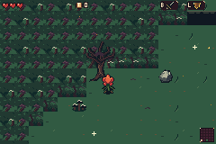
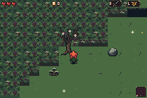

# Historical first-pass deep forest

[Back to the second pass](../../README.md)

These unchanged first-pass captures retain their original names and source73df5c1. The new studies change generation and choose different deep views. The comparison is illustrative; aligned option numbers do not establish family identity or pixel correspondence.

[Original snapshot provenance](provenance.json)
