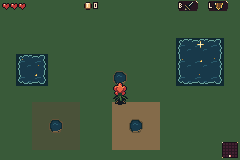
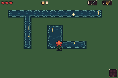
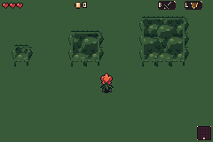
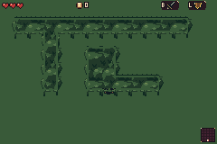
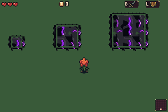
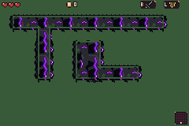

# 1. Black Sap Oak: explicit diagnostic rooms

[Back to natural contexts](../README.md)

Every scene below deliberately injects a small semantic terrain fixture. The frozen game then builds actual adjacency pictures and collision in mGBA. These six contexts are counted separately from generated rooms.

### Diagnostic water isolated sizes

Seed 0xb4a7 · room 22 · stage 0

Explicit diagnostic room fixture, not a naturally generated room. Same frozen ROM art, adjacency renderer and collision builder.

[After action](../diagnostic-water-isolated-sizes-after.png) · [Native chronological filmstrip](../diagnostic-water-isolated-sizes-filmstrip.png)

### Diagnostic water narrow inner corners

Seed 0xb4a7 · room 22 · stage 0

Explicit diagnostic room fixture, not a naturally generated room. Same frozen ROM art, adjacency renderer and collision builder.

[After action](../diagnostic-water-narrow-inner-corners-after.png) · [Native chronological filmstrip](../diagnostic-water-narrow-inner-corners-filmstrip.png)

### Diagnostic living canopy isolated sizes

Seed 0xb4a7 · room 22 · stage 0

Explicit diagnostic room fixture, not a naturally generated room. Same frozen ROM art, adjacency renderer and collision builder.

[After action](../diagnostic-living-canopy-isolated-sizes-after.png) · [Native chronological filmstrip](../diagnostic-living-canopy-isolated-sizes-filmstrip.png)

### Diagnostic living canopy narrow inner corners

Seed 0xb4a7 · room 22 · stage 0

Explicit diagnostic room fixture, not a naturally generated room. Same frozen ROM art, adjacency renderer and collision builder.

[After action](../diagnostic-living-canopy-narrow-inner-corners-after.png) · [Native chronological filmstrip](../diagnostic-living-canopy-narrow-inner-corners-filmstrip.png)

### Diagnostic sick canopy isolated sizes

Seed 0xb4a7 · room 22 · stage 0

Explicit diagnostic room fixture, not a naturally generated room. Same frozen ROM art, adjacency renderer and collision builder.

[After action](../diagnostic-sick-canopy-isolated-sizes-after.png) · [Native chronological filmstrip](../diagnostic-sick-canopy-isolated-sizes-filmstrip.png)

### Diagnostic sick canopy narrow inner corners

Seed 0xb4a7 · room 22 · stage 0

Explicit diagnostic room fixture, not a naturally generated room. Same frozen ROM art, adjacency renderer and collision builder.

[After action](../diagnostic-sick-canopy-narrow-inner-corners-after.png) · [Native chronological filmstrip](../diagnostic-sick-canopy-narrow-inner-corners-filmstrip.png)
