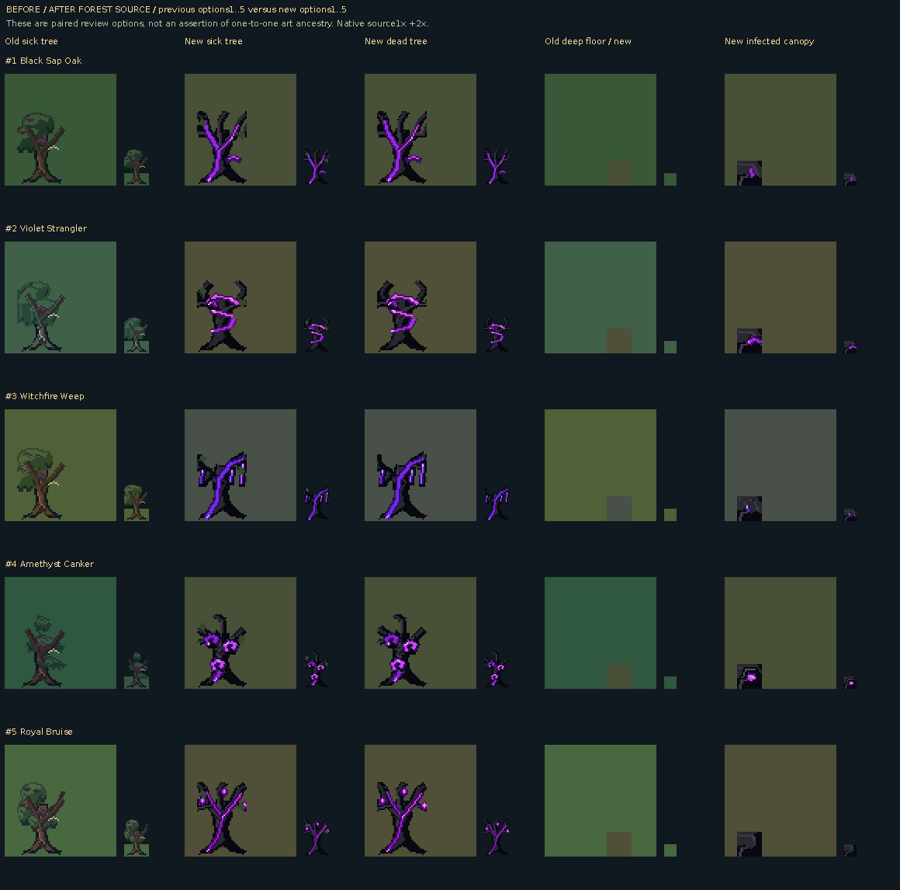

# Five infected-forest directions: complete native source review

**SOURCE catalogs, palette-phase previews and layer diagrams; these are not mGBA captures.**

[Ten wooden chest forms and states](ten-wooden-chests-source.png) · [Five-way interactions and height](five-way-interactions-height-source.png) · [Fifteen new folk with matching portraits](fifteen-forest-folk-source.png) · [Every required native frame](complete-native-source.png) · [Matrix provenance](complete-native-source.json)

[Isolated water over three literal source floors](isolated-water-three-floors-source.png). The known-field test exposes corner opacity; it is not a renderer capture.

| New local option | Runtime selector | Complete source catalog |
| --- | --- | --- |
| 1. Black Sap Oak | `BART_FOREST=6` | [All frames,47-case diagrams and true bank-phase preview](variant-01/README.md) |
| 2. Violet Strangler | `BART_FOREST=7` | [All frames,47-case diagrams and true bank-phase preview](variant-02/README.md) |
| 3. Witchfire Weep | `BART_FOREST=8` | [All frames,47-case diagrams and true bank-phase preview](variant-03/README.md) |
| 4. Amethyst Canker | `BART_FOREST=9` | [All frames,47-case diagrams and true bank-phase preview](variant-04/README.md) |
| 5. Royal Bruise | `BART_FOREST=10` | [All frames,47-case diagrams and true bank-phase preview](variant-05/README.md) |

The old0–5 studies remain separate. Source comparison pairs previous optionN and new optionN for review; their names are not a claim of direct asset ancestry. Original forest/mystery IDs, all appended topology aliases and all environment/landmark frames are present. Logical ground collision is documented separately from foreground transparency and render-only pictures. The assembled key gate combines two BG bar cells with one large lock OBJ. Root arches show only a walkable lower route; no accessible upper deck is promised.

Total source coverage: 5320 frame instances. Authored four-state BG palette pulse previews use fixed 180ms inspection holds. They do not claim engine cadence, screenshot grading or OBJ recoloring. [Source inputs and exact output hashes](source-manifest.json).
