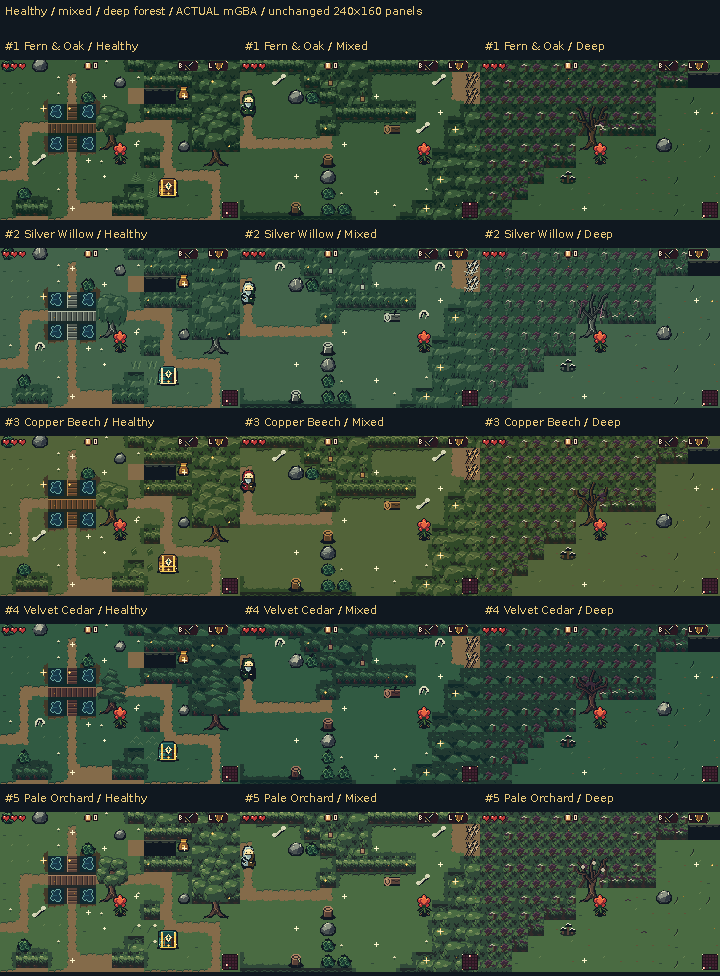

# Five forest art directions

Five complete, playable environment alternatives keep **green grass, warm dirt
and a recognizable forest at every blight depth**. Corruption changes crowns,
branches, vines, flowers and attached parasites. Quiet ground leaves the
player, enemies, loot and temporary barriers room to read.

[Download all five ROMs](https://raw.githubusercontent.com/natertott/bartgame/forest-concepts/downloads/forest-concepts-73df5c1/forest-concepts-73df5c1.zip) ·
[Individual ROMs and checksums](../../downloads/forest-concepts-73df5c1/README.md) ·
[All actual mGBA views](actual/README.md) · [Complete native asset catalogs](source/README.md)

These are **unselected alternatives**. Normal builds retain the current forest
and the selected enemies/Heart. Study ROMs include the full game with the same
maze generator and controls; select an art direction with `BART_FOREST=1..5`.

## Compare the actual game

Each row below uses the same three generated views and camera/player fixtures
as every other row. Every game panel is an unchanged native **240×160 mGBA
framebuffer**; only the captions are added outside it. The deep column shows
the Heart room's forested border; its boss view and additional deep rooms are
included in each option's full gallery.

| Option | Construction | Actual views and clips | Every native asset |
| --- | --- | --- | --- |
| **1. Fern & Oak** | Rounded connected crowns, fern blades, bent oak roots and warm wood. | [mGBA](actual/variant-01/README.md) | [Catalog](source/variant-01/README.md) |
| **2. Silver Willow** | Umbrella crowns, uneven hanging leaves, silver bark and pale lichen. | [mGBA](actual/variant-02/README.md) | [Catalog](source/variant-02/README.md) |
| **3. Copper Beech** | Broad leaf fans, warm copper bark and attached wine-colored remnants. | [mGBA](actual/variant-03/README.md) | [Catalog](source/variant-03/README.md) |
| **4. Velvet Cedar** | Tiered conifer boughs, deeper cool shade and sagging dark growth. | [mGBA](actual/variant-04/README.md) | [Catalog](source/variant-04/README.md) |
| **5. Pale Orchard** | Lobed knotted crowns, exposed forks and pale parasitic shelves/pods. | [mGBA](actual/variant-05/README.md) | [Catalog](source/variant-05/README.md) |

Each set uses two related crown arrangements and one skeletal construction,
reused coherently across the retained tree identifiers. The three depths keep
related terrain instead of introducing a separate visual language. Existing
surface glitter is preserved, including its exact white highlight colors.

### Water, depth and interiors

- [Water, bridge, pit and ledge comparison](water-bridges-and-depth-actual.png).
- [Cave, hollow and thicket interiors](interiors-actual.png).
- [Forest folk and dialogue contexts](forest-folk-actual.png).

Water has clear teal planes, short moving ripple groups and continuous banks.
Bridges retain an open travel axis, holes have dark recessed cavities, and
ledges have short directional faces. Entrances are taller than Bloom, with
large dark apertures, visible sills and material-specific frames.

### Interactions and temporary barriers

- Inter-room gates [before](gates-before-actual.png) and [after item use](gates-after-actual.png).
- Ground interactions [before](interactions-before-actual.png) and [after use](interactions-after-actual.png).

Whole lift stones have unbroken facets; bomb barriers have broad pale branching
fractures. Pale anchored silk differs from living foliage. Key gates have
visible bars/locks; plates fill a tile and depress/light when pressed. Chests
have lids, latches, contact shadows and wood, brass or relic construction.
Ground, carried and thrown versions of portable objects share exact art and
material colors. Unlit/lit, closed/open and available/spent states are included.

The existing two-tile outer key gate repeats its logical lock tile; it still
opens with the existing single-key rule. Room layout and barrier footprints
have not been changed for these art studies.

The [selected Coin Toad context comparison](actual/pursuer-context/README.md)
adds five natural AI encounters, with exact native frames and motion clips.
Its green body is quieter than Bloom, while the dark outline, pale eyes and
leg movement remain readable on each ground palette. The main environment
suite clears unrelated enemies; these additional views test that specific
actor/background relationship.

## Compare every asset family

All five columns keep the same option numbers as the room views.

| Family | Five-way source comparison |
| --- | --- |
| Grass, dirt, details and transition masks | [Sheet](source/comparisons/floors-and-transitions-source.png) |
| Water, banks, bridges, pits and ledges | [Sheet](source/comparisons/water-crossings-and-depth-source.png) |
| Canopy, trees and corrupted structures | [Sheet](source/comparisons/canopy-and-forest-structure-source.png) |
| Complete multi-tile trees and groups | [Sheet](source/comparisons/assembled-trees-and-groups-source.png) |
| Bushes, rocks, gates, webs, plates, censers and objects | [Sheet](source/comparisons/interactions-and-ground-objects-source.png) |
| Mystery-room materials | [Sheet](source/comparisons/interior-materials-source.png) |
| Chests, entrances, portable objects and forest folk | [Sheet 1](source/comparisons/environment-sprites-01-source.png) · [Sheet 2](source/comparisons/environment-sprites-02-source.png) |

The complete catalogs contain **2,760 native frame instances**, 552 per option:
528 BG phases across 463 retained metatile IDs, plus 24 environment sprite/
portrait frames. They include every transition, state and animated source
phase, protected sparkle context and explicitly retired unused root-extension
floor cells. Coverage is recorded honestly rather than claiming every catalog
entry has different pixels. Each option has eighteen complete atlases, native
indexed/RGBA PNGs, value/silhouette diagnostics and exact source cycles.

**Source sheets and material test patches are not emulator screenshots.** Their
180ms inspection holds show authored phases or state pairs, rather than game
attack timing or invented destruction animations. Actual game clips are linked
separately above.

## Research, critique and verification

[Fresh primary-game research](../../bartgame/docs/art-reboot/references/FOREST_READABILITY_RESEARCH.md)
examines native Emerald terrain, cut trees and rock silhouettes, and Minish Cap
bush/pot behavior. Quiet material fields, connected forest boundaries, coherent
prop states and distinct tool targets guide the original drawings. The six
previously read tutorial PDFs/G01–G18 remain the shared foundation. Reference
graphics are not imported into the game or redistributed in this gallery.

My preferred starting points for review are Oak for a balanced broadleaf
forest, Willow for a strong hanging silhouette and Cedar for deeper atmosphere.
Beech is warmer; Orchard emphasizes pale disease. Remaining tradeoffs are
visible: repeated canopy bands can expose the grid, wood/brass tiers are
closer than the relic tier at 1×, and an unlit censer can initially resemble a
low bowl. The quiet floor can look spare in open rooms; this comparison keeps
the current generation and room geometry. These are review choices rather
than a claim that one whole direction is final.

- **498 main actual mGBA cases, 3,307/3,307 runtime checks pass**: 83 views/
  interactions per profile, including all 25 room viewports, three natural
  interior styles, NPC dialogue, gates, chests, plates, lift/throw, shrines,
  bomb/web/cape pockets and a Drain control. There are sixty full-rate clips
  across five studies plus the control.
- **Five additional Coin Toad cases pass 30/30 checks** and preserve its
  existing AI trajectory. Combined publication: **503 actual cases and
  3,337 runtime checks**, with 65 full-rate clips.
- **75,315/75,315 independent source/ROM/runtime checks pass**. IDs, collision,
  flags, clocks, physical layout, RNG, progress, ordered mechanic states and
  sampled initial/final positions match the production control.
- **19,750/19,750 source-gallery checks pass**, including native PNG roundtrips,
  every declared frame, literal atlas panels, source GIF colors and hashes.
- Forest BG usage is **590–609/1,024 tiles and 10/12 banks**; mystery interiors
  use 109 tiles/6 banks. Drain architecture is exact at 822 tiles/1 bank.

The smaller BG payloads can finish a transition one video update earlier.
The chasm comparison releases movement before play resumes, using the same
ordinary input in all six builds; original transition ticks remain in the
reports. This preserves a meaningful endpoint comparison without changing the
engine or pretending loading time is identical.

Seeds, player/camera positioning, equipment, health and unrelated-enemy clearing
are disclosed review fixtures. Generated terrain, mystery descriptors and
interactive states are not painted or injected for the screenshots. Native
PNGs are exact; MP4s are lossy viewing copies; GIFs are included only when they
retain exact colors. Raw full-frame recording archives remain local.

Game/art source: [`73df5c1`](https://github.com/natertott/bartgame/commit/73df5c1296f84ac469102c92f106dc9ad17b9a27).
Production profile0 still produces the previous ROM byte for byte, SHA256
`9330a44a4e27d99606a757134aa41a62adb122a74315c400e1ad3427048c8661`.
Every `src/*` file and all sixteen OBJ palette banks are unchanged. Bloom,
the selected enemies and Heart, equipment/pickups, menu/HUD/font/title,
Drain architecture/keepers and existing glitter retain their art. Shared
portable objects, chests and entrances use each study's new drawings across
areas; forest speakers also have matching new portraits.

[Publication evidence](validation/publication-summary.json) ·
[Independent audit](validation/audit/finalaudit-summary.json) ·
[Source critique](validation/source-gallery-review.md) ·
[Pixel provenance](actual-panel-manifest.json) ·
[File hashes](validation/publication-manifest.json) ·
[Living art bible](../../bartgame/docs/art-reboot/ART_BIBLE.md) ·
[Direction log](../../bartgame/docs/art-reboot/ART_DIRECTION_LOG.md)
