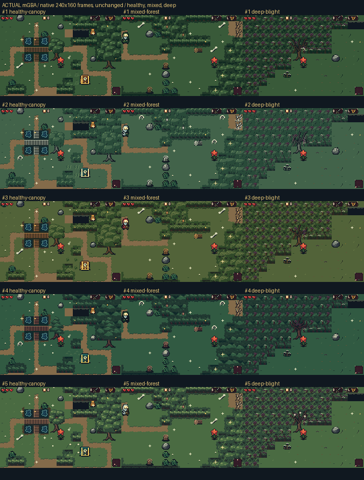
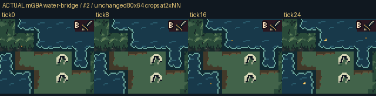
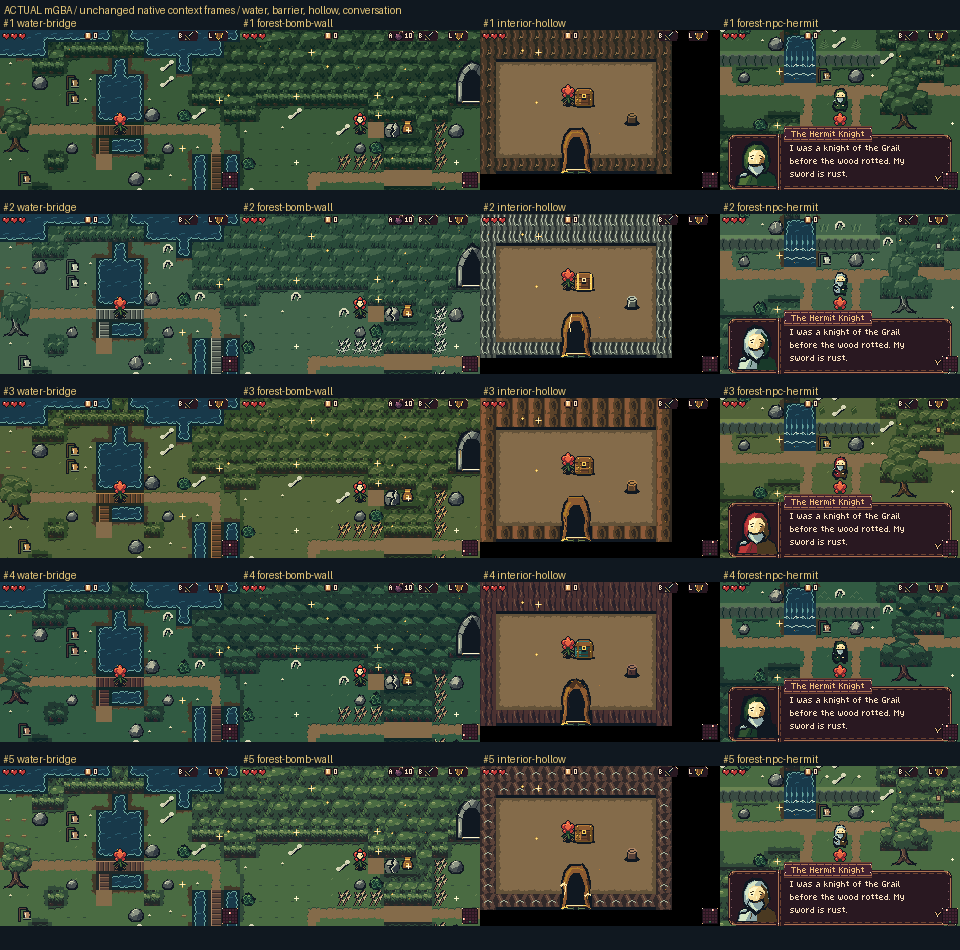

# Independent actual mGBA probes

[Back to the forest review](../../README.md)

These independent audit boards retain exact captured pixels. Stage and context panels are native framebuffers; water panels are chronological 80×64 crops enlarged only at 2× nearest-neighbour. Their unchanged provenance records retain local archival source filenames and hashes.

[Unchanged provenance record](actual-stages-native.json)

[Unchanged provenance record](actual-water-phases.json)

[Unchanged provenance record](actual-context-review.json)
