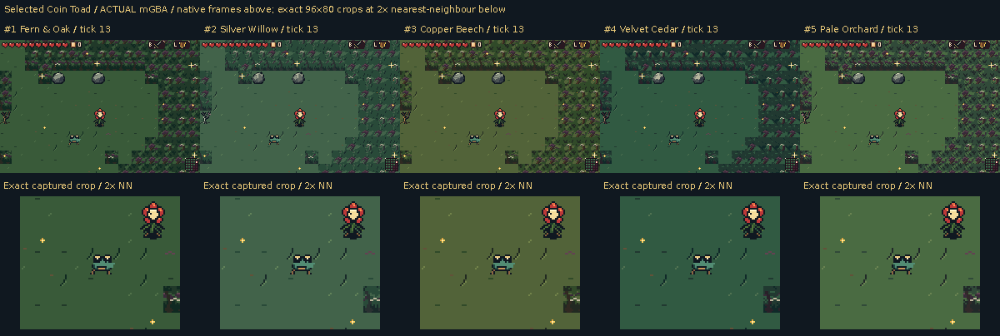

# Selected Coin Toad: five actual forest contexts

[Back to the forest review](../../README.md)

These five focused recordings show the unchanged selected Coin Toad on clear natural deep-forest ground. The same generated spawn, disclosed player position/health and 96 real AI updates are used in every forest treatment. This targeted contrast check is additional to the main room/interaction suite.

- [1. Fern & Oak](variant1/README.md)
- [2. Silver Willow](variant2/README.md)
- [3. Copper Beech](variant3/README.md)
- [4. Velvet Cedar](variant4/README.md)
- [5. Pale Orchard](variant5/README.md)

[Exact panel provenance](panel-manifest.json) · [Independent forest binding and trajectory comparison](../../validation/audit/pursuer-context-summary.json)
