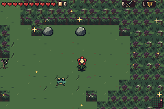

# 5. Pale Orchard: Coin Toad contrast

[Back to the five contexts](../README.md)

Supplementary natural pursuer on an independently selected unobstructed natural floor lane. No enemy position/state/timer/frame or terrain writes. Main bridge-depth recordings remain untouched.

[Native filmstrip](pursuer-clearing-filmstrip.png) · [Full-rate MP4](pursuer-clearing.mp4) · [Exact-palette GIF](pursuer-clearing.gif)

[Capture, natural spawn and player fixtures](capture.json)
