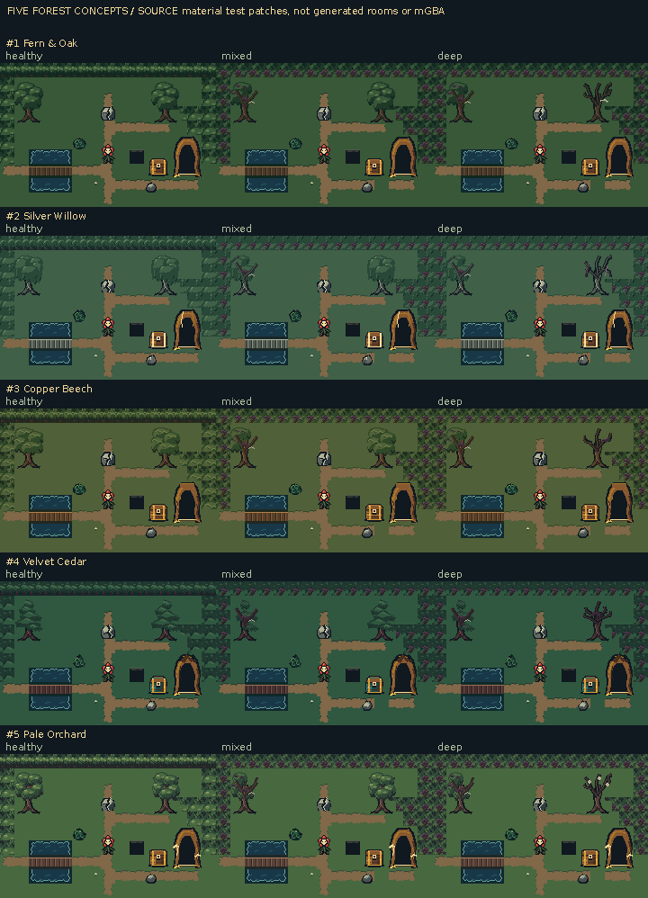

# Five forest directions: complete native source catalogs

**SOURCE assets and inspection assemblies, not actual emulator screenshots.**

All concepts retain quiet green grass and brown earth. Blight changes tree structure, canopy masses, parasites and local wet details while the same path/water/pit/gate meanings remain readable. The common 15×10 source test layout compares material hierarchy; actual generated room footage is separate.

[Every required frame at native 1×, all five columns](complete-native-source.png) · [Native matrix provenance](complete-native-source.json)

| Concept | Complete native catalog |
| --- | --- |
| 1. Fern & Oak | [All frames and family atlases](variant-01/README.md) |
| 2. Silver Willow | [All frames and family atlases](variant-02/README.md) |
| 3. Copper Beech | [All frames and family atlases](variant-03/README.md) |
| 4. Velvet Cedar | [All frames and family atlases](variant-04/README.md) |
| 5. Pale Orchard | [All frames and family atlases](variant-05/README.md) |

## Side-by-side family sheets

- [floors-and-transitions](comparisons/floors-and-transitions-source.png)
- [water-crossings-and-depth](comparisons/water-crossings-and-depth-source.png)
- [canopy-and-forest-structure](comparisons/canopy-and-forest-structure-source.png)
- [interactions-and-ground-objects](comparisons/interactions-and-ground-objects-source.png)
- [interior-materials](comparisons/interior-materials-source.png)
- [assembled trees and groups](comparisons/assembled-trees-and-groups-source.png)
- [environment sprites](comparisons/environment-sprites-01-source.png)
- [environment sprites](comparisons/environment-sprites-02-source.png)

Total coverage: **2760 native frame instances** across 5 profiles. This includes every inventory-required BG transition/frame and environment sprite/portrait, including unchanged context where explicitly requested. Native PNG roundtrips are checked exactly. Source cycles use fixed 180ms review holds, not gameplay timing. Baseline comparisons identify unchanged and redrawn frames rather than claiming all catalog entries changed.

[Coverage, source hashes and output hashes](source-manifest.json).
