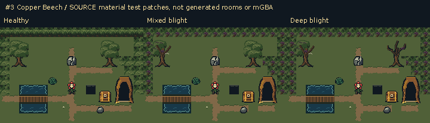

# 3. Copper Beech: native source catalog

**SOURCE artwork and assembly tests; these are not emulator captures.**

The 240×160 material patches use one disclosed source-only 15×10 layout to compare floor, forest mass, water crossing and interaction hierarchy. They do not reproduce a generated room. Actual room views and gameplay timing are published separately.

[Assembled complete groups](assembled-groups-source.png) · [Value and contour diagnostics](value-contour-diagnostics-source.png) · [Native coverage and hashes](source-manifest.json)

Tree groups include both raised transparent canopy cells and opaque grass-bearing ground cells. Their rectangular floor substrates are shown literally on the raw group sheet; the source material patches and separate actual-room views show how they meet surrounding ground.

Complete inventory: 463 BG metatiles / 528 BG frame instances, plus 24 environment sprite/portrait frames. Every frame has exact native indexed and RGBA PNGs. Family atlases show all phases at 1× and integer 3×.

Legacy tree IDs share a deliberately limited crown/skeleton vocabulary. The unplaced `btree_6`–`btree_11` extensions are intentionally retired to quiet grass. Retained Sister Mary Grace and Brother Mark bodies alias the Nun and Hermit; catalog coverage does not invent extra spawned people. Some allocated soil/root/pit phases have identical static paintings, keeping walkable ground quiet.

| Category | Complete source atlas |
| --- | --- |
| floor and overlay details | [PNG](atlases/floor_and_overlay_details-source.png) |
| ground and growing details | [PNG](atlases/ground_and_growing_details-source.png) |
| hazardous pool | [PNG](atlases/hazardous_pool-source.png) |
| interactive scenery | [PNG](atlases/interactive_scenery-source.png) |
| interior cave | [PNG](atlases/interior_cave-source.png) |
| interior hollow | [PNG](atlases/interior_hollow-source.png) |
| interior shared | [PNG](atlases/interior_shared-source.png) |
| interior thicket | [PNG](atlases/interior_thicket-source.png) |
| obj-face | [PNG](atlases/obj-face-source.png) |
| obj-interactivechest | [PNG](atlases/obj-interactivechest-source.png) |
| obj-interactiveentry | [PNG](atlases/obj-interactiveentry-source.png) |
| obj-lift | [PNG](atlases/obj-lift-source.png) |
| obj-npc | [PNG](atlases/obj-npc-source.png) |
| solid scenery | [PNG](atlases/solid_scenery-source.png) |
| terrain transitions | [PNG](atlases/terrain_transitions-01-source.png) |
| terrain transitions | [PNG](atlases/terrain_transitions-02-source.png) |
| trees and canopy | [PNG](atlases/trees_and_canopy-source.png) |
| water crossings and elevation | [PNG](atlases/water_crossings_and_elevation-source.png) |

Animated material boards use a fixed 180ms inspection hold per phase, not engine cadence. Source animation frames and all gate/plate/chest states remain in the native catalog. No blended transition between separate interaction states is invented.

[Exact-palette material cycle](animated-materials-source.gif).

[Exact-palette material cycle](animated-blight-details-source.gif).

[Exact-palette interaction state catalog](interaction-states-source.gif).
