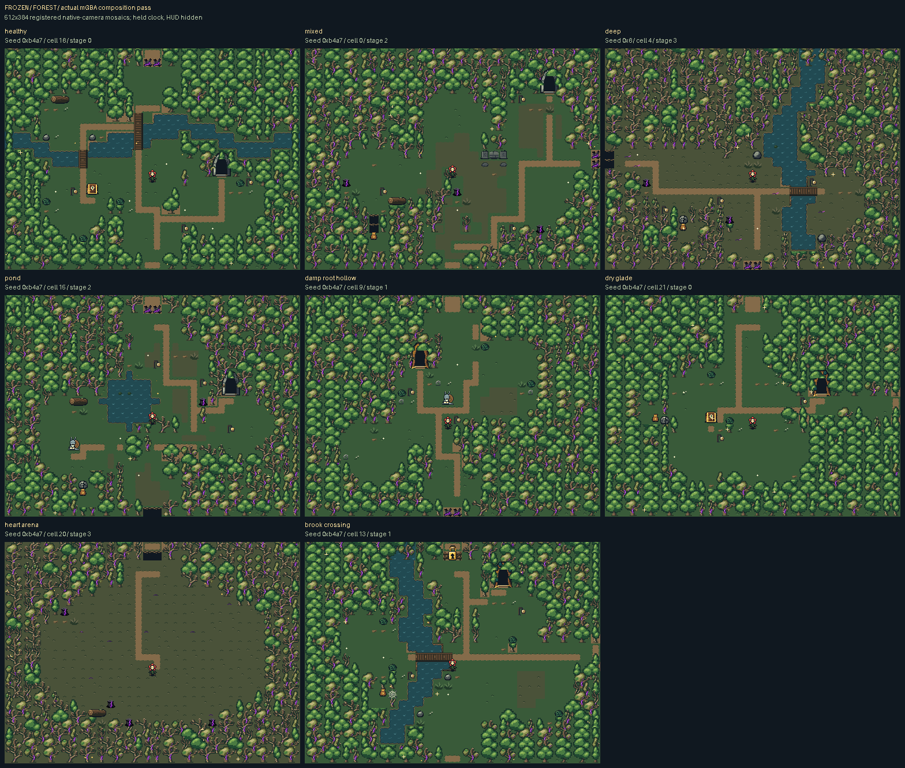
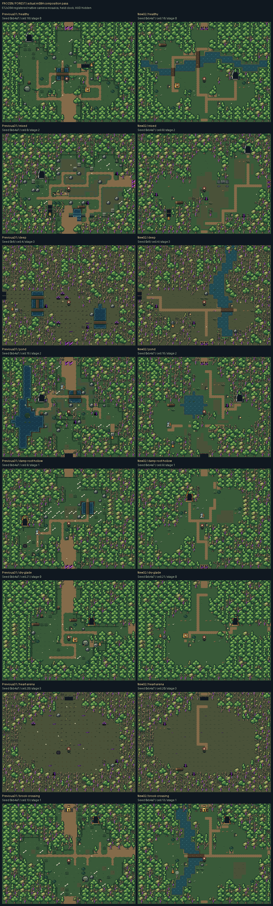
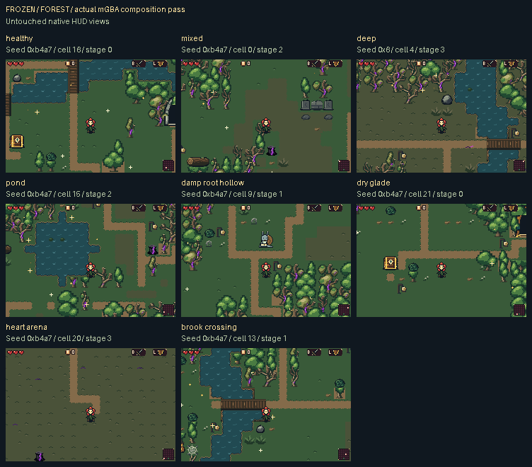

# Forest room composition and art refinement

The forest is composed around natural room features, then dressed with contextual details. The approved tree silhouettes retain their native source pixels.

Each 512×384 room is a registered mosaic of nine untouched 240×160 mGBA camera views. The review camera holds time and hides the HUD; no terrain or screenshot pixels are injected.

The comparison uses the same seeded cells in the previous profile 31 and refined profile 32 ROMs. Room geometry intentionally changes; both sides are real native-camera captures.

[Inspect native material and object source art](source/README.md) · [Source/palette manifest](source/source-manifest.json)

Source-only contact studies are separate from emulator captures. They show native 16px drawings on source grass, soil and sick grass, including material transitions, vegetation, water, crossings, debris, stonework and interactions.

| Room | Native room mosaic | 2× inspection | Motion |
| --- | --- | --- | --- |
| healthy / 0xb4a7 / cell16 | [PNG](actual/after/healthy/full-room.png) | [PNG](inspection/healthy-2x.png) | [Walk MP4](actual/after/healthy/walk.mp4) · [Water MP4](actual/after/healthy/water-motion.mp4) |
| mixed / 0xb4a7 / cell0 | [PNG](actual/after/mixed/full-room.png) | [PNG](inspection/mixed-2x.png) | [Walk MP4](actual/after/mixed/walk.mp4) |
| deep / 0x6 / cell4 | [PNG](actual/after/deep/full-room.png) | [PNG](inspection/deep-2x.png) | [Walk MP4](actual/after/deep/walk.mp4) · [Water MP4](actual/after/deep/water-motion.mp4) |
| pond / 0xb4a7 / cell15 | [PNG](actual/after/pond/full-room.png) | [PNG](inspection/pond-2x.png) | [Water MP4](actual/after/pond/water-motion.mp4) |
| damp-root-hollow / 0xb4a7 / cell9 | [PNG](actual/after/damp-root-hollow/full-room.png) | [PNG](inspection/damp-root-hollow-2x.png) | — |
| dry-glade / 0xb4a7 / cell21 | [PNG](actual/after/dry-glade/full-room.png) | [PNG](inspection/dry-glade-2x.png) | — |
| heart-arena / 0xb4a7 / cell20 | [PNG](actual/after/heart-arena/full-room.png) | [PNG](inspection/heart-arena-2x.png) | — |
| brook-crossing / 0xb4a7 / cell13 | [PNG](actual/after/brook-crossing/full-room.png) | [PNG](inspection/brook-crossing-2x.png) | [Water MP4](actual/after/brook-crossing/water-motion.mp4) |

[Playable ROM](../../downloads/forest-room-cohesion-4024902/forest-room-cohesion-4024902.gba) · [ZIP](../../downloads/forest-room-cohesion-4024902/forest-room-cohesion-4024902.zip) · [Checksums](../../downloads/forest-room-cohesion-4024902/SHA256SUMS.txt)

Native HUD and arrival images remain untouched framebuffers. The review seeds the real game and uses native selected-cell transitions. Viewing fixtures isolate enemies/projectiles/effects, restore health and establish an initial safe standing point/facing. The natural-arrival image precedes that viewing setup. These are inspection fixtures, not an unassisted playthrough. During recorded movement, the harness sends ordinary directional buttons chosen from the actual traversable grid; it records each requested/actual key and does not teleport Bloom. Water clips use normal game simulation after the same setup, with no held camera or animation clock.

Ambient glitter can differ in overlapping viewports because of native culling; literal crop seams remain unpainted. MP4s preserve every recorded native video frame at approximately 59.73 Hz. GIFs, when present, are sampled exact-color inspection copies.

Capture checks: 338/338. Literal missed-update intervals are reported per room, with no frame-perfect claim.

[Capture report](actual/after/capture.json) · [Literal panel proof](actual-panel-manifest.json) · [Publication summary](actual-publication-summary.json)

The Heart-arena overview uses the same disclosed enemy/boss isolation as other
inspection mosaics. Its untouched native-arrival view retains the original
boss roster; the quiet overview is not a claim that the playable arena is empty.

[Validation and remaining visual limits](validation/README.md) records the
1,223 host/source checks,567 independent capture checks,80 actual mGBA runtime
checks and3,200 generated rooms. All 33 profiles build; historical0–31 retain
their exact ROM bytes. Ordinary `make` produces this selected profile32 ROM.
