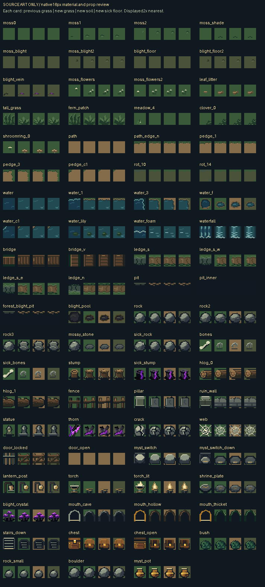
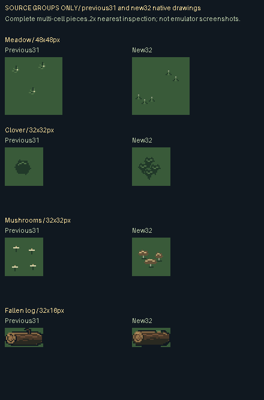

# Native forest material source review

These are native16×16 source drawings, displayed at integer2× for inspection. Each card compares previous art on its original grass with the new drawing on new grass, soil and sick grass. The backgrounds are native source swatches, not captured room screens. Exterior index0 exposes the local source floor.

The second board assembles complete meadow, clover, fungi and log source pieces at their authored native dimensions. It is a source join/scale inspection, not a generated room or GBA framebuffer.

The board shows phase0 of animated families. Current chests, entries, carry objects, Bloom and the approved tree kit may remain exact where already clear; the manifest records each representative asset and whether its effective source pixels changed.

[Indexed native PNGs and palette contract](source-manifest.json) · [Actual mGBA rooms](../README.md)
