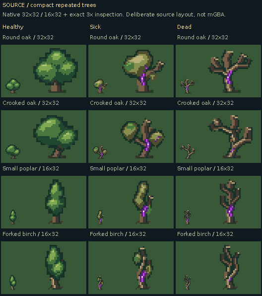
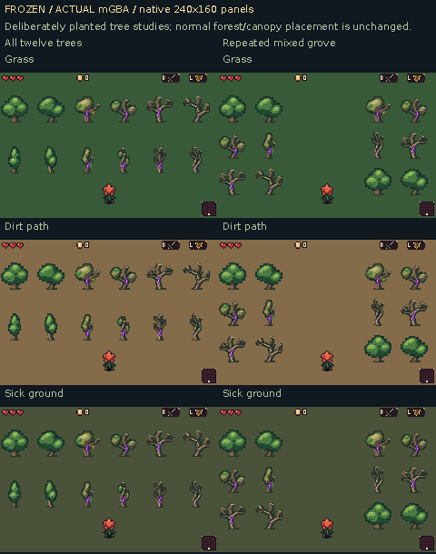

# Compact repeated forest trees

A tree-only pass using the uploaded fourteen-page **GBA Sprite Art Guide**. The requested sizes are interpreted as gameplay tiles: **2×2 tiles = 32×32 pixels**, **1×2 tiles = 16×32 pixels**. Canopy design is set aside.

[Download the native art pack](https://raw.githubusercontent.com/natertott/bartgame/forest-tree-study/downloads/forest-trees-c269b67/forest-trees-c269b67.zip) · [Source catalog/palette](source/README.md) · [Actual mGBA test groves](actual/README.md) · [Guide application](../../bartgame/docs/art-reboot/references/TREE_GUIDE_APPLICATION.md)

**SOURCE drawings:** the small examples are native size; the larger examples are exact 3× inspection enlargements. Each piece was drawn directly on its final indexed canvas.

| Canvas | Forms | States |
| --- | --- | --- |
| 32×32 | Round oak, crooked oak | Healthy, sick, dead |
| 16×32 | Small poplar, forked birch | Healthy, sick, dead |

These four forms produce **twelve static pieces**. Healthy crowns use a few connected leaf volumes and a short rooted trunk. Sick versions lose or droop part of the crown and expose damaged wood. Dead versions have bare broken forks. State remains visible through structure, including in the [silhouette](source/silhouettes-source.png) and [value study](source/grayscale-source.png).

The [palette iteration](source/palette-iteration-source.png) refines the familiar greens, olive sickness, warm wood and localized violet infection into **one shared sixteen-entry RGB555 bank**. All states can coexist. Real ground shows through transparent index zero, with small local root/contact shadows. [Three-floor source previews](source/floor-contacts-source.png) compare the same trees on grass, dirt path and sick ground.

These are **actual 240×160 mGBA framebuffers** with captions outside the game pixels. Layouts are deliberately planted diagnostic catalogs/groves, not naturally generated maze rooms. The harness invokes a retained ROM function; it does not paint trees, tile maps or action poses into the video output. [Broad-tree walk](actual/broad-tree-walk-around.mp4) and [narrow-tree walk](actual/narrow-tree-walk-around.mp4) test behind/alongside/front sorting, ground contact, shallow roots and visible Bloom.

The guide's pages 5/12 informed silhouette and quiet connected masses; 6/10 informed transparent edges and local material/contact; 7 informed structural state cues; 8/9 informed canvas-vs-collision and ground-anchor sorting; 11 informed the import contract. These are applications of the uploaded guide, not claims of newly reading its linked books or performing blind player tests.

**Scope:** normal forest/canopy art, procedural placement, current game tree colliders and Bloom/UI/items/enemies remain unchanged. The new source kit and repeated test plantings are ready for design review; production placement is a later step. No player-ready tree-grove ROM is claimed: the ZIP is an art pack, and the developer harness opens the explicit test scene.

**Verification:** source `c269b67b9f0652902a5295906f4d0c4d07e2710c`. All thirty historical profiles 0–29 rebuild byte-identically. Final captures pass **104/104** checks over eight contexts and 352 frame observations; independent verification passes **599/599**. The compact study atlas occupies 129 subtiles including three real floor materials (4,128 bytes), separate from the unchanged normal forest atlas. Both native canvases are legal GBA rectangles; the art is stored as BG tiles in these scenes.

GIFs are exact-color inspection copies sampled every eighth frame with fixed 130ms holds; MP4s play at the GBA's full approximately 59.73Hz. The repeated kit and organized test spacing are intentionally simple; these scenes do not establish a finished procedural forest composition.

[Validation and raw proof](validation/README.md) · [Art-pack contract/checksums](../../downloads/forest-trees-c269b67/README.md) · [Art direction log](../../bartgame/docs/art-reboot/ART_DIRECTION_LOG.md)
