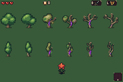
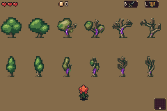
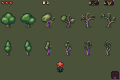
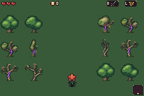
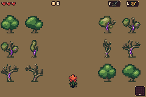
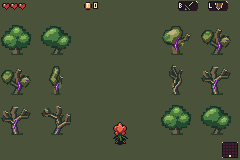
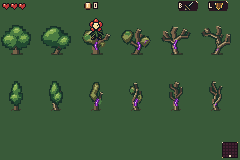
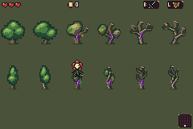

# Actual mGBA tree-study groves

**These are deliberately planted diagnostic layouts, not naturally generated forest rooms.**

The actual retained ROM routine places the native trees over existing forest floors, with Bloom for scale. Normal forest/canopy artwork and procedural placement are unchanged. These captured game pixels are not source composites.

[Exact capture report](capture.json)

## tree-catalog-grass

[Native filmstrip](tree-catalog-grass-filmstrip.png)

## tree-catalog-path

[Native filmstrip](tree-catalog-path-filmstrip.png)

## tree-catalog-sick-grass

[Native filmstrip](tree-catalog-sick-grass-filmstrip.png)

## repeated-grove-grass

[Native filmstrip](repeated-grove-grass-filmstrip.png)

## repeated-grove-path

[Native filmstrip](repeated-grove-path-filmstrip.png)

## repeated-grove-sick-grass

[Native filmstrip](repeated-grove-sick-grass-filmstrip.png)

## broad-tree-walk-around

[Native filmstrip](broad-tree-walk-around-filmstrip.png) · [Full-rate MP4](broad-tree-walk-around.mp4) · [Exact-color GIF](broad-tree-walk-around.gif)

## narrow-tree-walk-around

[Native filmstrip](narrow-tree-walk-around-filmstrip.png) · [Full-rate MP4](narrow-tree-walk-around.mp4) · [Exact-color GIF](narrow-tree-walk-around.gif)

Native PNGs and exact-color GIFs retain their stated fidelity; MP4s are lossy viewing copies. Raw all-frame recordings remain local. Canvas bounds, planted root collision and ground origins are different recorded contracts.

GIFs are inspection copies: every eighth video frame is held for 130ms. They preserve sampled colors but are not full-rate playback. The MP4s use the full GBA video clock (about 59.73Hz).
