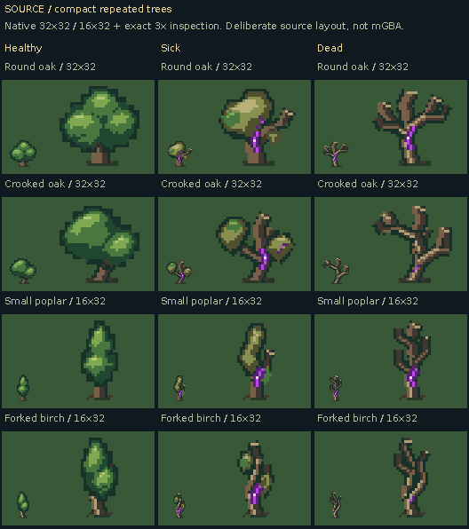

# Compact repeated trees: native source

**SOURCE artwork and floor previews. Actual mGBA diagnostic groves are separate.**

[Same trees on three floors](floor-contacts-source.png) · [Silhouettes](silhouettes-source.png) · [Grayscale diagnostic](grayscale-source.png) · [Palette iteration](palette-iteration-source.png) · [Native files and origins](native-manifest.json)

The kit has two forms per footprint (32×32 and 16×32), each healthy, sick and dead: twelve pieces, not twelve styles. Every state has its own structural drawing. All use one 16-entry RGB555 bank with transparent index0 and a fixed bottom-center origin at y30.

Healthy trees keep full crowns; sick trees lose or sag foliage and expose damaged branches; dead trees use bare broken forks. The existing green/olive/wood/violet palette family is simplified into quiet connected masses and local root shadows. The same unchanged grass, dirt and sick-ground source art is used for background comparisons. No background is baked into the native PNGs.

Regular forest/canopy artwork, generation and old colliders are not replaced by this source study. Integer enlargements are inspection views only.
