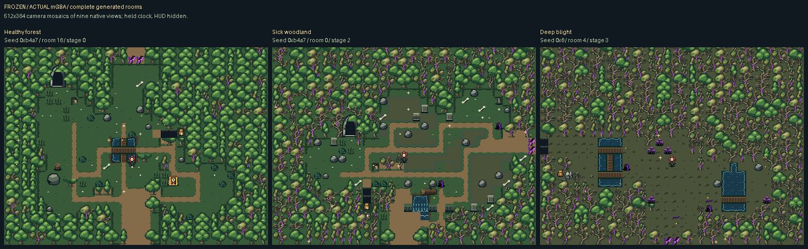
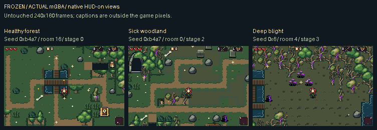

# Forest trees integrated into the game

The approved compact trees now replace the forest’s previous tree/canopy pictures in the procedural rooms. The twelve native drawings retain their original pixels and shared sixteen-entry RGB555 palette.

**Complete rooms:** each 512×384 image is a registered mosaic of nine actual 240×160 mGBA frames. The review camera holds the animation clock and hides the HUD; it changes no generated room geometry or art. These are camera mosaics, not single GBA framebuffers. Captions and borders sit outside captured game pixels.

**Native views:** each panel above is an unmodified 240×160 HUD-on framebuffer from the normal world renderer. Source pixels, full-room images and native views remain separate evidence.

[Download the playable ROM](../../downloads/forest-trees-integrated-fd7465d/forest-trees-integrated-fd7465d.gba) · [ZIP](../../downloads/forest-trees-integrated-fd7465d/forest-trees-integrated-fd7465d.zip) · [Build/checksums](../../downloads/forest-trees-integrated-fd7465d/README.md)

| Generated room | Complete room | Exact 2× inspection | Ordinary movement |
| --- | --- | --- | --- |
| Healthy forest / seed `0xb4a7` / room 16 | [Native mosaic](actual/healthy/full-room.png) | [2× PNG](inspection/healthy-2x.png) | [MP4](actual/healthy/walk.mp4) · [inspection GIF](actual/healthy/walk.gif) |
| Sick woodland / seed `0xb4a7` / room 0 | [Native mosaic](actual/mixed/full-room.png) | [2× PNG](inspection/mixed-2x.png) | [MP4](actual/mixed/walk.mp4) · [inspection GIF](actual/mixed/walk.gif) |
| Deep blight / seed `0x6` / room 4 | [Native mosaic](actual/deep/full-room.png) | [2× PNG](inspection/deep-2x.png) | [MP4](actual/deep/walk.mp4) · [inspection GIF](actual/deep/walk.gif) |

The review harness seeds the actual game and uses its native room transition to inspect selected generated cells. Enemies/projectiles are cleared and Bloom is placed at a disclosed safe standing point for inspection. Tree, terrain and pose pixels are never painted into the framebuffer. Walking clips use ordinary directional input after that fixture.

Every mosaic pixel is copied from its declared native camera crop, with no blending or repainting. Ambient glitter has native viewport-edge culling and per-view budgets; differences between overlapping camera frames are recorded rather than hidden. The same frozen world actor coordinates are used in each view.

Trees use transparent ground contact: BG2 carries the real local floor, BG1 the upper sixteen pixels, and BG3 the lower sixteen. Overlapping tree rows preserve the existing maze boundary. The visible canvas and collision remain separate: forest border bases retain their generated full-cell barriers, while free-standing trees retain their existing shallow root masks.

MP4s are lossy viewing copies at the GBA’s full approximately 59.73Hz. Any GIFs use sampled exact-color frames with fixed inspection holds; they do not claim original playback timing.

[Capture fixtures, native cameras and raw readbacks](actual/README.md) · [Literal panel proof](actual-panel-manifest.json) · [Publication summary](actual-publication-summary.json) · [Original approved source kit](../forest-tree-study/source/README.md) · [Guide application](../../bartgame/docs/art-reboot/references/TREE_GUIDE_APPLICATION.md)

Frozen source `fd7465d87f3dfcec33152254d49b3df629debf26`; ROM `977f38406e3f5cf12e7108e3840356d305d364bd665bc0d9ef578ec8f5937e78`.

Capture checks: 140/140. These are finite technical checks and recorded rooms, not a claim of exhaustive gameplay or aesthetic acceptance.

Independent validation passes1915/1915 checks, actual mGBA integration78/78,
and publication209/209. [Validation and remaining tradeoffs](validation/README.md)
include12,800 generated rooms, item-gate/approach checks and menu/bush-cut cache
preservation. The default `make` produces the exact downloadable ROM;
historical profiles0–30 remain byte-identical.
