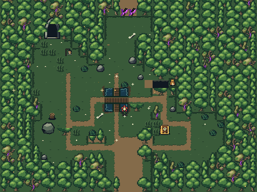
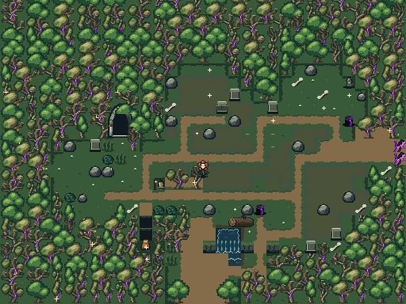
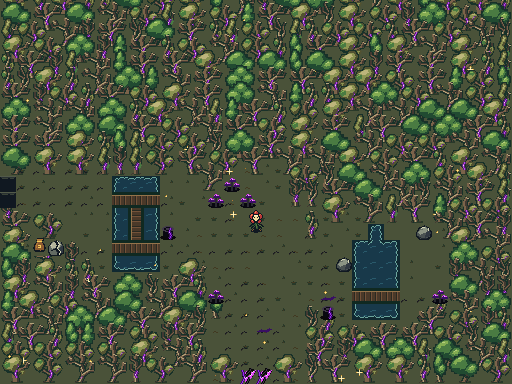

# Actual mGBA room captures

[Full capture report](capture.json) records the exact source bundle, camera crops, overlap differences, fixtures, room/collision hashes and native body scanout observations.

Full-room images are camera mosaics. Native camera PNGs are unmodified 240×160 framebuffers. Raw `.bin` files are hardware/room readbacks used for independent verification; they are not rendered substitutes for the captures.

## Healthy forest

[Native HUD view](healthy/native-HUD.png) · [First raw camera](healthy/camera-000-000.png)

[Natural arrival with original actors](healthy/native-arrival.png) (before enemy clearing or the standing-position fixture).

## Sick woodland

[Native HUD view](mixed/native-HUD.png) · [First raw camera](mixed/camera-000-000.png)

[Natural arrival with original actors](mixed/native-arrival.png) (before enemy clearing or the standing-position fixture).

## Deep blight

[Native HUD view](deep/native-HUD.png) · [First raw camera](deep/camera-000-000.png)

[Natural arrival with original actors](deep/native-arrival.png) (before enemy clearing or the standing-position fixture).
