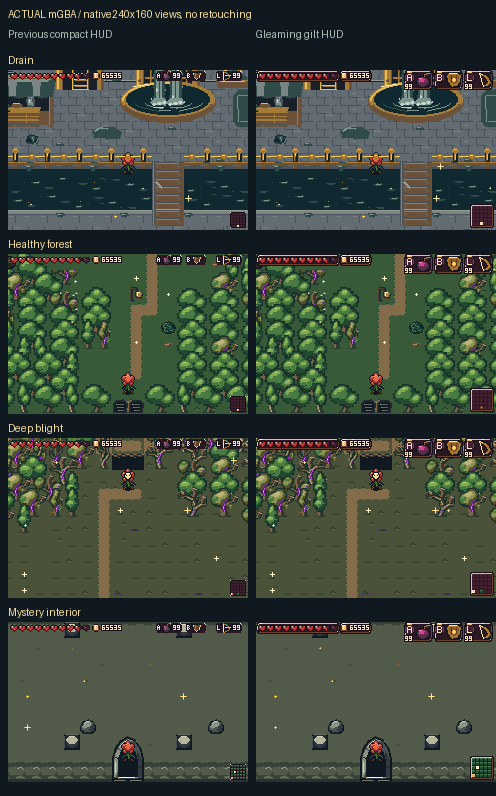
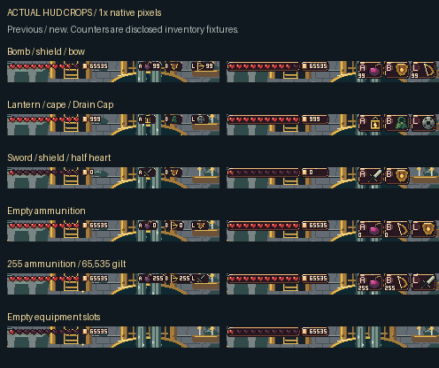
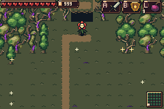
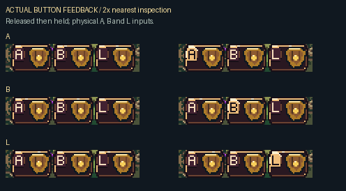

# Gleaming gilt HUD and native item redraw

Larger item silhouettes and A/B/L medallions sit in local gold frames. Physical button presses brighten the corresponding badge. The minimap has a larger5×5 room grid, a gleaming gold border and a blinking current-room marker. Hearts, gilt and conditional ammunition remain the only other HUD fields. The center stays open; ground pickups retain their compact world scale.

[Download the playable ROM/ZIP](../../downloads/hud-gilt-4747b67/README.md) · [All native item source art](source/README.md) · [Validation/provenance](validation/README.md)

## Actual mGBA scenes

Every game view below comes from a real run of the frozen ROM in mGBA0.10.5. Native PNGs remain240×160 and unretouched. The boards only place literal views or crops beside labels. Inventory, navigation and enemy-isolation fixtures are disclosed in the capture reports; these are readability tests, not an unassisted playthrough.

## Motion and button feedback

The animation samples every sixth frame from180 actual simulation frames. Its100ms viewing holds are approximately the native59.73Hz playback rate; all raw frames and recorded game clocks remain in the [capture report](validation/after-capture.json). No HUD animation clocks or framebuffer pixels were injected.

## Menus, dialogue and restoration

[Native item menu](actual/after/20-items.png) · [Key items](actual/after/21-key-items.png) · [Overview map](actual/after/22-map.png) · [Room zoom](actual/after/23-map-zoom.png) · [Return to gameplay](actual/after/24-after-menu.png).

[Opening dialogue](actual/after/13-unnamed-opening-dialogue.png) · [Wizard dialogue](actual/after/15-named-wizard-dialogue.png) · [Frog market](actual/after/17-frog-market.png).

Menu/dialogue frame and color options remain independent of the gameplay HUD. The minimap temporarily hides during dialogue to leave the text and continuation cue clear.

## Verification

Final capture: **290/290**; previous capture: **210/210**. Independent source/scope/budget audit: **1090/1090**.
 Source `4747b6788f18fe32da7d3304f34ce94c22468d5b`; ROM SHA256 `1bd913bc5bf1ad81e9c1dcc7e07ebc38eac855d390a5bb613257f8fbfe128e59`. The [source catalog](source/README.md) is explicitly separate from emulator evidence.
