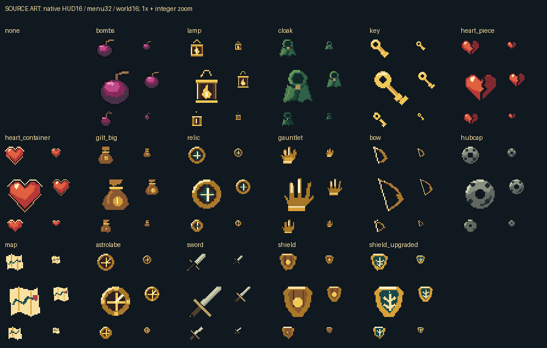

# Native item source catalog

These are source paintings, separate from the [actual mGBA review](../README.md). HUD16, menu32 and compact-world16 canvases are independently drawn at final resolution. The board includes native pixels and2x nearest inspection views. Indexed PNGs retain4bpp indices, literal RGB555 author inks and transparent index0.

[Every indexed/RGBA asset and material record](manifest.json).
