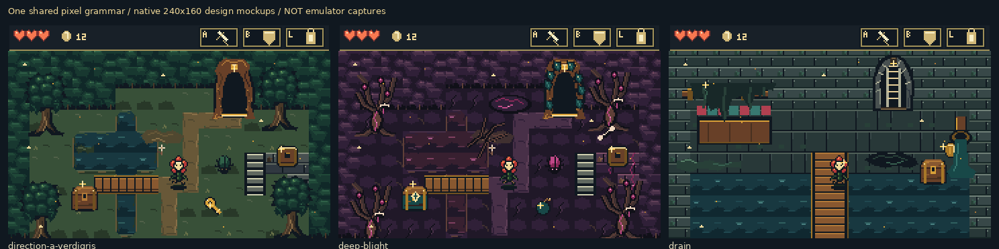
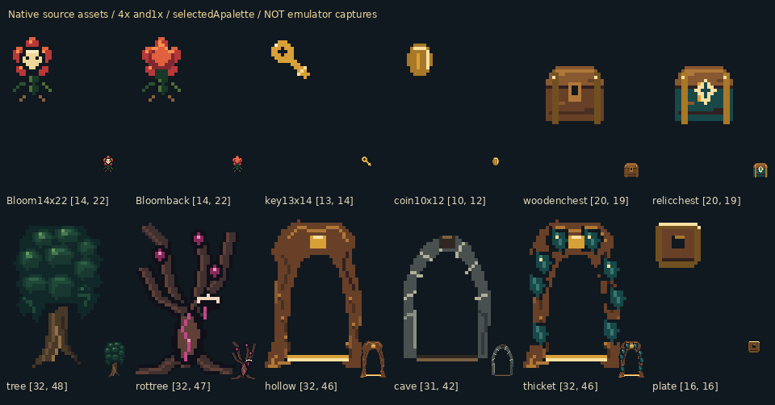
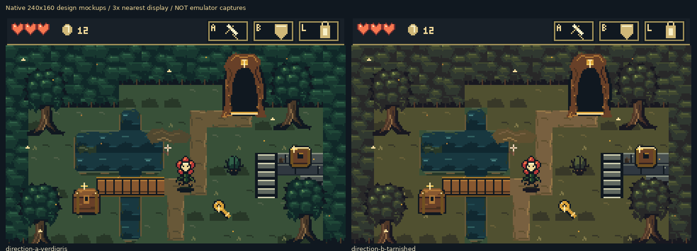

# BARTGAME: native GBA art reboot

These are **design mockups**, authored directly at 240×160 with indexed
RGB555 inks. They are not screenshots of the running game. Enlarged copies
use nearest-neighbour sampling for inspection only.

## Selected direction

Cool verdigris, warm earth and brass/ivory light give the living forest a
clear material hierarchy. Wet filth and brilliant surfaces appear together;
corruption changes anatomy and matter as well as colour.

[Healthy glitter animation](mockups/direction-a-verdigris.gif) ·
[Blight glitter animation](mockups/deep-blight.gif) ·
[Drain glitter animation](mockups/drain.gif)

## Scale study

Bloom is about14×22 visible pixels, ordinary world pickups10–14, chests20×19,
and entrances32×42–46. Menu illustrations are a separate larger category.
Production will pad the source design boxes into legal hardware OBJ shapes.

## Comparison and critique

The warmer olive study merges mud, paths and foliage too much; the cooler
study separates warm objects from the world more clearly. The first studies
were also too schematic: square banks, repeating leaf masses, generic
arches, little grime and too few glints. The revised three-scene board adds
broken canopies, bank faces, connected mud, scum and grease, distinct diseased
trees, and staggered glitter. Animation, depth and the complete game budgets
still require actual-ROM verification.

- [Research with measured Pokémon assets and Minish Cap implementation evidence](../../bartgame/docs/art-reboot/RESEARCH.md)
- [Art bible for all nine areas](../../bartgame/docs/art-reboot/ART_BIBLE.md)
- [Detailed mockup critique](../../bartgame/docs/art-reboot/MOCKUP_CRITIQUE.md)
- [Complete current-build asset audit](../../bartgame/docs/art-reboot/ASSET_AUDIT.md)
- [Mockup palette/tile/OBJ constraints](mockups/constraints.json)

The mockup constraints are measured for these scenes, not estimates of the
complete game's final memory use. Production is built from the same shared
palette and shape vocabulary after this review.
