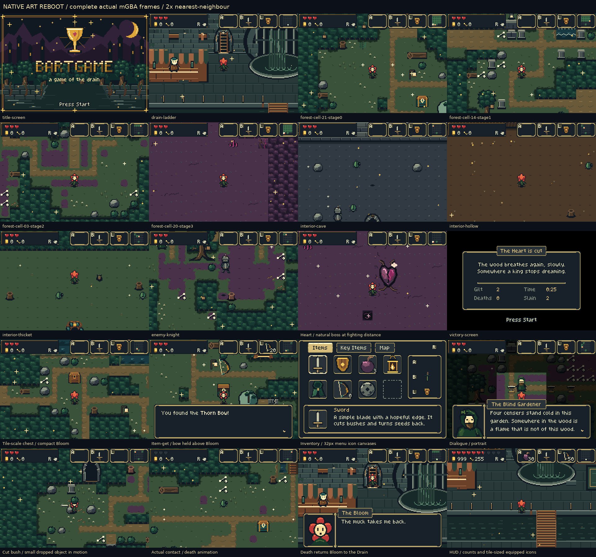
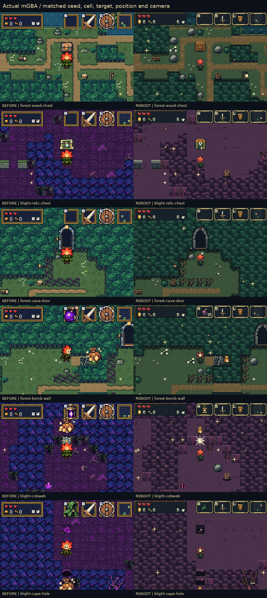

# BARTGAME: native GBA art reboot

This is the **running game**, captured from the published ROM in mGBA 0.10.5.
Every active visual family now uses one native scale, material vocabulary and
RGB555 palette system. Source studies below are labelled separately.

[Download the ROM](https://github.com/natertott/bartgame/raw/refs/heads/art-reboot/downloads/art-reboot-202c75e/bartgame-art-reboot-202c75e.gba) ·
[Download the ZIP](https://github.com/natertott/bartgame/raw/refs/heads/art-reboot/downloads/art-reboot-202c75e/bartgame-art-reboot-202c75e.zip) ·
[Watch the 81-second actual-run reel](play-reel.mp4) ·
[Release checks](validation/summary.json)



## What changed

- Bloom is about 14×22 painted pixels inside a legal 32×32 canvas. Walk, roll,
  sword, shields, bow, lamp, bombs, cape, carry/throw, hurt, fall, drowning and
  death share stable feet/hands and correct directional depth.
- Ground drops are generally 10–14 pixels in 16×16 canvases. HUD equipment and
  larger menu/reward illustrations are separate native drawings.
- Sword damage follows the visible fixed-length blade’s individual poses.
  The north shield is on the far side; carried props meet the hands and do
  not jump at release. These include intentional contact/footprint changes.
- Forest, progressive blight, Drain and interiors share cool verdigris,
  warm soil, dark near faces and brass/ivory light. Entrances, chests, plates,
  fractures, silk, pits and healing objects share a readable vocabulary.
- The Drain’s forest ladder has a stone threshold and distinct brass rungs.
  Wet stone, foliage, rot and metal carry abundant staggered glitter.
- All enemies, NPCs, keepers, the Heart, portraits, title, font and interface
  have native ownership. The familiar menu layout remains; the true HUD is 24px.
  Dirty-health redraws preserve pixels and restore one-frame reaction timing.

## Watch actual actions on different backgrounds

| Ground | Sword north | Shield north | Jump | Lamp north |
| --- | --- | --- | --- | --- |
| Drain | [GIF](actual/actions/drain/drain-sword-n.gif) | [GIF](actual/actions/drain/drain-shield-wood-n.gif) | [GIF](actual/actions/drain/drain-cape-n.gif) | [GIF](actual/actions/drain/drain-lamp-n.gif) |
| Healthy forest | [GIF](actual/actions/forest/forest-sword-n.gif) | [GIF](actual/actions/forest/forest-shield-wood-n.gif) | [GIF](actual/actions/forest/forest-cape-n.gif) | [GIF](actual/actions/forest/forest-lamp-n.gif) |
| Blight | [GIF](actual/actions/blight/blight-sword-n.gif) | [GIF](actual/actions/blight/blight-shield-wood-n.gif) | [GIF](actual/actions/blight/blight-cape-n.gif) | [GIF](actual/actions/blight/blight-lamp-n.gif) |
| Cave | [GIF](actual/actions/cave/cave-sword-n.gif) | [GIF](actual/actions/cave/cave-shield-wood-n.gif) | [GIF](actual/actions/cave/cave-cape-n.gif) | [GIF](actual/actions/cave/cave-lamp-n.gif) |

[All four facings and both shield designs](actual/actions/drain/) ·
[Lift/carry/throw](actual/actions/special/lift-carry-throw-pot.gif) ·
[Roll](actual/actions/drain/drain-roll-e.gif) ·
[Drowning](actual/actions/special/forest-drowning.gif) ·
[Pit fall](actual/actions/special/forest-pit-fall.gif) ·
[Item acquisition](actual/actions/special/forest-item-get-bow.gif) ·
[Death and Drain return](actual/screens/bloom-death-and-return.gif)

## World and interactions

[All 25 generated forest cells](forest-stages.png) ·
[All enemy species and the full Heart](enemies.png) ·
[40 interactive cases](actual/interactive/) ·
[Title, three Drain views, interiors and endings](actual/screens/) ·
[Full interfaces and all six portraits](interfaces.png)



These six comparisons match seed, room, target, position, facing, camera,
physical terrain contracts and inputs. The smaller character and new weapon/
arrow contact geometry are intentional differences; old gameplay traces are
not claimed identical. [Comparison metadata](comparisons/comparison-manifest.json).

## Research, mockups and critique

[Measured Pokémon assets and Minish Cap implementation evidence](../../bartgame/docs/art-reboot/RESEARCH.md) ·
[Nine-area art bible](../../bartgame/docs/art-reboot/ART_BIBLE.md) ·
[Implementation and hardware budgets](../../bartgame/docs/art-reboot/IMPLEMENTATION.md) ·
[Full asset audit](../../bartgame/docs/art-reboot/ASSET_AUDIT.md)

The process began with native 240×160 A/B palette studies, then a critique and
revised healthy/blight/Drain boards before production. Direction A’s cool
verdigris separates warm objects from the floor more clearly than olive B.
The first studies had square banks, repeated leaf masses, a generic arch,
too-clean Drain surfaces and insufficient glitter; the revised studies
addressed those issues. [Detailed critique and remaining art limits](../../bartgame/docs/art-reboot/MOCKUP_CRITIQUE.md).


[Both source directions](mockups/directions.png) ·
[Native scale study](mockups/scale-calibration.png) ·
[Mockup glitter animation](mockups/direction-a-verdigris.gif) ·
[Mockup hardware measurements](mockups/constraints.json) ·
[First-ROM problems corrected in final recordings](comparisons/candidate-refinement.png) ·
[Compiled-source atlases, not gameplay](source-atlases/)

Some generated living/blight edges remain angular and large clearings can
feel flat. Future polish should improve connected edge shapes and landmarks
without returning to noisy floor wallpaper. This is the first complete
shared native direction, with further room to develop the film’s contrast.
The Drain is the hub and Forest is area one; the other eight areas are not built.

## Evidence and exact build

The gallery contains 171 canonical actual-run cases: 40 screen clips, 91 Bloom
action clips and 40 interactive clips, plus one full-Heart camera clip. Separate
interface review contains 28 native title/HUD/menu views. All 99 currently
selected Bloom frames were observed; two legacy jump descriptors are redrawn
but not selected by the renderer. [Methods and exceptions](../../bartgame/docs/art-reboot/PROBE_NOTES.md).

Native PNGs are unchanged 240×160 framebuffers. GIFs are nearest-neighbour 2×;
166 of 172 original clips retain their exact colour union, while six exceed the
GIF 256-colour limit and are quantized. Their native PNGs remain exact. Caption
boards contain complete enlarged frames. The MP4 is a lossy convenience copy.
Source atlases are decoded assets, and mockups are source designs.

Seeds, position/facing, inventory/healing and clearing unrelated enemies are
disclosed review fixtures. Generated terrain, chest contents and mystery
descriptors are not replaced. Special enemy-contact fixtures are labelled.
[Capture index](actual/index.json) · [File hashes and palette metadata](gallery-manifest.json).

The release checks cover native ownership, palettes/VRAM, sword boundaries,
animations, progression, trials, pockets, quests, saves and 625 generated rooms
across 25 seeds. Quiet/isolated action samples sustained 192 updates / 192 VBlanks
on four grounds; this is not a worst-case combat benchmark. Separate paired
normal/max-heart contact samples restore baseline one-frame hardware response.

Source: [`202c75e`](https://github.com/natertott/bartgame/commit/202c75e8ffbfa6079d011a2848f5d9f6305ca9dc).
The ROM, gallery and release reports all identify this exact SHA256:

```text
41dc680068c094416e92152d4c22637c10d6a055d2bee63ce7700c419490e92d
```
