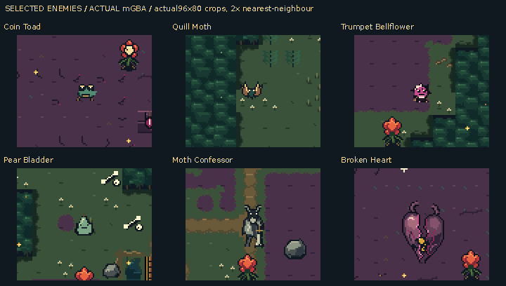
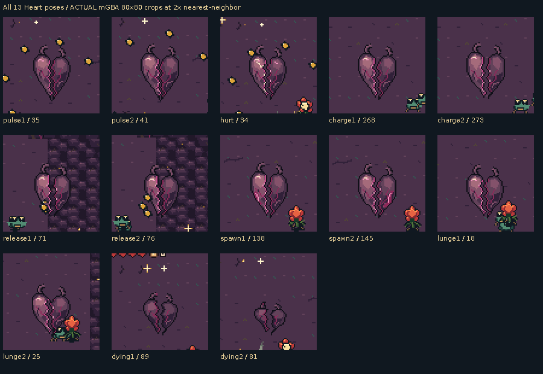

# Selected enemies and the broken purple Heart

The five chosen enemies are now the normal game defaults. The final boss is a
new purplish Heart with two torn lobes and a jagged break down its middle.
Its thirteen poses preserve that split through pulsing, attacks, hurt and collapse.

[Download the ROM](https://raw.githubusercontent.com/natertott/bartgame/selected-enemies-heart/downloads/selected-enemies-770b542/selected-enemies-770b542.gba) ·
[Download the ZIP](https://raw.githubusercontent.com/natertott/bartgame/selected-enemies-heart/downloads/selected-enemies-770b542/selected-enemies-770b542.zip) ·
[Release and checksums](../../downloads/selected-enemies-770b542/README.md)

## Actual mGBA views

These six panels are unchanged 96×80 crops from real runs, enlarged exactly 2×.
Captions sit outside the game image. [Full native screens](selected-actual-native.png)
and [panel provenance](selected-actual-manifest.json) are available separately.



| Mechanic | Adopted artwork | Original study |
| --- | --- | ---: |
| Ground pursuit | Coin Toad | 9 |
| Airborne hunter | Quill Moth | 9 |
| Directional shooter | Trumpet Bellflower and its seed | 5 |
| Compress and hop | Pear Bladder | 9 |
| Heavy melee | Moth Confessor and its weapon | 6 |
| Final boss | New broken purple Heart | New artwork |

[Watch all actual encounters](actual/README.md), including ordinary behavior,
combat, post-menu rendering, cave groups and the three boss phases.
The [Coin Toad clearing recording](actual/clearing/README.md) shows its feet
on unobstructed ground; the other pursuer clip also demonstrates bridge depth.

- Heart [pulse and ring attack](actual/boss-ring.gif).
- Heart [fan attack and spawning](actual/boss-fan-and-adds.gif).
- Heart [lunge](actual/boss-lunge.gif).
- Heart [hurt, defeat and Grail drop](actual/boss-real-defeat.mp4), with an
  [exact native chronology](actual/boss-real-defeat-filmstrip.png) and
  [enlarged defeat timeline](actual/heart-defeat-actual-timeline.png).

All thirteen Heart poses were also identified and checked against the actual
hardware sprite tiles, palettes and framebuffer. These unchanged 80×80 crops
are enlarged 2×; labels give pose and captured update.



[Pose provenance and visible-pixel checks](actual/heart-actual-poses.json).
The death animation alternates two contracted split-lobe poses through the
existing death interval. Native attack-pose changes are restrained; movement
and projectile cues carry much of their timing. [Visual critique](validation/visual-review.md).

## Complete native artwork

[Source atlas and animation catalog](source/README.md) covers all 64 frame
instances: 61 body poses, two weapon orientations and one seed. These catalogs
use fixed inspection holds; the actual-run clips above show gameplay timing.

[Heart source cycle](source/boss-all-poses-source.gif) ·
[Complete Heart atlas](source/atlases/boss-all-frames-source.png) ·
[All six source cycles](source/selected-all-poses-source.gif)

The normal build now selects `BART_ENEMY=11`. The earlier profiles `0..10`
remain explicit comparison options. The chosen five families reuse their
complete original artwork. The Heart is authored directly on its native
32×64 canvas in the existing sixteen-entry RGB555 blight bank, retaining the
Bellflower's colors. No high-resolution downscaling is used.

## Verification and scope

Frozen game/art source: [`770b542`](https://github.com/natertott/bartgame/commit/770b5422715fd108fc5b2607ab0978702b96e46f).
The normal `make -j4` produced the exact ROM used for every recording.

- **13 actual mGBA cases, 88/88 runtime checks pass**, including combat,
  all boss phases, genuine hurt/death, cave encounters and menu restoration.
- **12,919/12,919 independent checks pass**: all 51 selected non-boss frame
  instances match the prior selected sheets exactly; all thirteen new Heart
  poses match source, ROM and visible sprite pixels. Existing profiles remain
  intact, and all thirteen sampled gameplay trajectories match the prior
  positive-profile engine behavior.
- Every `src/*` file, protected world/Bloom/items/UI/font/glitter asset and
  relevant shared palette remains unchanged. This adopts artwork rather than
  changing combat, hitboxes, AI, saves or interface behavior.
- Conservative OBJ usage is 816/876 tiles; EWRAM is 212,184/262,144 bytes.

See [audit summary](validation/audit-summary.json),
[complete audit](validation/audit.json), [capture report](actual/capture.json),
[clearing report](actual/clearing/capture.json),
[frozen build inputs](validation/freeze.json) and
[publication hashes](validation/publication-manifest.json).

Review fixtures disclose seeds, player placement, equipment/healing, and
boss health used to reach later phases. Enemy positions, states, timers,
heights and poses are never assigned. Native PNGs/chronologies are exact;
MP4s are lossy viewing copies. GIFs retain exact colors and sample every other
update at the recorded cadence. The defeat sequence exceeds GIF's 256-color
limit, so its exact PNGs and full-rate MP4 are provided instead.

The [art bible](../../bartgame/docs/art-reboot/ART_BIBLE.md),
[direction log](../../bartgame/docs/art-reboot/ART_DIRECTION_LOG.md) and
[Heart design notes](../../bartgame/docs/art-reboot/references/BROKEN_HEART.md)
record the adoption and its native design rules.

ROM SHA256:

```text
9330a44a4e27d99606a757134aa41a62adb122a74315c400e1ad3427048c8661
```
