# Selected enemies: actual mGBA recordings

[Back to the full review](../README.md)

These are real generated encounters and ordinary AI updates. The report records the disclosed seed, player position/health/inventory and boss-HP fixtures. Enemy state, position, timer, height, animation phase and pose are never assigned. Source pose catalogs are published separately.

[Checks, native-frame links and complete traces](capture.json)

## pursuer behavior

Natural generated enemy; safe player position, inventory, healing and unrelated-actor clearing fixtures. AI state/timer/pose/height never assigned.

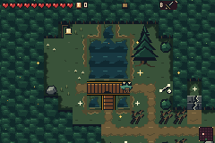

[Exact-palette animation](pursuer-behavior.gif) · [Full-rate MP4](pursuer-behavior.mp4) · [Native chronology](pursuer-behavior-filmstrip.png)

## flyer behavior

Natural generated enemy; safe player position, inventory, healing and unrelated-actor clearing fixtures. AI state/timer/pose/height never assigned.

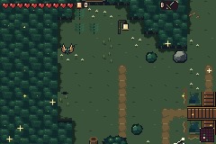

[Exact-palette animation](flyer-behavior.gif) · [Full-rate MP4](flyer-behavior.mp4) · [Native chronology](flyer-behavior-filmstrip.png)

## shooter behavior

Natural generated enemy; safe player position, inventory, healing and unrelated-actor clearing fixtures. AI state/timer/pose/height never assigned.

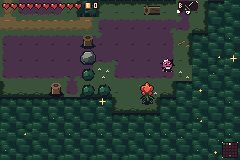

[Exact-palette animation](shooter-behavior.gif) · [Full-rate MP4](shooter-behavior.mp4) · [Native chronology](shooter-behavior-filmstrip.png)

## hopper behavior

Natural generated enemy; safe player position, inventory, healing and unrelated-actor clearing fixtures. AI state/timer/pose/height never assigned.

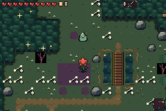

[Exact-palette animation](hopper-behavior.gif) · [Full-rate MP4](hopper-behavior.mp4) · [Native chronology](hopper-behavior-filmstrip.png)

## melee behavior

Natural generated enemy; safe player position, inventory, healing and unrelated-actor clearing fixtures. AI state/timer/pose/height never assigned.

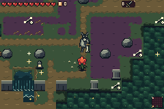

[Exact-palette animation](melee-behavior.gif) · [Full-rate MP4](melee-behavior.mp4) · [Native chronology](melee-behavior-filmstrip.png)

## melee after menu

Ordinary Start opened and closed the live item menu. Native enemy weapon VRAM and small-enemy/foliage OBJ palette banks are independently verified unchanged; real AI resumes.

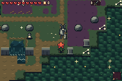

[Exact-palette animation](melee-after-menu.gif) · [Full-rate MP4](melee-after-menu.mp4) · [Native chronology](melee-after-menu-filmstrip.png)

## melee real combat

Natural 10HP heavy enemy, actual D-pad/B sword inputs. Player health/position/equipment and unrelated-actor clearing are fixtures; enemy HP/state/timer/pose are never assigned.

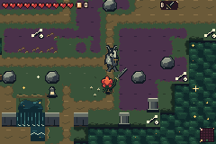

[Exact-palette animation](melee-real-combat.gif) · [Full-rate MP4](melee-real-combat.mp4) · [Native chronology](melee-real-combat-filmstrip.png)

## boss ring

Natural 40HP generated boss: ordinary pulse, drift and eight-spore burst. Player healing/position fixtures only.

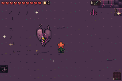

[Exact-palette animation](boss-ring.gif) · [Full-rate MP4](boss-ring.mp4) · [Native chronology](boss-ring-filmstrip.png)

## boss fan and adds

Disclosed boss HP26 fixture selects its existing middle phase; no AI state/timer/pose injected. Actual fans and add spawns follow.

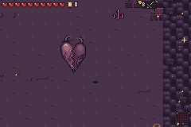

[Exact-palette animation](boss-fan-and-adds.gif) · [Full-rate MP4](boss-fan-and-adds.mp4) · [Native chronology](boss-fan-and-adds-filmstrip.png)

## boss lunge

Disclosed boss HP12 fixture selects existing low-health lunge phase; all motion and state transitions are real AI.

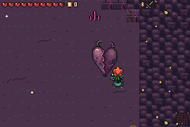

[Exact-palette animation](boss-lunge.gif) · [Full-rate MP4](boss-lunge.mp4) · [Native chronology](boss-lunge-filmstrip.png)

## boss real defeat

Natural boss with disclosed HP4 fixture; real D-pad/B sword inputs cause a nonlethal hit, then existing 120-update death, blasts and Grail drop. No enemy animation/state assignments.

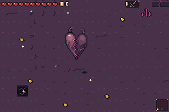

[Full-rate MP4](boss-real-defeat.mp4) · [Native chronology](boss-real-defeat-filmstrip.png)

## cave natural group

Actual generated cave combat trial entered through its real mouth. All naturally spawned enemies are retained; only player healing is a fixture. No Drain enemy spawns or invented enemy room are claimed.

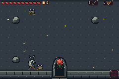

[Exact-palette animation](cave-natural-group.gif) · [Full-rate MP4](cave-natural-group.mp4) · [Native chronology](cave-natural-group-filmstrip.png)
