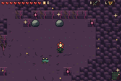

# Selected enemies: actual mGBA recordings

[Back to the full review](../../README.md)

These are real generated encounters and ordinary AI updates. The report records the disclosed seed, player position/health/inventory and boss-HP fixtures. Enemy state, position, timer, height, animation phase and pose are never assigned. Source pose catalogs are published separately.

[Checks, native-frame links and complete traces](capture.json)

## pursuer clearing

Supplementary natural pursuer on an independently selected unobstructed natural floor lane. No enemy position/state/timer/frame or terrain writes. Main bridge-depth recordings remain untouched.

[Exact-palette animation](pursuer-clearing.gif) · [Full-rate MP4](pursuer-clearing.mp4) · [Native chronology](pursuer-clearing-filmstrip.png)
