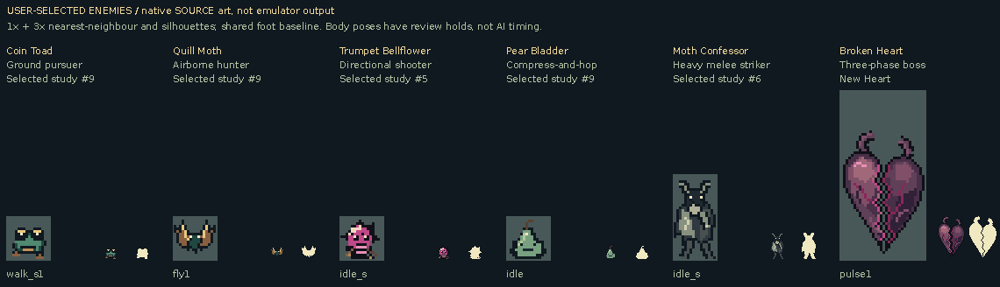

# Selected enemy native source art

These are **SOURCE pose catalogs**, not mGBA recordings or gameplay-timing simulations.

The user selected Coin Toad, Quill Moth, Trumpet Bellflower, Pear Bladder and Moth Confessor. The final boss is a new purplish Broken Heart with a jagged split down the middle. All art starts on its actual GBA canvas with sixteen RGB555 inks including transparent zero.

[Animate the selected pose catalog](selected-all-poses-source.gif) · [Native value/silhouette diagnostics](selected-diagnostics-source.png) · [Exact native coverage and hashes](source-manifest.json)

## Complete body pose cycles

Every body pose is shown with a fixed 150ms inspection hold. Source cycles do not reproduce actual windup duration, live damage windows, gravity, movement, hurt blinking or AI decisions. Actual mGBA footage is separate. The six body cycles cover all 61 body frame instances; two weapon orientations and one seed complete the 64-frame native set and are included in the labelled atlases.

| Selected form / mechanic | Native canvas | Body frames | Source cycle | Complete atlas |
| --- | --- | ---: | --- | --- |
| Coin Toad / Ground pursuer | 16×16 | 6 | [GIF](beetle-all-poses-source.gif) | [PNG](atlases/beetle-all-frames-source.png) |
| Quill Moth / Airborne hunter | 16×16 | 3 | [GIF](bat-all-poses-source.gif) | [PNG](atlases/bat-all-frames-source.png) |
| Trumpet Bellflower / Directional shooter | 16×16 | 12 | [GIF](spitter-all-poses-source.gif) | [PNG](atlases/spitter-all-frames-source.png) |
| Pear Bladder / Compress-and-hop | 16×16 | 3 | [GIF](slime-all-poses-source.gif) | [PNG](atlases/slime-all-frames-source.png) |
| Moth Confessor / Heavy melee striker | 16×32 | 24 | [GIF](knight-all-poses-source.gif) | [PNG](atlases/knight-all-frames-source.png) |
| Broken Heart / Three-phase boss | 32×64 | 13 | [GIF](boss-all-poses-source.gif) | [PNG](atlases/boss-all-frames-source.png) |

The original `atk` frames deliberately alias the newer `strike` images. West-facing views use the existing horizontal mirror. The boss uses its actual 32×64 canvas; transparent padding is not its damage footprint. The body split remains visible through pulse, charge, release, spawn, lunge, hurt and collapse.

## Native files and validation

Every frame has an indexed PNG with its literal hardware palette and an exact RGBA PNG. The manifest records original/appended IDs, raw index and RGBA hashes, native canvas, palette, source hashes and each output hash. No filtered reduction, fractional alpha or automatic screenshot recoloring is used. Every GIF is decoded back and compared with its source RGB boards; there is no quantized fallback.

The small enemy bank remains separate from the shared cloak/carried-bush colors. Moth Confessor and the shooter/Heart use the existing stone/blight banks. Validation establishes native completeness and encoding, not a claim of gameplay balance or a new damage/vulnerability rule.
