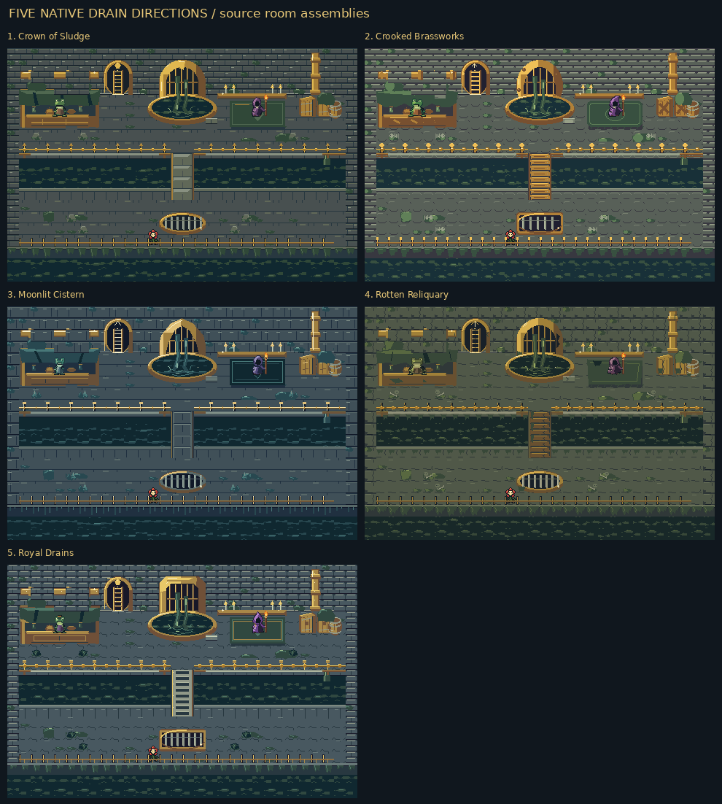
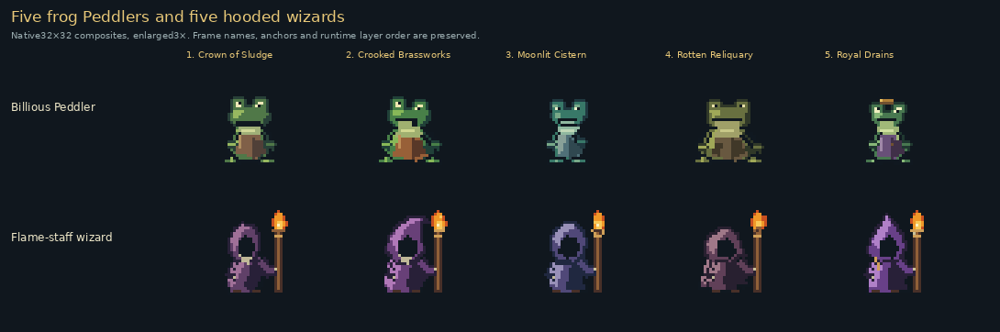
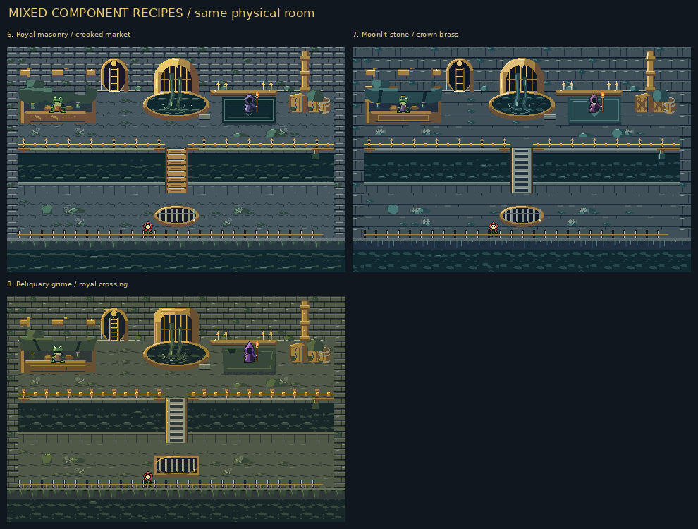
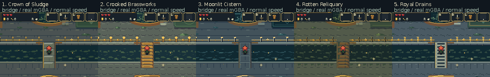

# Drain art, second pass: guided by the six pixel-art PDFs

All five sewer concepts have been reauthored from the six supplied PDFs,
with three regenerated mixed rooms and complete fresh review content. The scrolling
room stays **480×320**, with the same layout, collision, bridge, stream, ladder,
counter, NPC anchors and spawn. **Bloom and the existing glitter stay intact.**
Each concept includes gray slimy brick, localized filth and debris, moving
sewage, conspicuous gold sewer fittings, a continuous foreground rail, a frog
Billious Peddler and a hooded purple wizard with a flame-tipped staff.

[Watch all five in real mGBA, normal speed](five-concepts-mgba.mp4) ·
[Every asset choice and diagnostic](source/README.md) ·
[Full current inventory](source/INVENTORY.md) ·
[Try all eight study ROMs](../../downloads/sewer-concepts-v2-476d1ed/all-eight-sewer-concepts.zip)

The released `art-reboot` branch remains unchanged. These are comparison
builds on `sewer-concepts-v2`; no sewer direction has been selected yet.

## What changed from the references

The new pass starts from silhouette and material masses, with two or three
purposeful values per small material, cooler shadows and selected warm light.
Floors are quieter; gray brick remains identifiable. Gold, wood, cloth and
water have different highlight/shape grammars instead of nested bevel bands.
The frog and wizard families and their portraits are newly authored, and a
new frog-body breathing pose follows the head bob while keeping feet planted.

[Shared art bible](../../bartgame/docs/art-reboot/ART_BIBLE.md) ·
[Continuous decision log](../../bartgame/docs/art-reboot/ART_DIRECTION_LOG.md) ·
[All six sources and page citations](../../bartgame/docs/art-reboot/REFERENCE_REGISTER.md) ·
[Guidance, GBA adaptations and conflicts](../../bartgame/docs/art-reboot/REFERENCE_APPLICATION.md)

The source notes explain the optional techniques that do not transfer literally:
large-canvas tracing/downsampling, filtered blur, unrestricted colors and
posterization are translated into native blockouts, explicit indexed palettes
and deliberate pixel clusters. No high-resolution image was reduced into game art.

[Five native before/after room pairs](source/before-after/room-overview.png) ·
[Floor changes](source/before-after/fixture-floor.png) ·
[Gold outfall changes](source/before-after/fixture-cistern.png) ·
[Grayscale room review](source/diagnostics/room-value-overview.png) ·
[Native character silhouettes/values](source/diagnostics/character-reads-1x.png) ·
[Rest/breathe joins](source/diagnostics/frog-idle-joins.png)

## Five full-room designs

This board assembles native room assets at their world coordinates so the
entire scrolling room can be compared at once. **It is a source assembly,
not a 240×160 emulator screenshot.** It omits the runtime ambient glitter
emitter; the actual recordings below include the preserved glitter.

| Option | Direction | Concrete tradeoff | Full room | Actual gameplay |
| --- | --- | --- | --- | --- |
| **1** | **Crown of Sludge** | Broad gray flags and heavy brass with directional light-facing planes. | [Native](source/rooms/room-1-native.png) · [2×](source/rooms/room-1-2x.png) | [Market](actual/v1/market.gif) · [Wizard](actual/v1/wizard.gif) · [Bridge](actual/v1/bridge.gif) |
| **2** | **Crooked Brassworks** | Rounded masonry, patched cloth, thick wood and a squat frog; a denser floor option. | [Native](source/rooms/room-2-native.png) · [2×](source/rooms/room-2-2x.png) | [Market](actual/v2/market.gif) · [Wizard](actual/v2/wizard.gif) · [Bridge](actual/v2/bridge.gif) |
| **3** | **Moonlit Cistern** | Quiet cool flags and dark current groups; restrained warm brass and a narrow sleepy frog. | [Native](source/rooms/room-3-native.png) · [2×](source/rooms/room-3-2x.png) | [Market](actual/v3/market.gif) · [Wizard](actual/v3/wizard.gif) · [Bridge](actual/v3/bridge.gif) |
| **4** | **Rotten Reliquary** | Connected greasy deposits, controlled broken forms and a low broad toad; darkest treatment. | [Native](source/rooms/room-4-native.png) · [2×](source/rooms/room-4-2x.png) | [Market](actual/v4/market.gif) · [Wizard](actual/v4/wizard.gif) · [Bridge](actual/v4/bridge.gif) |
| **5** | **Royal Drains** | Ordered chamfered masonry and controlled gilt, a capped frog and tall cowl; trim is reduced. | [Native](source/rooms/room-5-native.png) · [2×](source/rooms/room-5-2x.png) | [Market](actual/v5/market.gif) · [Wizard](actual/v5/wizard.gif) · [Bridge](actual/v5/bridge.gif) |

## Frog and wizard choices

The reauthored frog choices vary eye shape, jaw, body proportions and clothing: wide-eyed
apron, squat potbelly, sleepy stoop, broad toad and a compact capped trader.
The wizard choices vary hood, hunch, robe hem and trim. Their face stays in
shadow, with a common staff/flame anchor that works in every animation frame.

The frog's shop language is deliberately simple: **“Oh. Hello. I sell things.”**,
**“Seeds. They go boom.”**, **“Here. Eat it.”** Prices and purchase rules remain
the same. The [actual shop screen](actual/v2/peddler-shop.png) shows the new portrait
and greeting; the [wizard dialogue](actual/v3/wizard-dialogue.png) uses its matching portrait.

[Every frog head frame](source/sprites/peddler_head.png) ·
[Every frog body frame](source/sprites/peddler_body.png) ·
[Every wizard frame](source/sprites/gatekeeper.png) ·
[Every flame frame](source/sprites/wisp.png) ·
[Portrait alternatives](source/sprites/portraits.png) ·
[New rail alternatives](source/sprites/sewerrail.png)

The original fourteen body action IDs retain their ordering. An appended
`breathe` pose compresses the upper body by one pixel in step with the head,
with exact unchanged foot/contact rows. All eight market recordings confirm
both phases in actual hardware: head/body offsets `(8,6)` and `(8,7)`.

## Choose individual materials and fixtures

Each link presents the same asset or assembled fixture in **five numbered
columns**. Large objects span multiple 16×16 IDs, so these assembled crops are
the easiest place to start before inspecting every tile.

| Asset family | All parts covered | Five-way comparison |
| --- | --- | --- |
| Ground | Gray brick bonds, slime, cracks, oily puddles and localized debris. | [Floors and filth](source/fixtures/floor.png) |
| Walls | Rear retaining bricks, damp stone, side masonry, brass pipe and couplings. | [Wall and pipe](source/fixtures/wall.png) |
| Forest exit | Dark opening, arch, clear ladder rails and rungs. | [Ladder](source/fixtures/ladder.png) |
| Main sewer | Gold wall outfall, bars, flowing fall and receiving basin. | [Gold outfall](source/fixtures/cistern.png) |
| Market | Awning, counter, supports, displayed wares and frog. | [Market](source/fixtures/market.png) |
| Wizard corner | Robe, hood, staff, flame, rug, shelf and candles. | [Wizard corner](source/fixtures/wizard.png) |
| Crossing | Both landings and the bridge over the actual stream. | [Bridge](source/fixtures/bridge.png) |
| Stream boundary | Gold posts, continuous handrail, coping, water and scum. | [North rail](source/fixtures/rail.png) |
| Small outfall | Gold pipe, mouth, sewage discharge and stream contact. | [Side outfall](source/fixtures/outfall.png) |
| Storage | Two crates, barrel and surrounding floor grime. | [Storage](source/fixtures/storage.png) |
| Floor drain | Walkable barred grate, rim and surrounding bricks. | [Floor grate](source/fixtures/grate.png) |
| Lower bank | Foreground rail, coping, hanging slime and moving reservoir water. | [Lower bank](source/fixtures/bottom-bank.png) |

The complete inventory lists **all 370 used metatile IDs and all 657 placements**:
350 ground IDs and 20 foreground IDs. Their **623 frame drawings × five** give
3,115 tile-frame choices. All 30 keeper animation frames, two dialogue portraits
and the new rail also have five alternatives. Two transparent foreground IDs
remain blank in every option; the exact sharing is disclosed in the catalogue.

The separate [unused sewer catalogue](source/README.md#retained-unused-sewer-catalogue)
covers 80 retained `sw_*` IDs and their animation frames. It is not additional
content secretly placed in the current room. The inventory also lists the
preserved six glitter frames, shared HUD/menu/shop assets and conditional item
effects; those common assets keep the existing game artwork.

## Mixed room combinations

| Mix | Combination | Full room | Real mGBA |
| --- | --- | --- | --- |
| **6** | Royal floor/walls, Moonlit water, Crown goldwork, Crooked bridge/market/frog, Moonlit wizard, Reliquary props. | [Native](source/rooms/room-6-native.png) · [2×](source/rooms/room-6-2x.png) | [Bridge animation](actual/v6/bridge.gif) |
| **7** | Moonlit floor/walls, Crooked water, Crown goldwork/wizard, Royal bridge/market/frog, Crooked props. | [Native](source/rooms/room-7-native.png) · [2×](source/rooms/room-7-2x.png) | [Bridge animation](actual/v7/bridge.gif) |
| **8** | Reliquary floor/water/props, Crown walls/frog, Royal goldwork/bridge/wizard, Moonlit market. | [Native](source/rooms/room-8-native.png) · [2×](source/rooms/room-8-2x.png) | [Bridge animation](actual/v8/bridge.gif) |

The [exact recipes](../../bartgame/art/sewer_concepts.py) also record rug/sanctum
choices and palette bases. Material ink roles match so mixed parts still fit
one legal Drain background bank.

## Actual mGBA evidence

This is a synchronized comparison of five **real 240×160 screens**. It uses
original framebuffers, with labels added outside gameplay. All five have the
same camera, player position, frame clock and inputs. Normal GIFs sample every
second video frame; the [full-rate video](five-concepts-mgba.mp4) retains every frame.

| Recipe | Market | Ladder | Wizard | Bridge | Outfall and lower room | Shop / dialogue |
| --- | --- | --- | --- | --- | --- | --- |
| 1 | [Video](actual/v1/market.mp4) | [Video](actual/v1/ladder.mp4) | [Video](actual/v1/wizard.mp4) | [Video](actual/v1/bridge.mp4) | [Outfall](actual/v1/right-outfall.mp4) · [Lower](actual/v1/lower-right.mp4) | [Shop](actual/v1/peddler-shop.mp4) · [Wizard](actual/v1/wizard-dialogue.mp4) |
| 2 | [Video](actual/v2/market.mp4) | [Video](actual/v2/ladder.mp4) | [Video](actual/v2/wizard.mp4) | [Video](actual/v2/bridge.mp4) | [Outfall](actual/v2/right-outfall.mp4) · [Lower](actual/v2/lower-right.mp4) | [Shop](actual/v2/peddler-shop.mp4) · [Wizard](actual/v2/wizard-dialogue.mp4) |
| 3 | [Video](actual/v3/market.mp4) | [Video](actual/v3/ladder.mp4) | [Video](actual/v3/wizard.mp4) | [Video](actual/v3/bridge.mp4) | [Outfall](actual/v3/right-outfall.mp4) · [Lower](actual/v3/lower-right.mp4) | [Shop](actual/v3/peddler-shop.mp4) · [Wizard](actual/v3/wizard-dialogue.mp4) |
| 4 | [Video](actual/v4/market.mp4) | [Video](actual/v4/ladder.mp4) | [Video](actual/v4/wizard.mp4) | [Video](actual/v4/bridge.mp4) | [Outfall](actual/v4/right-outfall.mp4) · [Lower](actual/v4/lower-right.mp4) | [Shop](actual/v4/peddler-shop.mp4) · [Wizard](actual/v4/wizard-dialogue.mp4) |
| 5 | [Video](actual/v5/market.mp4) | [Video](actual/v5/ladder.mp4) | [Video](actual/v5/wizard.mp4) | [Video](actual/v5/bridge.mp4) | [Outfall](actual/v5/right-outfall.mp4) · [Lower](actual/v5/lower-right.mp4) | [Shop](actual/v5/peddler-shop.mp4) · [Wizard](actual/v5/wizard-dialogue.mp4) |
| 6 | [Video](actual/v6/market.mp4) | [Video](actual/v6/ladder.mp4) | [Video](actual/v6/wizard.mp4) | [Video](actual/v6/bridge.mp4) | [Outfall](actual/v6/right-outfall.mp4) · [Lower](actual/v6/lower-right.mp4) | [Shop](actual/v6/peddler-shop.mp4) · [Wizard](actual/v6/wizard-dialogue.mp4) |
| 7 | [Video](actual/v7/market.mp4) | [Video](actual/v7/ladder.mp4) | [Video](actual/v7/wizard.mp4) | [Video](actual/v7/bridge.mp4) | [Outfall](actual/v7/right-outfall.mp4) · [Lower](actual/v7/lower-right.mp4) | [Shop](actual/v7/peddler-shop.mp4) · [Wizard](actual/v7/wizard-dialogue.mp4) |
| 8 | [Video](actual/v8/market.mp4) | [Video](actual/v8/ladder.mp4) | [Video](actual/v8/wizard.mp4) | [Video](actual/v8/bridge.mp4) | [Outfall](actual/v8/right-outfall.mp4) · [Lower](actual/v8/lower-right.mp4) | [Shop](actual/v8/peddler-shop.mp4) · [Wizard](actual/v8/wizard-dialogue.mp4) |

Every recipe has ten recorded cases: eight room viewpoints, an ordinary A
press opening the shop and an ordinary A press opening wizard dialogue.
Reports and selected native PNGs are in each `actual/vN` directory; videos,
chronological filmstrips and full runtime traces are all retained.

## Verification and limits

**21,971/21,971 checks pass:** 20,827 independent ROM/source/scope checks and
1,144 runtime checks across 80 cases. All eight sets keep the exact physical
room, every Bloom/Step-and-cut frame, glitter art/rules/surface metadata,
forest/interior art, unrelated sprites, UI, font, title and protected palettes.
The default build still has released ROM hash `547674bf…832c97a`.

The Drain uses 547–587 of 1,024 available BG subtiles and one area palette.
The new handrail uses two live OBJ tiles; peak OAM in the recordings is 42/128.
Every idle recording completes one game update per VBlank. Flow animation is
verified in hardware VRAM, and staff-flame and handrail coordinates are
verified against actual OAM. These are measured samples, not a worst-case
performance guarantee.

All 80 individual GIFs created during capture retain exact palettes. The
published subset and the comparison GIF preserve native game colors; native
PNGs are the primary exact evidence. MP4s are lossy review conveniences.
The capture fixture sets seed, safe player position and facing; NPCs stay
alive, terrain is not replaced, and no animation poses or timers are injected.
Atlas coverage includes every authored frame, while the idle clips activate
11/15 frog body poses and four head poses—not the whole repertoire.

Full-frame local archives and omitted redundant GIFs are listed under
`archival_formats`; publication reports record the original capture-report
hash. All selected native images, videos, filmstrips and traces remain exact
copies. Full-room source assemblies omit the runtime glitter emitter.

[Verification summary](validation/summary.json) ·
[Independent ROM/source audit](validation/audit-scope.json) ·
[Runtime summary](validation/review-summary.json) ·
[Builds and ROM hashes](validation/builds.json) ·
[Design and reproduction notes](../../bartgame/docs/SEWER_CONCEPTS.md)

Frozen game/art source: [`476d1ed`](https://github.com/natertott/bartgame/commit/476d1ede7162e20212707ede84d586a770f940f1).

Feedback can name a whole option or individual parts, for example:
**“floor 3, water 4, goldwork 1, bridge 2, market 2, frog 5, wizard 3.”**
