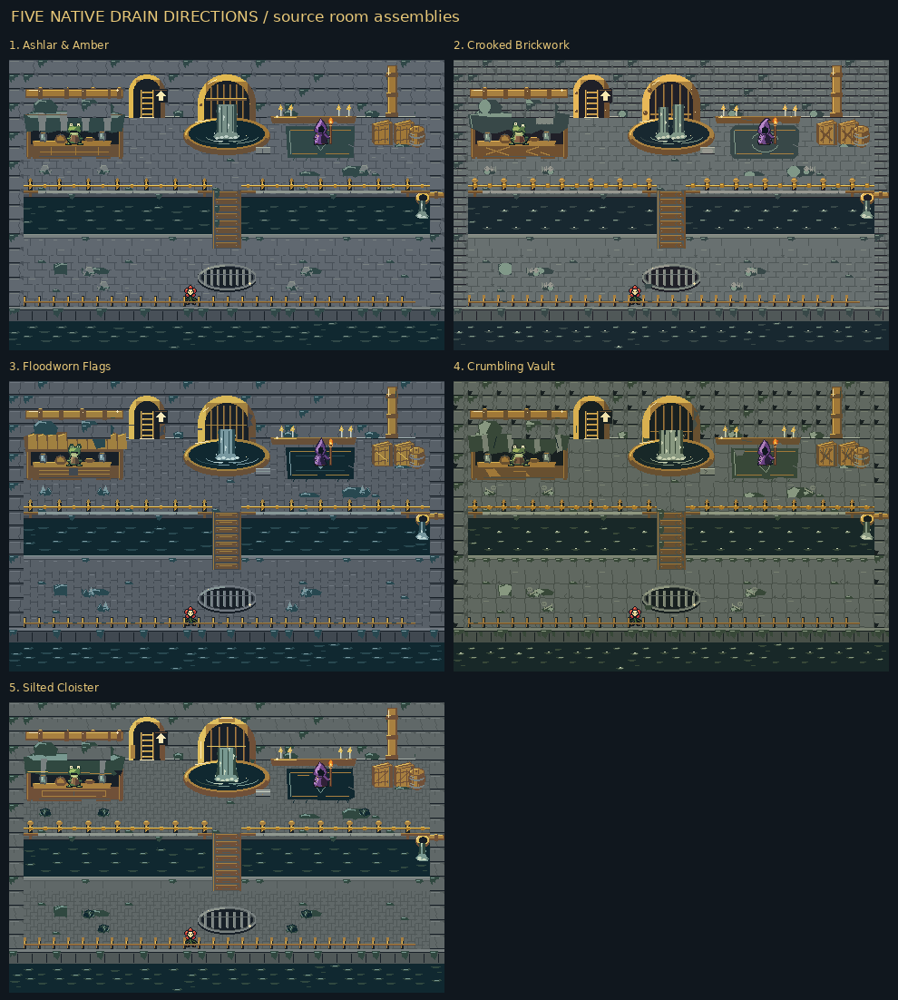
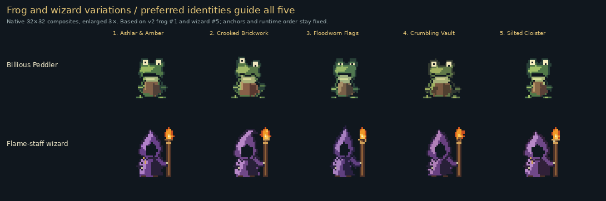
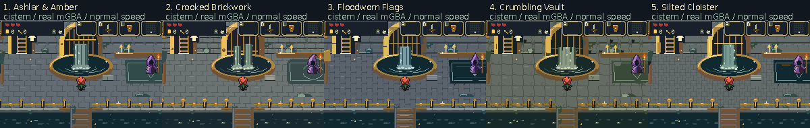
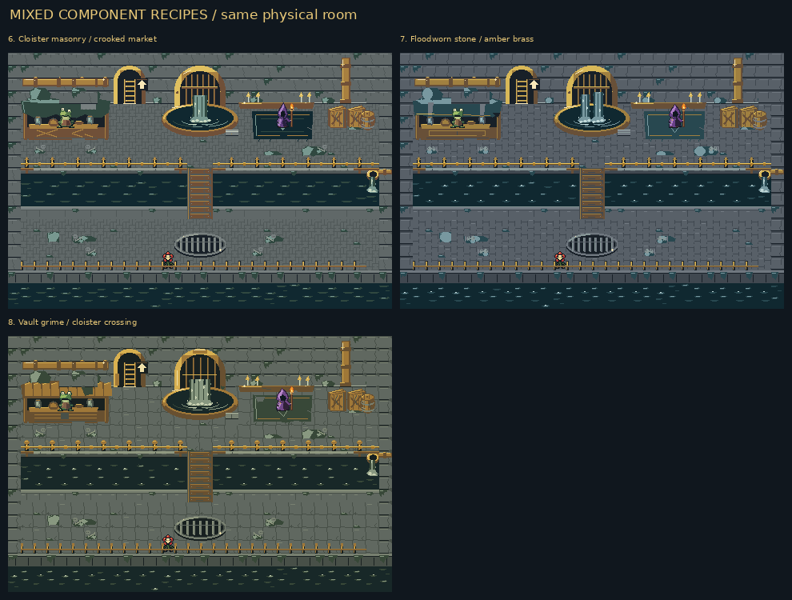

# Drain concepts v3: five new variations from your feedback

All five sewer sets are newly revised, including **five frogs based on preferred
v2 #1** and **five wizards based on preferred v2 #5**. Every fixture family has
five choices. The room layout, Bloom, Step-and-cut, glitter and shared UI stay
intact. These remain selection studies, with three additional mixed rooms.

[Watch the five real mGBA runs](five-concepts-mgba.mp4) ·
[All eight playable ROMs](../../downloads/sewer-concepts-v3-22b0af6/all-eight-sewer-concepts.zip) ·
[Every tile, sprite and animation frame](source/README.md) ·
[Full current inventory](source/INVENTORY.md)

## Five complete rooms

**Source asset assemblies, not emulator screenshots.** Each room is 480×320
world pixels, assembled through the game's original reused metatile IDs.
Zooms are integer nearest-neighbour; no high-resolution art was reduced.
These maps omit the runtime ambient glitter emitter. Actual recordings below
show the 240×160 framebuffer with the preserved glitter.

| Option | Direction | Compare | Full room |
| --- | --- | --- | --- |
| **1** | **Ashlar & Amber** | Broad running-bond brick; closest preferred frog body and pointed wizard anchor. | [Native](source/rooms/room-1-native.png) · [2×](source/rooms/room-1-2x.png) |
| **2** | **Crooked Brickwork** | Unequal old courses, patched scalloped canopy and lopsided frog/hood. | [Native](source/rooms/room-2-native.png) · [2×](source/rooms/room-2-2x.png) |
| **3** | **Floodworn Flags** | Long setts, salvaged timber canopy, narrower sleepy frog and taller cowl. | [Native](source/rooms/room-3-native.png) · [2×](source/rooms/room-3-2x.png) |
| **4** | **Crumbling Vault** | Chipped flags, damaged retaining masonry, ragged cloth and broken-lip water. | [Native](source/rooms/room-4-native.png) · [2×](source/rooms/room-4-2x.png) |
| **5** | **Silted Cloister** | Dense herringbone paving, worn once-fine stall and compact broad hood; the busiest floor. | [Native](source/rooms/room-5-native.png) · [2×](source/rooms/room-5-2x.png) |

## Frogs and wizards

The frogs retain the broad eye/jaw identity and absentminded expressions from
v2 #1; the wizards retain v2 #5's pointed purple hood, shadowed face and flame
staff. Eye height, jaw, posture, apron, cowl bend, hem and robe mass vary.
World sprites and 48×48 portraits are authored separately in native pixels.

Option 1 deliberately retains the preferred frog's fifteen body/action poses;
its new head changes the assembled actor. **135/150 individual world frame
geometries change**, alongside all ten portraits. No meaningless pixels were
added to force every retained pose to have a different hash.

[Preferred actors versus the five new sets](validation/npcs/preferred-to-new-characters.png) ·
[All head expressions](source/sprites/peddler_head.png) ·
[All body actions](source/sprites/peddler_body.png) ·
[All wizard poses](source/sprites/gatekeeper.png) ·
[All flame poses](source/sprites/wisp.png) ·
[All portraits](source/sprites/portraits.png)

The existing planted-foot rest/breathe joins, head anchors, staff/flame anchor,
frame IDs and simple shop speech remain stable. World frogs are partly hidden
by the counter, so their eyes, jaw and shoulders carry their identity there.

## What changed from your feedback

| Family | Your feedback | New revision |
| --- | --- | --- |
| Frog | Prefer #1; keep exploring variations | Preserve broad frog eyes/jaw and absentminded expression as the common starting identity. |
| Wizard | Prefer #5; keep exploring variations | Preserve the tall purple hood and flame-tipped staff; vary cloth wear and silhouette details. |
| Floor | Reject every prior floor | Five new gray brick/flag constructions with distinct bonds, quieter joints and attached grime. |
| Wall | #4 closest | Connected damaged masonry, exposed stone and purposeful damp deposits rather than clean decorative bevels. |
| Ladder | #1 closest; arrow unreadable everywhere | Clear dark opening, useful bright rungs and a separate high-contrast, plainly upward arrow. |
| Cistern | Shapes #1/#4; falling water looks like roots | Broad falling liquid sheets, disconnected moving highlights and visible splash/impact ripples. |
| Market | #1/#2 closest, none approved | Rebuilt cloth/wood stalls with readable wares, coherent supports and deliberate wear. |
| Wizard corner | Vibes #1/#2/#5; like #4's dilapidation | A small shrine/work corner with worn cloth, broken edges and attached grime around the candles. |
| Bridge | #4 closest | Worn, serviceable timber spanning the actual channel and connecting both banks. |
| Rail | #1/#2 construction plus #4's filth | Clear waist-high metal railing with local corrosion, missing finish and coherent grime. |
| Gold outfall | Purpose unclear | A plainly open brass waste pipe: black mouth, lower lip and water discharging into the stream. |
| Storage | #1/#2; blob on crates is unidentifiable | Exposed wooden crate lids and recognizable barrel construction; keep pipe/slime shapes from covering the wood. |
| Floor grate | #4 | Worn barred drain with visible dark recess and a ground-facing rim. |
| Floor bank | #1/#2/#4 | Cohesive dirty coping, a visible vertical face and a clear water boundary. |

The first waterfall sketch still resembled an opaque column. Its final form
adds broken edges, short descending highlights, spray, scalloped impact foam
and expanding pool ripples. The five options include single, split, narrow,
broken-lip and spreading-apron pours. The water should be judged in motion.

The ladder's old arrow was covered by the 24px HUD at the northern camera.
The new filled arrow sits beside the climb lane, below that HUD.

The full-room pilot exposed a map-assembly problem: reused floor tiles erased
most of the small gold outlet. Its mouth now sits on existing unique bank tiles,
and its pour/foam occupies an existing unique animated water tile. The long
wall pipe's reused middle panels now join too. No new collision, room IDs,
actor allocation or physical obstacle was introduced to solve those failures.

## Compare every assembled fixture

Each board keeps the same crop and five numbered options. Before/after boards
compare the previous v2 source art with this corrected v3 source.

| Family | Five new options | Previous / new |
| --- | --- | --- |
| Gray floor brick and filth | [Five choices](source/fixtures/floor.png) | [Compare](source/before-after/fixture-floor.png) |
| Damaged wall masonry and brass pipe | [Five choices](source/fixtures/wall.png) | [Compare](source/before-after/fixture-wall.png) |
| Forest ladder and visible up-arrow | [Five choices](source/fixtures/ladder.png) | [Compare](source/before-after/fixture-ladder.png) |
| Gold cistern, pouring water and basin | [Five choices](source/fixtures/cistern.png) | [Compare](source/before-after/fixture-cistern.png) |
| Frog market and displayed wares | [Five choices](source/fixtures/market.png) | [Compare](source/before-after/fixture-market.png) |
| Worn wizard corner | [Five choices](source/fixtures/wizard.png) | [Compare](source/before-after/fixture-wizard.png) |
| Timber crossing | [Five choices](source/fixtures/bridge.png) | [Compare](source/before-after/fixture-bridge.png) |
| Weathered channel railing | [Five choices](source/fixtures/rail.png) | [Compare](source/before-after/fixture-rail.png) |
| Open brass outlet into the channel | [Five choices](source/fixtures/outfall.png) | [Compare](source/before-after/fixture-outfall.png) |
| Wooden crates and barrel | [Five choices](source/fixtures/storage.png) | [Compare](source/before-after/fixture-storage.png) |
| Barred floor drain | [Five choices](source/fixtures/grate.png) | [Compare](source/before-after/fixture-grate.png) |
| Lower coping and water bank | [Five choices](source/fixtures/bottom-bank.png) | [Compare](source/before-after/fixture-bottom-bank.png) |

[All five room before/after pairs](source/before-after/room-overview.png) ·
[Grayscale room check](source/diagnostics/room-value-overview.png) ·
[Character silhouettes and values](source/diagnostics/character-reads-1x.png) ·
[Rest/breathe joins](source/diagnostics/frog-idle-joins.png) ·
[Native source water animation](source/water-motion-native.gif)

The source water GIF is a native asset animation study, **not mGBA output**.

## Actual mGBA presentation and water motion

These recordings boot the actual ROM in mGBA. Each viewpoint uses the same
seed and only position/safe-position/facing fixtures before ordinary idle or
A-press interaction. They do not assign terrain, NPC poses or animation phases.

[Full-rate five-concept video](five-concepts-mgba.mp4) ·
[Actual ladder comparison](actual-ladder-comparison.png) ·
[Actual market comparison](actual-market-comparison.png) ·
[Actual wizard comparison](actual-wizard-comparison.png) ·
[Actual bridge animation](actual-bridge-comparison.gif)

Each MP4 retains every 59.7275 fps emulator frame; it is a lossy convenience copy.
Selected native PNGs and exact-palette GIFs preserve framebuffer colours.
Comparison captions sit outside the game image. GIFs sample every second frame
at normal speed and 2× nearest-neighbour; filmstrips are chronological samples.

**88 fresh real-run cases** cover nine room viewpoints plus the shop and
wizard dialogue in every complete and mixed recipe.

| Recipe | All actual captures | Cistern motion | Shop / wizard dialogue |
| --- | --- | --- | --- |
| 1. Ashlar & Amber | [Full trace/report](actual/v1/capture.json) | [GIF](actual/v1/cistern.gif) · [MP4](actual/v1/cistern.mp4) | [Shop](actual/v1/peddler-shop.png) · [Wizard](actual/v1/wizard-dialogue.png) |
| 2. Crooked Brickwork | [Full trace/report](actual/v2/capture.json) | [GIF](actual/v2/cistern.gif) · [MP4](actual/v2/cistern.mp4) | [Shop](actual/v2/peddler-shop.png) · [Wizard](actual/v2/wizard-dialogue.png) |
| 3. Floodworn Flags | [Full trace/report](actual/v3/capture.json) | [GIF](actual/v3/cistern.gif) · [MP4](actual/v3/cistern.mp4) | [Shop](actual/v3/peddler-shop.png) · [Wizard](actual/v3/wizard-dialogue.png) |
| 4. Crumbling Vault | [Full trace/report](actual/v4/capture.json) | [GIF](actual/v4/cistern.gif) · [MP4](actual/v4/cistern.mp4) | [Shop](actual/v4/peddler-shop.png) · [Wizard](actual/v4/wizard-dialogue.png) |
| 5. Silted Cloister | [Full trace/report](actual/v5/capture.json) | [GIF](actual/v5/cistern.gif) · [MP4](actual/v5/cistern.mp4) | [Shop](actual/v5/peddler-shop.png) · [Wizard](actual/v5/wizard-dialogue.png) |
| 6. Cloister masonry / crooked market | [Full trace/report](actual/v6/capture.json) | [GIF](actual/v6/cistern.gif) · [MP4](actual/v6/cistern.mp4) | [Shop](actual/v6/peddler-shop.png) · [Wizard](actual/v6/wizard-dialogue.png) |
| 7. Floodworn stone / amber brass | [Full trace/report](actual/v7/capture.json) | [GIF](actual/v7/cistern.gif) · [MP4](actual/v7/cistern.mp4) | [Shop](actual/v7/peddler-shop.png) · [Wizard](actual/v7/wizard-dialogue.png) |
| 8. Vault grime / cloister crossing | [Full trace/report](actual/v8/capture.json) | [GIF](actual/v8/cistern.gif) · [MP4](actual/v8/cistern.mp4) | [Shop](actual/v8/peddler-shop.png) · [Wizard](actual/v8/wizard-dialogue.png) |

Native PNG / MP4 / filmstrip links for every view:

**Recipe 1:** [market](actual/v1/market.mp4) · [ladder](actual/v1/ladder.mp4) · [wizard](actual/v1/wizard.mp4) · [cistern](actual/v1/cistern.mp4) · [bridge](actual/v1/bridge.mp4) · [left-channel](actual/v1/left-channel.mp4) · [right-outfall](actual/v1/right-outfall.mp4) · [lower-left](actual/v1/lower-left.mp4) · [lower-right](actual/v1/lower-right.mp4) · [peddler-shop](actual/v1/peddler-shop.mp4) · [wizard-dialogue](actual/v1/wizard-dialogue.mp4)

**Recipe 2:** [market](actual/v2/market.mp4) · [ladder](actual/v2/ladder.mp4) · [wizard](actual/v2/wizard.mp4) · [cistern](actual/v2/cistern.mp4) · [bridge](actual/v2/bridge.mp4) · [left-channel](actual/v2/left-channel.mp4) · [right-outfall](actual/v2/right-outfall.mp4) · [lower-left](actual/v2/lower-left.mp4) · [lower-right](actual/v2/lower-right.mp4) · [peddler-shop](actual/v2/peddler-shop.mp4) · [wizard-dialogue](actual/v2/wizard-dialogue.mp4)

**Recipe 3:** [market](actual/v3/market.mp4) · [ladder](actual/v3/ladder.mp4) · [wizard](actual/v3/wizard.mp4) · [cistern](actual/v3/cistern.mp4) · [bridge](actual/v3/bridge.mp4) · [left-channel](actual/v3/left-channel.mp4) · [right-outfall](actual/v3/right-outfall.mp4) · [lower-left](actual/v3/lower-left.mp4) · [lower-right](actual/v3/lower-right.mp4) · [peddler-shop](actual/v3/peddler-shop.mp4) · [wizard-dialogue](actual/v3/wizard-dialogue.mp4)

**Recipe 4:** [market](actual/v4/market.mp4) · [ladder](actual/v4/ladder.mp4) · [wizard](actual/v4/wizard.mp4) · [cistern](actual/v4/cistern.mp4) · [bridge](actual/v4/bridge.mp4) · [left-channel](actual/v4/left-channel.mp4) · [right-outfall](actual/v4/right-outfall.mp4) · [lower-left](actual/v4/lower-left.mp4) · [lower-right](actual/v4/lower-right.mp4) · [peddler-shop](actual/v4/peddler-shop.mp4) · [wizard-dialogue](actual/v4/wizard-dialogue.mp4)

**Recipe 5:** [market](actual/v5/market.mp4) · [ladder](actual/v5/ladder.mp4) · [wizard](actual/v5/wizard.mp4) · [cistern](actual/v5/cistern.mp4) · [bridge](actual/v5/bridge.mp4) · [left-channel](actual/v5/left-channel.mp4) · [right-outfall](actual/v5/right-outfall.mp4) · [lower-left](actual/v5/lower-left.mp4) · [lower-right](actual/v5/lower-right.mp4) · [peddler-shop](actual/v5/peddler-shop.mp4) · [wizard-dialogue](actual/v5/wizard-dialogue.mp4)

**Recipe 6:** [market](actual/v6/market.mp4) · [ladder](actual/v6/ladder.mp4) · [wizard](actual/v6/wizard.mp4) · [cistern](actual/v6/cistern.mp4) · [bridge](actual/v6/bridge.mp4) · [left-channel](actual/v6/left-channel.mp4) · [right-outfall](actual/v6/right-outfall.mp4) · [lower-left](actual/v6/lower-left.mp4) · [lower-right](actual/v6/lower-right.mp4) · [peddler-shop](actual/v6/peddler-shop.mp4) · [wizard-dialogue](actual/v6/wizard-dialogue.mp4)

**Recipe 7:** [market](actual/v7/market.mp4) · [ladder](actual/v7/ladder.mp4) · [wizard](actual/v7/wizard.mp4) · [cistern](actual/v7/cistern.mp4) · [bridge](actual/v7/bridge.mp4) · [left-channel](actual/v7/left-channel.mp4) · [right-outfall](actual/v7/right-outfall.mp4) · [lower-left](actual/v7/lower-left.mp4) · [lower-right](actual/v7/lower-right.mp4) · [peddler-shop](actual/v7/peddler-shop.mp4) · [wizard-dialogue](actual/v7/wizard-dialogue.mp4)

**Recipe 8:** [market](actual/v8/market.mp4) · [ladder](actual/v8/ladder.mp4) · [wizard](actual/v8/wizard.mp4) · [cistern](actual/v8/cistern.mp4) · [bridge](actual/v8/bridge.mp4) · [left-channel](actual/v8/left-channel.mp4) · [right-outfall](actual/v8/right-outfall.mp4) · [lower-left](actual/v8/lower-left.mp4) · [lower-right](actual/v8/lower-right.mp4) · [peddler-shop](actual/v8/peddler-shop.mp4) · [wizard-dialogue](actual/v8/wizard-dialogue.mp4)

Full all-frame captures and additional GIFs are kept locally; the portable
report labels those paths as archival. Published native selected frames,
MP4s, filmstrips and traces are unchanged from the final capture output.
The superseded `e354268` pilot is archived separately and is not final evidence.

## Three mixed rooms

Recipes 6–8 mix the revised materials, actors and fixtures in the same layout.
The exact component numbers are in the [source catalogue](source/catalogue.json)
and [recipe module](../../bartgame/art/sewer_concepts.py). Palette roles remain
compatible within one legal Drain BG bank. You can choose individual components
rather than selecting one whole room unchanged.

## Playable builds

[Download all eight ROMs as one ZIP](../../downloads/sewer-concepts-v3-22b0af6/all-eight-sewer-concepts.zip) · [SHA256 checksums](../../downloads/sewer-concepts-v3-22b0af6/SHA256SUMS.txt)

- [1. Ashlar & Amber](../../downloads/sewer-concepts-v3-22b0af6/01-ashlar-amber.gba)
- [2. Crooked Brickwork](../../downloads/sewer-concepts-v3-22b0af6/02-crooked-brickwork.gba)
- [3. Floodworn Flags](../../downloads/sewer-concepts-v3-22b0af6/03-floodworn-flags.gba)
- [4. Crumbling Vault](../../downloads/sewer-concepts-v3-22b0af6/04-crumbling-vault.gba)
- [5. Silted Cloister](../../downloads/sewer-concepts-v3-22b0af6/05-silted-cloister.gba)
- [6. Cloister masonry / crooked market](../../downloads/sewer-concepts-v3-22b0af6/06-cloister-masonry-crooked-market.gba)
- [7. Floodworn stone / amber brass](../../downloads/sewer-concepts-v3-22b0af6/07-floodworn-stone-amber-brass.gba)
- [8. Vault grime / cloister crossing](../../downloads/sewer-concepts-v3-22b0af6/08-vault-grime-cloister-crossing.gba)

Use mGBA. No commercial base ROM is needed. D-pad walk; A talk/use assigned
item; B sword; L shield; R roll while moving or lift while still; R throws
when carrying; Start inventory/key items/map. Default `BART_SEWER=0` still
builds the byte-identical released Step-and-cut room. No sewer style is selected.

## Evidence, shared direction and limits

Frozen game/art source: [`22b0af6`](https://github.com/natertott/bartgame/commit/22b0af6a3c7739f688daf22cd496f402f13b49f1).
[Build commands/hashes](validation/builds.json) · [Packed art audit](validation/audit-scope-summary.json) ·
[Actual-run summary](validation/review-summary.json) · [Combined evidence](validation/summary.json).

The independent 4bpp decoder passes **20,845/20,845 checks**;
fresh mGBA review passes **1,280/1,280 checks**.
Peak recorded OAM is **42/128**. Drain BG use across the eight recipes
is **601, 598, 603, 606, 587, 600, 588, 606/1024**,
with one Drain palette each. Every sampled idle update keeps pace with VBlank.
These are measured cases, not worst-case performance guarantees or taste scores.

Source coverage includes 370 active tile IDs/623 frame drawings per option,
80 unused catalogue IDs/113 frame drawings, five rails,150 world keeper frames
and ten portraits. Thirty of 38 declared animated tile IDs visibly change;
two old fall-top IDs now depict static upper grate. Timing/IDs stay intact.
The packed audit checks all authored poses; actual idle/interact clips activate
11/15 frog body poses,4/5 head poses,5/6 wizard poses and all four flames.
Those samples are not claimed as exhaustive action activation.

The audit preserves room/collision/type/prop/glitter arrays, all Bloom and
Step-and-cut bytes, shared UI/title/font/items, unrelated sprites, forest and
interior art. Separate runtime checks verify both the cistern sheet/impact
and the small outlet's actual VRAM animation against exact ROM frames.

[Shared art bible](../../bartgame/docs/art-reboot/ART_BIBLE.md) ·
[Continuous direction log](../../bartgame/docs/art-reboot/ART_DIRECTION_LOG.md) ·
[Six reference PDFs and page-cited notes](../../bartgame/docs/art-reboot/REFERENCE_REGISTER.md) ·
[Guidance and GBA adaptations](../../bartgame/docs/art-reboot/REFERENCE_APPLICATION.md) ·
[Terrain decisions](../../bartgame/docs/art-reboot/references/DRAIN_V3_TERRAIN.md) ·
[Fixture decisions](../../bartgame/docs/art-reboot/references/DRAIN_V3_FIXTURES.md) ·
[Character decisions](../../bartgame/docs/art-reboot/references/DRAIN_V3_CHARACTERS.md).

Remaining visual tradeoffs: #5's herringbone is substantially denser, #4 is
filthier and lower in saturation, and subtle gray joints depend on display
brightness. Tiny world expressions cannot carry portrait-level detail. The
round cistern architecture stays related because its shape was preferred.
These five proposals need your visual feedback; check counts establish faithful
native implementation, not whether a floor is the right artistic choice.
