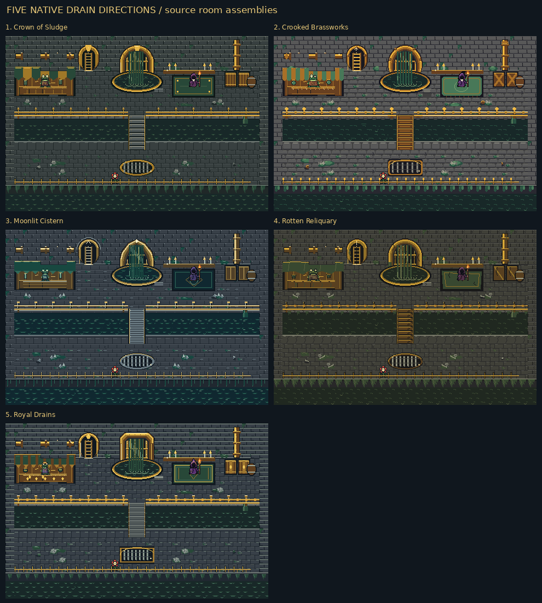
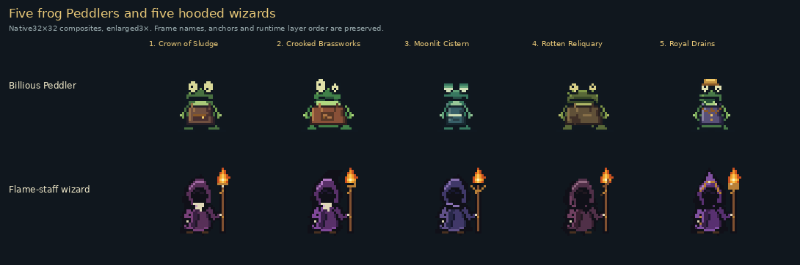
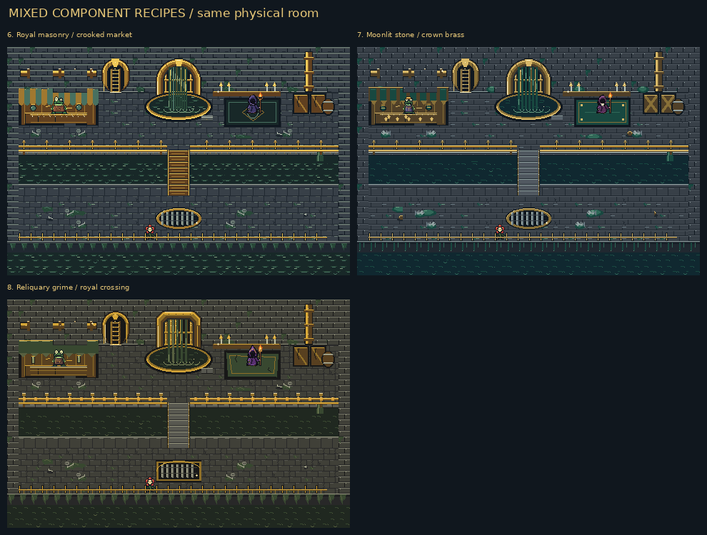

# Drain art concepts for selection

Five complete native-GBA art directions and three mixed-component rooms use
the same Drain layout. All five use gray slimy masonry, dirty ground, flowing
sewage, bright gold fittings, a clear forest ladder, railings and a bridge.
The Billious Peddler is a cartoon frog; the old wizard wears a purple hood and
carries a flame-tipped staff. Bloom, the shared UI and the existing ambient
glitter are preserved.

**The images on this page are source asset comparisons and room assemblies,
not mGBA screenshots.** Every drawing starts at its final GBA pixel size and
uses legal 4bpp inks and RGB555 colors; zooms use integer nearest-neighbour.
The whole room is 480×320 world pixels, larger than the 240×160 GBA viewport.
Source room maps show the full layout for comparison and omit the runtime
ambient glitter emitter. Actual game recordings should be judged separately.

[Complete current asset inventory](INVENTORY.md) · [Machine-readable inventory](inventory.json) ·
[Every alternative and frame hash](catalogue.json)

## Five complete directions

| Option | Direction | Art tradeoff | Full room |
| --- | --- | --- | --- |
| **1** | **Crown of Sludge** | Broad masonry and weighty royal metalwork. Best for a monumental, filthy palace sewer. | [Native 480×320](rooms/room-1-native.png) · [2× zoom](rooms/room-1-2x.png) |
| **2** | **Crooked Brassworks** | Rounder, more crooked forms and playful fittings. Best for a cartoony market and broad frog expressions. | [Native 480×320](rooms/room-2-native.png) · [2× zoom](rooms/room-2-2x.png) |
| **3** | **Moonlit Cistern** | Cooler stone and quieter silhouettes, with warm fittings against dark liquid. Best for a damp night-time cistern. | [Native 480×320](rooms/room-3-native.png) · [2× zoom](rooms/room-3-2x.png) |
| **4** | **Rotten Reliquary** | Broken, encrusted surfaces and more accumulated grime. Best for decay; inspect floor clutter against small characters. | [Native 480×320](rooms/room-4-native.png) · [2× zoom](rooms/room-4-2x.png) |
| **5** | **Royal Drains** | Clearer architectural edges and controlled ornament. Best for readable paths, fixtures and strong gold accents. | [Native 480×320](rooms/room-5-native.png) · [2× zoom](rooms/room-5-2x.png) |

## Choose parts independently

You can ask for a complete option, or mix choices such as **floor 3 + brass 1 +
market 2 + frog 5 + wizard 3**. The following comparisons keep the same crop and
placement in each of the five columns. Large fixtures span several 16px tiles;
they are shown assembled before the exhaustive individual tile catalogue.

- [Slimy gray bricks, puddles and floor grime](fixtures/floor.png)
- [Gray retaining masonry and gold wall pipe](fixtures/wall.png)
- [Forest ladder and unmistakable dark aperture](fixtures/ladder.png)
- [Gold wall outfall, bars, flowing fall and basin](fixtures/cistern.png)
- [Market, displayed wares and absentminded frog](fixtures/market.png)
- [Hooded purple wizard, staff flame and rug](fixtures/wizard.png)
- [Bridge linking banks across the sewage stream](fixtures/bridge.png)
- [Rail separating the player from flowing sewage](fixtures/rail.png)
- [Small gold outfall pouring into moving water](fixtures/outfall.png)
- [Crates, barrel and ground filth](fixtures/storage.png)
- [Walkable floor drain with a clear barred surface](fixtures/grate.png)
- [Lower rail, dirty coping, moss and moving water](fixtures/bottom-bank.png)

## Mixed rooms

These demonstrate component combinations without moving walls, the bridge,
the ladder, the counter or the NPC anchors. Palette roles are consistent, so
metal, water, floors and props can mix while sharing one legal Drain bank.

| Mix | Palette base | Floor | Masonry | Water | Goldwork | Bridge | Market | Frog | Wizard | Full room |
| --- | --- | --- | --- | --- | --- | --- | --- | --- | --- | --- |
| 6. Royal masonry / crooked market | 5 | 5 | 5 | 3 | 1 | 2 | 2 | 2 | 3 | [Native](rooms/room-6-native.png) · [2×](rooms/room-6-2x.png) |
| 7. Moonlit stone / crown brass | 3 | 3 | 3 | 2 | 1 | 5 | 5 | 5 | 1 | [Native](rooms/room-7-native.png) · [2×](rooms/room-7-2x.png) |
| 8. Reliquary grime / royal crossing | 4 | 4 | 1 | 4 | 5 | 5 | 3 | 1 | 5 | [Native](rooms/room-8-native.png) · [2×](rooms/room-8-2x.png) |

## Every NPC sprite frame and portrait

The head/body split keeps the frog's existing breathing, blinking, looking,
coin and hand animations. The wizard's existing frame IDs remain stable; its
separate four-frame flame now belongs at the staff tip. Portraits are authored
independently at 48×48 and match their world identities.

A new 16×8 foreground sprite supplies a continuous handrail between the retained
north-bank posts. It has five geometry choices, uses the common gold OBJ bank
and leaves the room's physical grid and glitter metadata untouched.

- [peddler_head: all 5 frame choices](sprites/peddler_head.png)
- [peddler_body: all 14 frame choices](sprites/peddler_body.png)
- [gatekeeper: all 6 frame choices](sprites/gatekeeper.png)
- [wisp: all 4 frame choices](sprites/wisp.png)
- [portraits: all 2 frame choices](sprites/portraits.png)
- [sewerrail (new foreground handrail): all 1 frame choices](sprites/sewerrail.png)

## Every active Drain metatile

All 370 used metatile identifiers have five alternatives below. These include
350 ground IDs and 20 foreground IDs, across 600 ground and 57 foreground placements.
Their 38 animated IDs retain their frame counts and timing contracts, for 623
distinct authored tile frames per option. Atlas rows show phase 0; every other
animation frame appears in the filmstrip appendix. IDs, collisions, dimensions,
interactions and room placement remain unchanged.

- [bridge / swh_227–swh_260](tiles/bridge-01.png)
- [floor / swh_116–swh_196](tiles/floor-01.png)
- [floor / swh_197–swh_216](tiles/floor-02.png)
- [floor / swh_265–swh_290](tiles/floor-03.png)
- [floor / swh_291–swh_318](tiles/floor-04.png)
- [market / swh_083–swh_140](tiles/market-01.png)
- [market / swh_141–swh_363](tiles/market-02.png)
- [masonry / swh_000–swh_024](tiles/masonry-01.png)
- [masonry / swh_025–swh_057](tiles/masonry-02.png)
- [masonry / swh_058–swh_222](tiles/masonry-03.png)
- [masonry / swh_223–swh_269](tiles/masonry-04.png)
- [masonry / swh_270–swh_331](tiles/masonry-05.png)
- [masonry / swh_332–swh_332](tiles/masonry-06.png)
- [metal / swh_011–swh_044](tiles/metal-01.png)
- [metal / swh_052–swh_081](tiles/metal-02.png)
- [metal / swh_090–swh_125](tiles/metal-03.png)
- [metal / swh_134–swh_178](tiles/metal-04.png)
- [metal / swh_179–swh_352](tiles/metal-05.png)
- [metal / swh_353–swh_369](tiles/metal-06.png)
- [props / swh_133–swh_306](tiles/props-01.png)
- [sanctum / swh_098–swh_159](tiles/sanctum-01.png)
- [sanctum / swh_180–swh_185](tiles/sanctum-02.png)
- [water / swh_233–swh_334](tiles/water-01.png)
- [water / swh_335–swh_349](tiles/water-02.png)

2 small active pieces retain the same indexed geometry in all five
options; some are blank or common seam fragments, with material colors supplied
by each option's palette. Other pieces can share geometry between a subset of
the options. The catalogue records the exact frame hashes and sharing counts.
Pixel differences were not added merely to manufacture five unique hashes.

## Every active animated tile frame

- [swh_038: all 3 frames × five options](animation-frames/swh_038.png)
- [swh_043: all 3 frames × five options](animation-frames/swh_043.png)
- [swh_068: all 4 frames × five options](animation-frames/swh_068.png)
- [swh_069: all 4 frames × five options](animation-frames/swh_069.png)
- [swh_095: all 4 frames × five options](animation-frames/swh_095.png)
- [swh_096: all 4 frames × five options](animation-frames/swh_096.png)
- [swh_100: all 3 frames × five options](animation-frames/swh_100.png)
- [swh_101: all 3 frames × five options](animation-frames/swh_101.png)
- [swh_102: all 3 frames × five options](animation-frames/swh_102.png)
- [swh_122: all 12 frames × five options](animation-frames/swh_122.png)
- [swh_123: all 12 frames × five options](animation-frames/swh_123.png)
- [swh_234: all 8 frames × five options](animation-frames/swh_234.png)
- [swh_235: all 8 frames × five options](animation-frames/swh_235.png)
- [swh_236: all 8 frames × five options](animation-frames/swh_236.png)
- [swh_237: all 8 frames × five options](animation-frames/swh_237.png)
- [swh_238: all 8 frames × five options](animation-frames/swh_238.png)
- [swh_241: all 8 frames × five options](animation-frames/swh_241.png)
- [swh_244: all 8 frames × five options](animation-frames/swh_244.png)
- [swh_245: all 8 frames × five options](animation-frames/swh_245.png)
- [swh_246: all 8 frames × five options](animation-frames/swh_246.png)
- [swh_247: all 8 frames × five options](animation-frames/swh_247.png)
- [swh_248: all 8 frames × five options](animation-frames/swh_248.png)
- [swh_249: all 8 frames × five options](animation-frames/swh_249.png)
- [swh_327: all 2 frames × five options](animation-frames/swh_327.png)
- [swh_330: all 2 frames × five options](animation-frames/swh_330.png)
- [swh_334: all 8 frames × five options](animation-frames/swh_334.png)
- [swh_335: all 8 frames × five options](animation-frames/swh_335.png)
- [swh_336: all 8 frames × five options](animation-frames/swh_336.png)
- [swh_337: all 24 frames × five options](animation-frames/swh_337.png)
- [swh_338: all 8 frames × five options](animation-frames/swh_338.png)
- [swh_339: all 8 frames × five options](animation-frames/swh_339.png)
- [swh_340: all 8 frames × five options](animation-frames/swh_340.png)
- [swh_341: all 24 frames × five options](animation-frames/swh_341.png)
- [swh_344: all 8 frames × five options](animation-frames/swh_344.png)
- [swh_345: all 8 frames × five options](animation-frames/swh_345.png)
- [swh_346: all 8 frames × five options](animation-frames/swh_346.png)
- [swh_347: all 8 frames × five options](animation-frames/swh_347.png)
- [swh_348: all 8 frames × five options](animation-frames/swh_348.png)

## Retained unused sewer catalogue

These 80 `sw_` identifiers are retained vocabulary, not room placements or
additional objects in the current Drain. They also receive five alternatives
for reference; their 113 frame drawings are listed separately to avoid implying
that these tiles appear in the current room.

- [floor / sw_floor0–sw_floor_drip](unused-tiles/floor-01.png)
- [market / sw_banner_teal–sw_counter_r](unused-tiles/market-01.png)
- [masonry / sw_wall–sw_wall_top_moss](unused-tiles/masonry-01.png)
- [metal / sw_grate–sw_grate_r](unused-tiles/metal-01.png)
- [props / sw_rubble–sw_gold](unused-tiles/props-01.png)
- [sanctum / sw_torch_lit–sw_rug_se](unused-tiles/sanctum-01.png)
- [water / sw_water–sw_fall_5](unused-tiles/water-01.png)

Unused-catalogue animation filmstrips:

- [sw_water: all 2 frames × five options](unused-animation-frames/sw_water.png)
- [sw_lilypad: all 2 frames × five options](unused-animation-frames/sw_lilypad.png)
- [sw_waterfall: all 2 frames × five options](unused-animation-frames/sw_waterfall.png)
- [sw_torch_lit: all 2 frames × five options](unused-animation-frames/sw_torch_lit.png)
- [sw_candles: all 2 frames × five options](unused-animation-frames/sw_candles.png)
- [sw_lantern: all 2 frames × five options](unused-animation-frames/sw_lantern.png)
- [sw_floor_puddle: all 2 frames × five options](unused-animation-frames/sw_floor_puddle.png)
- [sw_floor_shroom: all 2 frames × five options](unused-animation-frames/sw_floor_shroom.png)
- [sw_floor_drip: all 4 frames × five options](unused-animation-frames/sw_floor_drip.png)
- [sw_wall_drip: all 4 frames × five options](unused-animation-frames/sw_wall_drip.png)
- [sw_wall_fungus: all 2 frames × five options](unused-animation-frames/sw_wall_fungus.png)
- [sw_wall_window: all 2 frames × five options](unused-animation-frames/sw_wall_window.png)
- [sw_water_scum: all 2 frames × five options](unused-animation-frames/sw_water_scum.png)
- [sw_water_bubble: all 4 frames × five options](unused-animation-frames/sw_water_bubble.png)
- [sw_water_glint: all 2 frames × five options](unused-animation-frames/sw_water_glint.png)
- [sw_glint: all 3 frames × five options](unused-animation-frames/sw_glint.png)
- [sw_glint2: all 3 frames × five options](unused-animation-frames/sw_glint2.png)
- [sw_glint3: all 3 frames × five options](unused-animation-frames/sw_glint3.png)
- [sw_fall_0: all 2 frames × five options](unused-animation-frames/sw_fall_0.png)
- [sw_fall_1: all 2 frames × five options](unused-animation-frames/sw_fall_1.png)
- [sw_fall_2: all 2 frames × five options](unused-animation-frames/sw_fall_2.png)
- [sw_fall_3: all 2 frames × five options](unused-animation-frames/sw_fall_3.png)
- [sw_fall_4: all 2 frames × five options](unused-animation-frames/sw_fall_4.png)
- [sw_fall_5: all 2 frames × five options](unused-animation-frames/sw_fall_5.png)

## Scope and critique limits

These are choices for feedback. A complete option has not been selected for
the released game. Shared HUD, shop chrome, font, inventory, conditional item
effects, Bloom and runtime glitter are catalogued as preserved common assets;
they do not receive five Drain-only redesigns that would make them inconsistent
with the forest. There are no authored Drain enemy, chest or switch spawns.

Each complete direction changes indexed geometry as well as palette; the two
new NPCs also have five distinct composite geometries. A full native room map
is useful for composition, but cannot replace motion and occlusion review in
the real 240×160 viewport. Inspect flowing water, the staff flame, NPC poses,
the bridge landings and rail separation in the actual recordings before choosing.
