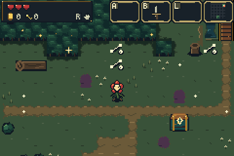
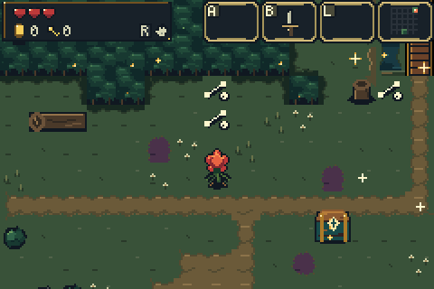

# Selected Step-and-cut sword swing

**Step-and-cut is now Bloom's default sword action.** This release promotes
variation 3 exactly as reviewed: eight whole-body and blade poses per facing,
with matching damage bounds and predictable preparation/cut/recovery timing.
The roots, hips, shoulders and flower move together. The drawn step transfers
weight without a world-position lunge. Existing saves remain compatible.

[Download the full game ROM](../../downloads/step-and-cut-7c46553/bartgame-step-and-cut-7c46553.gba) ·
[Download the ZIP](../../downloads/step-and-cut-7c46553/bartgame-step-and-cut-7c46553.zip) ·
[Source and timing notes](../../bartgame/docs/SWORD_STUDIES.md)

## Fresh actual mGBA recordings

[East 3× slow](captures/forest-e-slow.gif) · [North 3× slow](captures/forest-n-slow.gif) ·
[East diagnostic damage box](captures/forest-e-hitbox.gif) · [North diagnostic damage box](captures/forest-n-hitbox.gif) ·
[East enemy contact](targets/forest-e.gif) · [North enemy contact](targets/forest-n.gif)

All 20 clips below are fresh real mGBA 0.10.5 runs on the production ROM.
Videos retain every source video frame at the GBA rate; normal GIFs sample
every second frame and can omit a one-update pose. 3× slow GIFs retain every
frame. Native selected PNGs remain exact 240×160 framebuffers. Diagnostic cyan
rectangles are review overlays, outside the ordinary game interface.

| Ground | North | East | South | West |
| --- | --- | --- | --- | --- |
| Healthy forest | [Video](captures/forest-n.mp4) · [Poses](captures/forest-n-poses.png) | [Video](captures/forest-e.mp4) · [Poses](captures/forest-e-poses.png) | [Video](captures/forest-s.mp4) · [Poses](captures/forest-s-poses.png) | [Video](captures/forest-w.mp4) · [Poses](captures/forest-w-poses.png) |
| Blighted forest | [Video](captures/blight-n.mp4) · [Poses](captures/blight-n-poses.png) | [Video](captures/blight-e.mp4) · [Poses](captures/blight-e-poses.png) | [Video](captures/blight-s.mp4) · [Poses](captures/blight-s-poses.png) | [Video](captures/blight-w.mp4) · [Poses](captures/blight-w-poses.png) |
| Drain | [Video](captures/drain-n.mp4) · [Poses](captures/drain-n-poses.png) | [Video](captures/drain-e.mp4) · [Poses](captures/drain-e-poses.png) | [Video](captures/drain-s.mp4) · [Poses](captures/drain-s-poses.png) | [Video](captures/drain-w.mp4) · [Poses](captures/drain-w-poses.png) |
| Cave | [Video](captures/cave-n.mp4) · [Poses](captures/cave-n-poses.png) | [Video](captures/cave-e.mp4) · [Poses](captures/cave-e-poses.png) | [Video](captures/cave-s.mp4) · [Poses](captures/cave-s-poses.png) | [Video](captures/cave-w.mp4) · [Poses](captures/cave-w-poses.png) |
| Controlled enemy contacts | [Video](targets/forest-n.mp4) · [Poses](targets/forest-n-poses.png) | [Video](targets/forest-e.mp4) · [Poses](targets/forest-e-poses.png) | [Video](targets/forest-s.mp4) · [Poses](targets/forest-s-poses.png) | [Video](targets/forest-w.mp4) · [Poses](targets/forest-w-poses.png) |

## Timing and verification

The action lasts 18 updates: 4 preparation, 7 live and 7 recovery (about 301ms total).
Live logic ages are 4–10 inclusive; preparation and recovery cannot damage.
The single generated clock drives the body, blade, hand anchor, swish and
contact bounds. Contact uses the inclusive rectangle of the authored visible
blade/trail mask; it is rectangular collision, not per-pixel collision.

**1,359/1,359 checks pass**, covering 744 sword/art/hardware/contact checks,
469 broader action checks, 29 representative performance checks and 117 gameplay
regressions: gathering, seed reflection, lifting/throwing, all three mandatory
trials, full progression, actual Heart defeat, Grail victory and save handling.
The four 192-frame performance samples each complete 192 game updates in 192
VBlanks. These are representative measurements, not a worst-case guarantee.

All 16 clean cases and 4 target cases show exactly one complete action, all eight
poses, the expected live schedule and verified uploaded body/weapon bytes.
Controlled beetles retain native 2HP. Their first hits at 24px forward hurtbox
spacing occur at ages 6/4/6/4 for N/E/S/W, all within the live window. Different
spacing or enemies can change first contact timing.

The capture fixtures set seed, safe position, facing, inventory and clear
unrelated actors. They do not replace terrain or inject attack poses/timers.
Target demos use ordinary constructor-spawned beetles, positioned ahead and
paused with zero-speed knockback. Their HP/death/reward flags are not written.
Snapshots are matched to real OAM/OBJ data before diagnostic overlays are drawn.

[Validation summary](validation/summary.json) · [Exact sword report](validation/sword-probe.json) ·
[Action report](validation/action-suite.json) · [Performance report](validation/performance.json) ·
[Clean traces](captures/capture.json) · [Contact traces](targets/capture.json)

All videos, selected native frames, filmstrips and traces are published.
Only the linked GIFs are included; omitted GIF paths and local full-frame
archives are retained under `archival_formats`. Capture reports document this
publication adaptation and the SHA256 of their original source report.

Built with ordinary `make -j4` from source `7c46553ff80bf558daa66f02c2b6d4d9f468e888`
on `art-reboot`. Direct asset generation also selects 3. The ROM is byte-identical
to the approved Step-and-cut prototype.

ROM SHA256: `547674bfd44f79cd5614f3188bad86f8ed8a4a9ea9cee060e1236ca0c832c97a`
