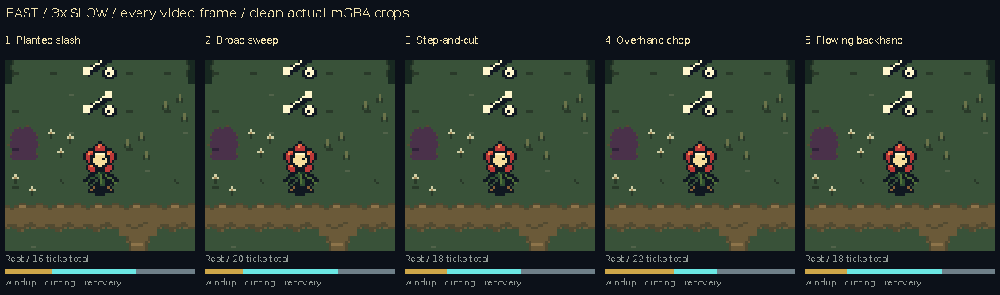

# Five Bloom sword-swing variations

These are **five prototypes for your feedback**, all recorded from real mGBA
runs. No option has been selected for the released game.

[Watch the 24-second side-by-side video](sword-studies.mp4) ·
[Download all five playable study ROMs](../../downloads/sword-studies-89978ba/all-five-sword-studies.zip) ·
[Zelda research and pinned sources](../../bartgame/docs/SWORD_STUDIES_RESEARCH.md)

Use the full-rate video for timing. It shows two normal-speed cycles followed
by a clearly labelled 3× slow cycle in each of the four facings. Normal GIFs
sample every second video frame and can omit a one-update pose; slow views
retain every source frame. All game pixels start at GBA resolution.

## Compare the five

| No. | Variation | Character and timing | Views |
| --- | --- | --- | --- |
| **1** | **Planted slash** | Fast, compact cut with a planted stance; 16updates (~268ms). Body motion is restrained. | [Normal](variation-1.gif) · [3× slow](variation-1-slow.gif) · [Hitbox](variation-1-hitbox.gif) · [Enemy hit](variation-1-target.gif) |
| **2** | **Broad sweep** | Stronger hip/flower rotation and a longer forward catch; 20updates (~335ms). Broadest, more forgiving hold. | [Normal](variation-2.gif) · [3× slow](variation-2-slow.gif) · [Hitbox](variation-2-hitbox.gif) · [Enemy hit](variation-2-target.gif) |
| **3** | **Step-and-cut** | Forward lean and root placement put weight into the cut; 18updates (~301ms). The step is cosmetic, without a world lunge. | [Normal](variation-3.gif) · [3× slow](variation-3-slow.gif) · [Hitbox](variation-3-hitbox.gif) · [Enemy hit](variation-3-target.gif) |
| **4** | **Overhand chop** | Overhead load, downstroke and compressed impact; 22updates (~368ms). Slowest preparation and shortest cutting window. | [Normal](variation-4.gif) · [3× slow](variation-4-slow.gif) · [Hitbox](variation-4-hitbox.gif) · [Enemy hit](variation-4-target.gif) |
| **5** | **Flowing backhand** | Reverse-direction sweep and an expressive shoulder follow-through; 18updates (~301ms). Busier return motion. | [Normal](variation-5.gif) · [3× slow](variation-5-slow.gif) · [Hitbox](variation-5-hitbox.gif) · [Enemy hit](variation-5-target.gif) |

The individual cards cycle **east then north** so the side view and the
previously troublesome back view are both visible. The following synchronized
slow comparison makes the eight full-body poses easier to inspect:

[North slow comparison](comparison-n-slow.gif) ·
[South slow comparison](comparison-s-slow.gif) ·
[West slow comparison](comparison-w-slow.gif) ·
[Static pose overview](overview.png) · [All eight poses](pose-sequences.png)

## Judge the real damage area

In the clean views, the leading steel and short faded ribbon indicate the
cut. In the separate diagnostic views, **cyan is the actual inclusive damage
box for the displayed pose**. The cyan rectangle is not normal game artwork.
Prepared snapshots are matched to uploaded body/weapon data before drawing it;
using the current actor timer alone would put the box ahead of the picture.

[East: actual boxes, 3× slow](comparison-e-hitbox-slow.gif) ·
[North: actual boxes, 3× slow](comparison-n-hitbox-slow.gif) ·
[South: actual boxes, 3× slow](comparison-s-hitbox-slow.gif) ·
[West: actual boxes, 3× slow](comparison-w-hitbox-slow.gif)

| Style | Preparation | Cutting | Recovery | Active ages, inclusive |
| --- | --- | --- | --- | --- |
| 1 | 4 | 7 | 5 | 4–10 |
| 2 | 4 | 10 | 6 | 4–13 |
| 3 | 4 | 7 | 7 | 4–10 |
| 4 | 8 | 5 | 9 | 8–12 |
| 5 | 4 | 9 | 5 | 4–12 |

Values are game updates at about 59.7275Hz, starting with age 0 on the input
update. Body, blade, hand, damage and swish now share the same clock.
Windup/recovery cannot damage targets. Each style uses rectangular contact
regions derived from its visible cutting mask, not per-pixel collision.

The controlled-target clips show an actual ordinary beetle being hit, with
native HP untouched. Its position and AI pause are disclosed review fixtures;
impact, damage, death and dropped loot come from the real game. The forward
contact tests first prove the target is outside body overlap. All 20 centred
forward-target cases hit during the declared live interval.

## Other backgrounds and full views

Each style has 16 clean full-screen clips: north/east/south/west on healthy
forest, Drain, deep blight and a naturally generated cave. MP4s retain every
captured frame. The five folders also contain exact 240×160 selected PNGs,
chronological pose filmstrips and complete runtime traces.

| Style | Full views | Controlled target views | Try it in mGBA |
| --- | --- | --- | --- |
| 1 | [All 16 clips](actual/v1/) | [North/east](actual/targets/v1/) | [Download ROM](../../downloads/sword-studies-89978ba/01-planted-slash.gba) |
| 2 | [All 16 clips](actual/v2/) | [North/east](actual/targets/v2/) | [Download ROM](../../downloads/sword-studies-89978ba/02-broad-sweep.gba) |
| 3 | [All 16 clips](actual/v3/) | [North/east](actual/targets/v3/) | [Download ROM](../../downloads/sword-studies-89978ba/03-step-and-cut.gba) |
| 4 | [All 16 clips](actual/v4/) | [North/east](actual/targets/v4/) | [Download ROM](../../downloads/sword-studies-89978ba/04-overhand-chop.gba) |
| 5 | [All 16 clips](actual/v5/) | [North/east](actual/targets/v5/) | [Download ROM](../../downloads/sword-studies-89978ba/05-flowing-backhand.gba) |

The compact publication retains all 90 case videos, native keyframes,
filmstrips and traces, plus the 46 main comparison/card GIFs. Redundant
full-screen case GIFs remain regenerable archives. Published reports move
those omitted paths into `archival_formats` and record the source report's
SHA256; trace/native/video fields are unchanged. Source mockups are not used
as emulator evidence. The MP4 is a lossy convenience; native PNGs stay exact.

## Research and critique

Studied Link's Awakening DX, Oracle of Ages/Seasons and Minish Cap native
sprite construction and animation/collision code. Important lessons were
whole-body posing, unequal anticipation/contact/recovery holds, and coherent
body/blade/contact selection. Oracle's ordinary script uses 3/3/8/3 update
holds; those are source-script values, not a claimed end-to-end input-latency
measurement. [Read the cited research](../../bartgame/docs/SWORD_STUDIES_RESEARCH.md).

Review found two practical causes of the old feel: the body and blade used
different pose schedules, and the north blade could stay off to the side of
a centred threat. The studies use one eight-pose clock and visible inward
north aiming. Side grips were lowered to waist height. The early blocky
trail was tapered and dimmed so it reads as motion behind the steel.

The remaining differences are deliberate choices: 1 is restrained, 2 uses the
broadest readable contact hold, 3 sells forward effort, 4 commits to an overhead
load, and 5 uses a more expressive reverse return. Inspect both normal speed
and slow motion before choosing. [Design and implementation notes](../../bartgame/docs/SWORD_STUDIES.md).

## Exact builds and verification

The five frozen builds are from source [`89978ba`](https://github.com/natertott/bartgame/commit/89978badb0f242471f402eeb1da4c65b01892f3a).
Their hashes are recorded in the [build manifest](validation/builds.json)
and [download checksums](../../downloads/sword-studies-89978ba/SHA256SUMS.txt).

All **3,878/3,878** study checks pass, including 544 edge contacts, 20 full-swing
forward contacts, harmless windup/recovery and exact hardware pose durations
in every style/facing. All 80 clean and 10 controlled-target recordings pass
expected action and hardware-alignment checks. The default build is byte-for-
byte the released art reboot; no study is automatically selected.

[Verification summary](validation/summary.json) ·
[Capture checks](validation/capture-checks.json) ·
[Unchanged-default proof](validation/default-proof.json) ·
[Gallery hashes and palette metadata](gallery-manifest.json)
