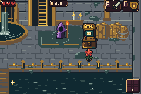
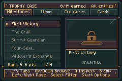
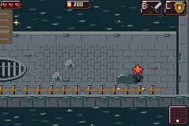
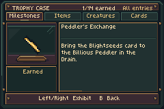
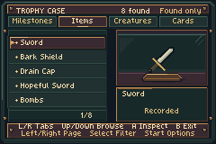
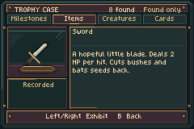
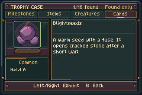
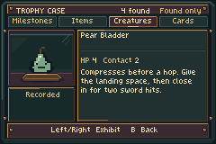
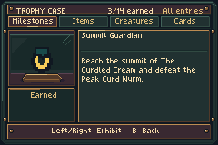

# The Drain Trophy Case

The cabinet on the north bank now carries a CASE marquee. The Peddler's shop
and the Wizard occupy their familiar places. The cot, service stalls and
duplicate trophy cup are gone from the Drain.

| The Drain | Milestones |
| --- | --- |
|  |  |
|  |  |

| Browse and filter | Inspect an exhibit |
| --- | --- |
|  |  |
|  |  |

These are native 240×160 frames from mGBA 0.10.5 on the ROM built from
`936db7c9`. The card and Peddler milestone come from an in-game drop and
trade. The probe uses a declared encounter fixture to reproduce that drop.

The release passed 59 Trophy Case and Drain checks, 66 Trading Cards checks,
75 Cream checks, 62 combat checks and 19 item checks. A cold New Game showed
the Summit Guardian trophy after actual boss combat. A private discovery
profile exercised all 253 catalogue entries and their preview artwork. An
older save with a real paid bed reward delivered that reward once on Continue.

**ROM SHA-256** `e7dcc0fa3571a4703cfb10e36f09032fae1c4cad42586100ffcc6f59e824a9fc`

[Playable ROM](../../downloads/trophy-case-936db7c9/bartgame-trophy-case.gba) · [Controls, reference study and save behavior](../../bartgame/docs/TROPHY_CASE.md) · [Native test](../../bartgame/tools/trophy_case_native.py)
