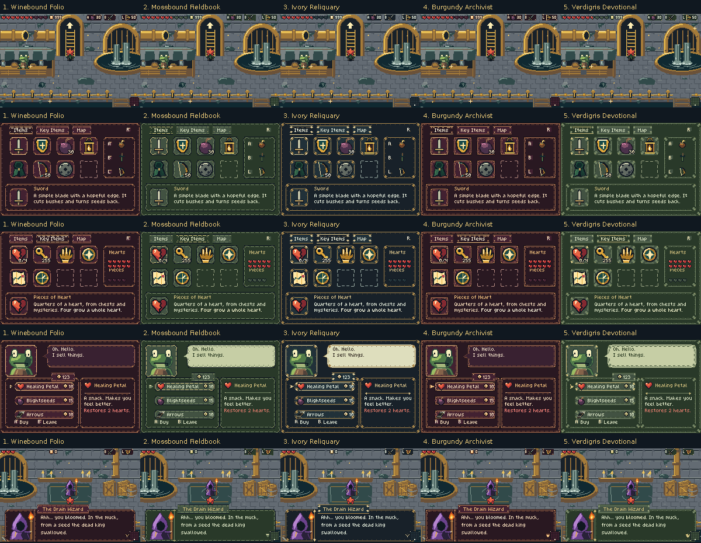
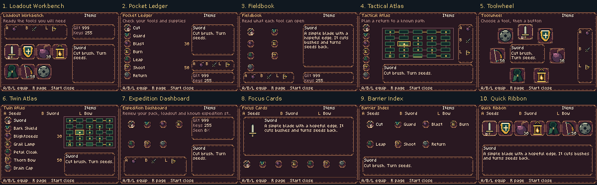
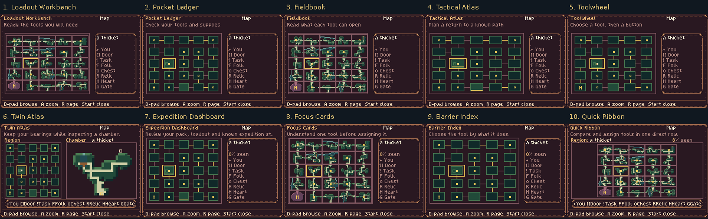
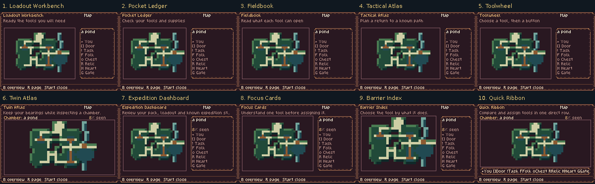

# Five interface skins and ten playable menu designs

These are **actual mGBA captures of native 240×160 GBA builds**, authored with
4bpp tiles and RGB555 palettes. Each option is playable. The final Drain,
forest, Bloom and Step-and-cut remain intact; no new interface is selected as
the production default.

There are two separate comparisons:

- **Skins 1–5:** new designs derived from your preferred #2/#4/#5 structures,
  using the requested #1/#4/#5 palettes, on the same existing menu layout.
- **Layouts 1–10:** different item, information and map arrangements in one
  common Winebound skin. Their numbers are independent of the skin numbers.

[Download the baseline and all fifteen studies](https://raw.githubusercontent.com/natertott/bartgame/ui-menu-exploration/downloads/ui-menu-studies-d113d39/baseline-and-fifteen-studies.zip)
· [Individual ROMs and checksums](../../downloads/ui-menu-studies-d113d39/README.md)
· [Research and pinned citations](../../bartgame/docs/art-reboot/references/GBA_MENU_RESEARCH.md)
· [Independent visual/usability critique](validation/ux-review.md)

## Five revised skins

| Skin | Structure / palette | Character and tradeoff |
| --- | --- | --- |
| **1 Winebound Folio** | Rounded folio #2 / wine #4 | Soft folded corners, wine fields and restrained gold rules. Warm and readable; close in mood to the previous Wine option. |
| **2 Mossbound Fieldbook** | Folio #2 + ledger #5 / green #5 | Lapped repairs and quiet seams. Earthier and more utilitarian; ornament is less prominent. |
| **3 Ivory Reliquary** | Restrained brocade #4 / ivory-wire #1 | Pale ornament on dark slate, clustered corner leaves. The clearest cool alternative to wine/green. |
| **4 Burgundy Archivist** | Brocade #4 + ledger #5 / wine #4 | Riveted corners, archival plates and broken double rails. Most rigid and ceremonial; also visually busiest. |
| **5 Verdigris Devotional** | Folio/brocade/ledger #2/#4/#5 / green #5 | Repaired seams and attached leaf ornaments. More decorative than Fieldbook while retaining a dark reading field. |

The HUD retains **hearts, gilt, equipped items, minimap, and ammunition only
for equipped blightseeds/bow**. Its top backing stays within twelve pixels;
the minimap stays in the bottom corner. Equipment and heart colors preserve
their meanings. Geometry and palette are separate recipes for future regions;
automatic regional color switching is not activated in these studies.

Compare the same five skins on other actual screens:

| Gameplay / HUD | Menus | Interactions |
| --- | --- | --- |
| [Sewer](skins/hud-sewer-max.png) · [99 ammo](skins/hud-ammo-99.png) | [Items](skins/menu-items.png) · [Key items](skins/menu-key-items.png) | [Market](skins/shop.png) · [Wizard dialogue](skins/dialogue-wizard.png) |
| [Healthy forest](skins/hud-healthy.png) · [Blighted forest](skins/hud-blighted.png) · [Cave](skins/hud-cave.png) | [Overview](skins/menu-map.png) · [Chamber zoom](skins/menu-map-zoom.png) | [Chest reward](skins/reward-chest.png) · [Continue](skins/title-continue.png) · [Heart victory](skins/victory.png) |

[Animated five-way type-on dialogue comparison](five-skin-dialogue.gif).
Native frames and individual full-rate clips are under
[actual/v1](actual/v1/capture.json), [v2](actual/v2/capture.json),
[v3](actual/v3/capture.json), [v4](actual/v4/capture.json), and
[v5](actual/v5/capture.json).

## Ten menu and item-selection layouts

Each design includes **Items, Key Items, Map and chamber zoom**, with real
inventory, quantities, assignment state and known-map information. All seven
current tools are reachable. Unknown tools cannot be selected. The native
32px menu illustrations and separately drawn 16px glyphs are used at their
authored sizes.

| Layout | What it helps the player do | Tradeoff | Inspect / play |
| --- | --- | --- | --- |
| **1 Loadout Workbench** | Compare the pack with A/B/L assignments at a glance. | Equipment/status panels shorten the item explanation. | [Four pages](layouts/layout-01-four-pages-2x.png) · [Video](walkthroughs/layout-01.mp4) |
| **2 Pocket Ledger** | Read a stable list of tool uses and relevant quantities. | Requires vertical navigation; less illustration detail. | [Four pages](layouts/layout-02-four-pages-2x.png) · [Video](walkthroughs/layout-02.mp4) |
| **3 Fieldbook** | Read a selected tool on an opposite page with equipment below. | Compact glyphs and narrow text column favor careful reading over quick scanning. | [Four pages](layouts/layout-03-four-pages-2x.png) · [Video](walkthroughs/layout-03.mp4) |
| **4 Tactical Atlas** | Choose equipment while keeping known connections visible. | Less room for long descriptions; schematic geography is simplified. | [Four pages](layouts/layout-04-four-pages-2x.png) · [Video](walkthroughs/layout-04.mp4) |
| **5 Toolwheel** | Learn fixed spatial tool positions and switch by direction. | D-pad navigation around a wheel takes learning; partial ownership leaves empty nodes. | [Four pages](layouts/layout-05-four-pages-2x.png) · [Video](walkthroughs/layout-05.mp4) |
| **6 Twin Atlas** | See the selected chamber beside the regional map for backtracking. | Each map is smaller; A still opens a larger chamber view. | [Four pages](layouts/layout-06-four-pages-2x.png) · [Video](walkthroughs/layout-06.mp4) |
| **7 Expedition Dashboard** | Check the pack, assignments, gilt, keys and actual explored state together. | Dense overview; small tool glyphs and shorter descriptions. | [Four pages](layouts/layout-07-four-pages-2x.png) · [Video](walkthroughs/layout-07.mp4) |
| **8 Focus Cards** | Understand one tool before assigning it, with a generous item card. | Other tools are less prominent in the small peer rail. | [Four pages](layouts/layout-08-four-pages-2x.png) · [Video](walkthroughs/layout-08.mp4) |
| **9 Barrier Index** | Select by gameplay verb: Cut, Guard, Blast, Burn, Leap, Shoot or Return. | Verbs supplement the real item names; they do not promise an obstacle in the selected room. | [Four pages](layouts/layout-09-four-pages-2x.png) · [Video](walkthroughs/layout-09.mp4) |
| **10 Quick Ribbon** | Reassign tools through one clear row of full-size illustrations. | Horizontal travel; more future tools would need paging. | [Four pages](layouts/layout-10-four-pages-2x.png) · [Video](walkthroughs/layout-10.mp4) |

My strongest comparison set is **1 for loadout clarity, 6 for maze navigation,
8 for learning tools, and 10 for quick reassignment**. The wheel and verb index
are the more experimental alternatives. These are design judgments for
feedback, not measured playtest rankings.

### Overview and chamber maps

North stays up. The player's room and inspected room have different markers;
changing scale or pages retains the inspected location. Terrain atlases show
room shape, while schematic maps emphasize connections. Twin Atlas retains
both scales in one view. Gate **G** and Relic **R** remain distinct from Door
and Chest; every layout includes the eight-symbol legend.

The Map and Astrolabe retain their different game permissions. Unseen terrain
is not generated for display without the relevant knowledge. These diagrams
do not claim to show a safe/shortest route, undiscovered loot, or that all
25 rooms must be visited.

### Quantities, focus and early-run states

- [Selected blightseeds](layouts/layout-seeds.png) · [Selected bow](layouts/layout-bow.png) · [After assignment](layouts/layout-assigned.png)
- [Key items](layouts/layout-key-items.png) · [Returning to tool focus](layouts/layout-focus-return.png)
- [Empty pack](layouts/layout-empty-items.png) · [Empty key items](layouts/layout-empty-key-items.png)
- [Fogged overview](layouts/layout-fog-map.png) · [Fogged chamber](layouts/layout-fog-zoom.png) · [Restored gameplay HUD](layouts/layout-hud-return.png)

## Controls and performance

**Start** opens/closes. **R** cycles Items → Key Items → Map. **D-pad** selects.
On Items, **A/B/L** assigns the selected tool to that button; an item moves
between buttons under the existing unique-assignment rule. Key items cannot
be equipped. On Map, **A** zooms and **B** returns to overview.

The screenshots use labeled review fixtures for inventory, map knowledge,
position and seed. Visible menu state is produced by real controls in the
running ROM. No menu-state report variable is written to fabricate a screen.
Clips are actual captured segments with explicit cuts between tasks, rather
than a claimed uninterrupted playthrough.

The prototypes respond to normal two-frame taps. Cached tool changes and map
cursor movements generally redraw in two video frames. A cold, fully charted
25-room **terrain** atlas takes about 52–54 frames (0.87–0.90 seconds); route
diagrams avoid that generation cost. Twin Atlas refreshes its chamber preview
as focus moves and is slower than a simple graph. This is an explicit
prototype cost to address if a terrain-heavy option is selected.

## Research that changed the designs

The [research notes](../../bartgame/docs/art-reboot/references/GBA_MENU_RESEARCH.md)
cite pinned source lines from Pokémon Emerald/FireRed, The Minish Cap, Fire
Emblem: The Sacred Stones and Metroid Fusion. Concrete findings applied here:

- Stable description locations and per-pocket focus memory in Pokémon.
- Explicit directional neighbors and visible equipment assignment in Minish Cap.
- Help attached to selection and seven readable list rows in Sacred Stones.
- Separate known, visited, hidden and collected map layers in Fusion.
- Independent player/cursor locations and zoom continuity in Emerald.

The layouts are original adaptations for this game's seven tools and 5×5 maze.
Review pages were inaccessible, so no scores, quotations or reviewer claims
are invented. No Nintendo artwork, code or commercial ROM is imported into
the game. [Compact source provenance](validation/research/publish-sources.json)
and [access record](validation/research/review-access.json) accompany the notes.
The six uploaded pixel-art PDFs remain the shared native-art foundation.

## Evidence and reproducibility

Frozen game/art source:
[`d113d398692e9b98903e5d5a944ea3cadc2d6282`](https://github.com/natertott/bartgame/commit/d113d398692e9b98903e5d5a944ea3cadc2d6282).
Normal builds retain UI0/MENU0. The fifteen alternatives are optional build
profiles. Each ROM's exact command, source hashes and checksum are in
[builds.json](validation/builds.json).

- **312 actual mGBA cases; 1,166/1,166 runtime checks pass.** Assignment,
  item/key/map focus, empty states, fog, pause invariance, world/HUD restoration,
  shop/reward/dialogue/title/death/Heart-victory samples are covered.
- **7,523/7,523 independent preservation/encoding checks pass.** Protected
  world, sprite and animation data match the final-room baseline; old UI0–5
  assets remain exact. This verifies bytes and behavior, not artistic taste.
- All **22 baseline screenshots** also match the previous final Drain captures
  pixel for pixel. [Proof](validation/baseline-pixel-preservation.json).
- [Runtime summary](validation/review-summary.json) · [Audit summary](validation/audit-summary.json)
  · [Runtime review](validation/runtime-review.md) · [Build restoration](validation/final-runtime-verification.json)
  · [Publication manifest](validation/publication-manifest.json)

Native PNGs/filmstrips are the exact visual evidence. Board labels sit outside
the 240×160 images; enlargements use integer nearest-neighbor. MP4 clips are
full-rate, lossy viewing copies. GIFs are published only when the entire
sequence has an exact palette; five quantized death/return GIFs are omitted.
Source/wireframe proofs under `validation/` are explicitly separate from
the actual emulator images shown above.

The living [art bible](../../bartgame/docs/art-reboot/ART_BIBLE.md),
[direction log](../../bartgame/docs/art-reboot/ART_DIRECTION_LOG.md) and
[reference register](../../bartgame/docs/art-reboot/REFERENCE_REGISTER.md)
record the rules and this pass's exploratory status for future areas.
